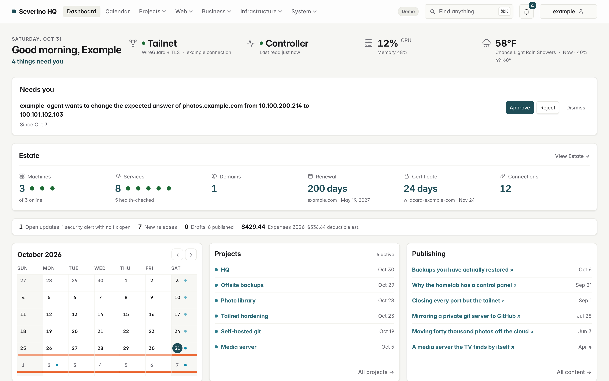
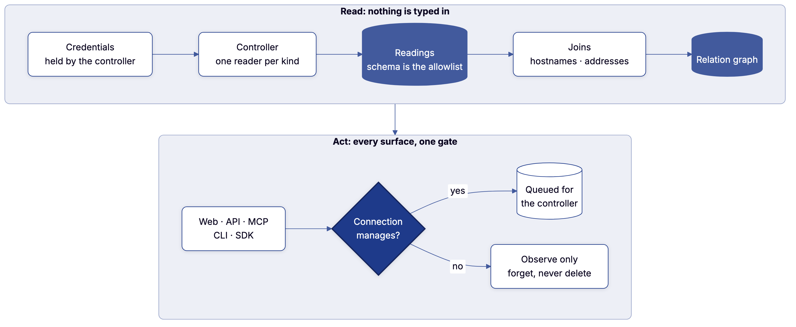
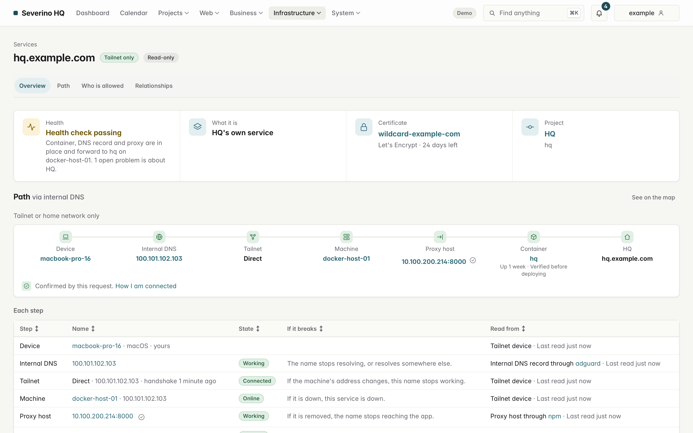

# Severino HQ

[](https://github.com/joeseverino/severino-hq/actions/workflows/ci.yml)
&nbsp;[](https://github.com/joeseverino/severino-hq/actions/workflows/scorecard.yml)
&nbsp;

HQ shows everything you self-host in one place, and changes it through one
audited path.

It runs on your own Linux host and answers only on your tailnet. It reads what
each credential you give it can see (machines, services, domains,
certificates, containers) and joins those readings into one picture. It also
keeps your projects, assets, expenses, receipts and an index of your
documentation, linked to each other.

The [demo](https://demo.jseverino.com/) is HQ's own pages filled with an
example homelab, saved as a static site ([how it is built](demo/README.md)).



## Start here

1. [Install](docs/Install.md): from a Linux host with Docker to HQ reading its
   first connection.
2. [Posture](docs/Posture.md): the checks every HQ enforces, and the stricter
   standard you can turn on.
3. [Documentation](#documentation): everything else, grouped by using HQ,
   operating it and extending it.

## How it works

Nothing about the infrastructure is typed in. A controller, a separate Go
program, holds the credentials and reads what each can see. HQ stores the
readings and derives the rest.

Every change goes through one path, shared by the web UI, the HTTP API, MCP,
the CLI and the extension SDK. A connection only reads until its credential is
marked `manages`. HQ changes a thing only through a connection that manages
it, which the diagram calls the manages gate
([Adoption](docs/Derived-Facts.md#adoption)).



<sup>Source: [`docs/diagrams/derived-estate.mmd`](docs/diagrams/derived-estate.mmd), pre-rendered with [`diagram`](https://github.com/joeseverino/tools/tree/main/lib/diagram).</sup>

HQ is a host. Extensions add whole domains to it from their own repositories.
This repository names none of them: it holds the contracts they meet at
([Plugins](docs/Plugins.md)).

More in [Derived Facts](docs/Derived-Facts.md) and
[Architecture](docs/Architecture.md).

## Stack

| | |
| :--- | :--- |
| Application | [Django 6.1](https://www.djangoproject.com) on Python 3.15, served by Uvicorn over ASGI |
| Data | SQLite in WAL mode |
| UI | server-rendered templates and plain CSS, with no build step |
| Interfaces | web, the `/api/v2/` machine API, MCP, a CLI, and `hq_sdk` for extensions |
| Controller | Go programs that read and change providers, render credentials and run the host |
| Host | one Linux machine, where systemd runs the container, the controller and the scheduled work |

The rest of the stack has its own docs: the delivery pipeline in
[Deployment](docs/Deployment.md), credentials in [Secrets](docs/Secrets.md),
sign-in in [Security](docs/Security.md), and the toolchain and tests in
[Development](docs/Development.md).

## Security

- Tailnet only. No public route, registration, or Django admin. Every URL but
  sign-in, health probes, browser policy reports and static files needs a
  session, or a token for the API and MCP.
- One write path. Every change is a capability: authorized in the
  application layer, schema-validated, atomic, audited, and safe for a machine
  to retry. Agents can be held for approval or paused all at once.
- Credentials stay out of the web process. The controller holds provider
  credentials in a separate, short-lived container. HQ's database and
  environment never enter it, and it reaches HQ only over a Unix socket that
  checks the caller's user id.
- A strict Content Security Policy with nonces and Trusted Types, and no
  inline scripts or handlers.
- The host runs only an image its own repository's pipeline signed. It checks
  the signature as root before running it. The deploy runner holds one sudo
  rule and no Docker access.

The design and the production checklist are in
[Security](docs/Security.md). To report a vulnerability, see
[`.github/SECURITY.md`](.github/SECURITY.md).

A service's page shows the path a request takes to it, each step read from
its source, with what breaks if that step fails.



## Verify it yourself

```sh
mise run check
```

runs every gate CI runs, at the same pinned versions; `mise tasks info check`
names them.

- The boundary between the host and its extensions is tested both ways. An
  extension that imports anything of the host's but `hq_sdk` fails Ruff's
  `banned-api` rule, and
  `hq/platform/application/tests/test_plugins.py` fails when a host file
  names an installed extension.
- Architecture rules (no view writes a model, MCP reads no model, one table
  engine) are tests in
  `hq/platform/application/tests/test_architecture.py`, listed in
  [New Domain](docs/New-Domain.md).
- An image's signature checks against the Compose workflow on `main`, the
  identity `hq-host deploy` requires:
  `cosign verify --certificate-oidc-issuer https://token.actions.githubusercontent.com --certificate-identity-regexp '^https://github\.com/joeseverino/severino-hq/\.github/workflows/compose\.yml@refs/heads/main$' <image>`.
- [Scorecard](https://github.com/joeseverino/severino-hq/actions/workflows/scorecard.yml)
  and CI's scan job publish to code scanning, and the ruleset blocks a merge
  while an alert is open.

## Repository

```text
hq/            the Django application: config, platform layers, domains
hq_sdk/        the supported import surface for extensions
controller/    Go: the controller, hq-host and hq-secrets
templates/     server-rendered pages and shared partials
static/        CSS, scripts and pinned vendor bundles
deploy/        systemd units, tmpfiles rule, remote targets, host.json shape,
               the GitHub App permissions CI's writes use
composition/   the composed image
policy/        the extension admission policy
demo/          the static demo site built from HQ's own pages
mise-tasks/    mise tasks: one per CI job, its gates in a TOML file of its name, and their scripts
tools/         development and CI programs, never in the image
tests/         synthetic extension fixtures, the SDK consumer, property
               tests and shell suites
docs/          architecture, operations and guides
```

## Working on it

```sh
mise install
mise run dev:scratch
```

`mise tasks` lists every task, each with when to reach for it.
[`AGENTS.md`](AGENTS.md) is the engineering contract: where a change belongs,
the host and extension boundary, the frontend standards and the definition of
done. [Development](docs/Development.md) has setup and every gate.

## Documentation

### Use

| | |
| :--- | :--- |
| [Glossary](docs/Glossary.md) | the words these docs use for HQ's own parts |
| [Connections](docs/Connections.md) | what to create for each provider, and the 1Password item it goes in |
| [API](docs/API.md) | the machine API: tokens, routes, errors, safe retries |
| [AI and HQ](docs/AI.md) | how agents build HQ, and how they operate it |

### Operate

| | |
| :--- | :--- |
| [Install](docs/Install.md) | self-hosting HQ, from a new host to its first reading |
| [Blueprint Setup](docs/Blueprint-Setup.md) | every value that names your instance |
| [Posture](docs/Posture.md) | the checks every HQ enforces, and the standard Advanced HQ Posture holds it to |
| [Deployment](docs/Deployment.md) | the pipeline, the host, `hq-host`, a new host |
| [Release Checklist](docs/Release-Checklist.md) | from a branch to live, and rolling back |
| [Secrets](docs/Secrets.md) | the vault, the renderer, connections and credentials |
| [Security](docs/Security.md) | the security design and the production checklist |
| [Backup](docs/Backup.md) | the nightly backup and a restore |

### Extend

| | |
| :--- | :--- |
| [Architecture](docs/Architecture.md) | one application core, every interface, and the infrastructure control plane |
| [Derived Facts](docs/Derived-Facts.md) | readings, joins, relationships, adoption |
| [Plugins](docs/Plugins.md) | the extension contract, admission and composition |
| [New Domain](docs/New-Domain.md) | adding a host domain, and the test behind each rule |
| [Design](docs/Design.md) | the UI's primitives and rules |
| [Development](docs/Development.md) | setup, gates, browser checks, repository layout |
| [Dependencies](docs/Dependencies.md) | where every pin lives and how to move one |
| [Structural Gate](docs/Structural-Gate.md) | how the duplication gate classifies source |
| [Roadmap](docs/Roadmap.md) | what is next, and what is not planned |

## License

MIT; see [`LICENSE`](LICENSE).
