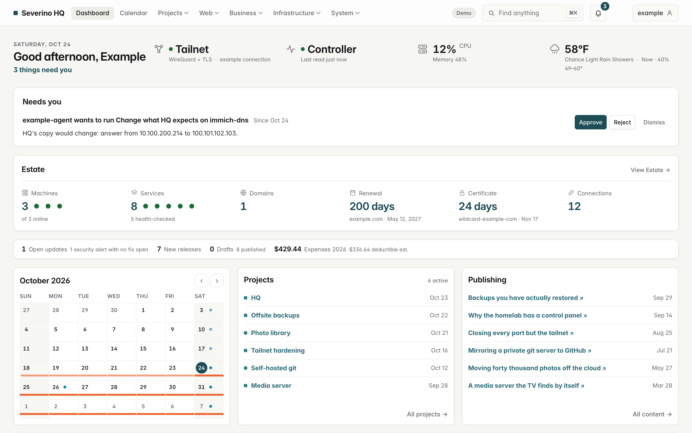
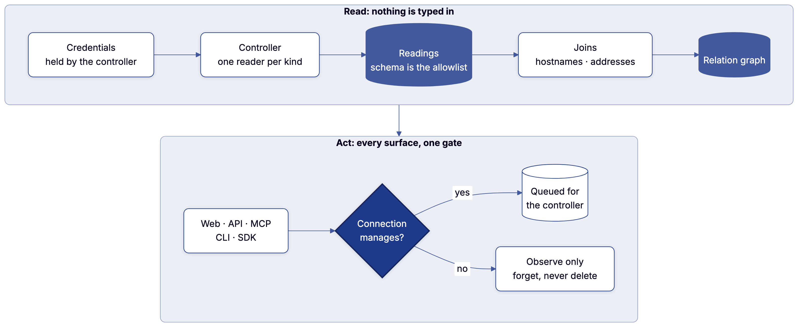

# Severino HQ

[](https://github.com/joeseverino/severino-hq/actions/workflows/ci.yml)
&nbsp;[](https://github.com/joeseverino/severino-hq/actions/workflows/scorecard.yml)
&nbsp;

A self-hosted operations app for one operator, reachable only over a tailnet.
It reads what each credential it is given can see (machines, services,
domains, certificates, containers), joins those readings into one picture,
and changes infrastructure only through one gated path that the web UI, the
HTTP API, MCP, the CLI and the extension SDK share. It also keeps the
operator's projects, assets, expenses, receipts and documentation index, linked
to each other.

HQ is a host. Extensions add whole domains to it from their own repositories,
and this repository names none of them: it holds the contracts they meet at.





<sup>Diagram source: [`docs/diagrams/derived-estate.mmd`](docs/diagrams/derived-estate.mmd),
pre-rendered with [`diagram`](https://github.com/joeseverino/tools/blob/main/bin/diagram).</sup>

Nothing about the infrastructure is typed in. A controller holds the
credentials and reads what each can see; HQ stores the readings, derives the
rest, and acts only through a connection that declares it `manages` what it
touches. How is in [Derived Facts](docs/Derived-Facts.md) and
[Architecture](docs/Architecture.md).

## Install

[Install](docs/Install.md) takes a Linux host with Docker to HQ running and
the controller reading its first connection, step by step.

## Stack

| | |
| :--- | :--- |
| Application | [Django 6.1](https://www.djangoproject.com) on Python 3.15, served by Uvicorn over ASGI |
| Data | SQLite in WAL mode, migrations through the ORM |
| UI | server-rendered templates and plain CSS, no build step; scripts progressively enhance |
| Interfaces | web, the `/api/v2/` machine API (OpenAPI 3.2, derived), MCP over Streamable HTTP, a CLI, and `hq_sdk` for extensions |
| Controller | Go: `hq-controller` reads and changes providers, `hq-secrets` renders credentials, `hq-host` runs the host |
| Secrets | one 1Password vault, read through Connect on loopback, rendered to a `noswap` tmpfs |
| Sign-in | OIDC against a self-hosted identity provider (Pocket ID), passkey-first |
| Host | one Linux machine: systemd runs the container, the controller and the scheduled work |
| Delivery | GitHub Actions: CI, Compose (host plus extensions, signed with Sigstore), Deploy on a self-hosted runner after approval |
| Tests | Django's runner in parallel, Playwright on WebKit for layout, Go tests, shell suites, CodeQL, Scorecard, Trivy |

## Security

- Tailnet only. No public route, registration, or Django admin; every URL but
  sign-in, health and static needs a session.
- One write path. Every mutation is a capability: authorized in the
  application layer, schema-validated, atomic, audited, and idempotent for
  machines. Agents can be held for approval or paused globally.
- Credentials stay out of the web process. The controller holds provider
  credentials in a separate, short-lived container; HQ's database and
  environment never enter it, and it reaches HQ only over a Unix socket that
  checks the peer's uid.
- A strict CSP with nonces and Trusted Types; no inline scripts or handlers.
- The deployed image is the one Compose signed: the host verifies the
  signature as root before running it, and the runner holds one sudo rule
  and no Docker access.

The design and the production checklist are in
[Security](docs/Security.md); reporting is in
[`.github/SECURITY.md`](.github/SECURITY.md).

## Verify it yourself

```sh
mise run ci
```

runs every gate CI runs, at the same pinned versions: lint, types, the suite
on every supported Python, the browser layout gate, the controller, CodeQL,
Scorecard, and the image built and tested from inside.

- The host/extension boundary is tested in both directions:
  `python -m hq_sdk.validation` rejects an extension importing anything but
  `hq_sdk`, and `hq/platform/application/tests/test_plugins.py` fails when a
  host file names an installed extension.
- Architecture rules (no view writes a model, one table engine, no inline
  script, function complexity) are tests in
  `hq/platform/application/tests/test_architecture.py`, listed in
  [New Domain](docs/New-Domain.md).
- A composition's signature checks against Compose on `main`, the identity
  `hq-host deploy` requires:
  `cosign verify --certificate-oidc-issuer https://token.actions.githubusercontent.com --certificate-identity-regexp '^https://github\.com/joeseverino/severino-hq/\.github/workflows/compose\.yml@refs/heads/main$' <image>`.
- [Scorecard](https://github.com/joeseverino/severino-hq/actions/workflows/scorecard.yml)
  and CI's CodeQL job publish to code scanning; the ruleset holds a merge on an alert.

## Repository

```text
hq/            the Django application: config, platform layers, domains
hq_sdk/        the supported import surface for extensions
controller/    Go: the controller, hq-host and hq-secrets
templates/     server-rendered pages and shared partials
static/        CSS, scripts and pinned vendor bundles
deploy/        systemd units, tmpfiles rule, remote targets, host.json shape
composition/   the composed image; policy/ holds the admission policy
scripts/       gates, pipeline helpers and operator tools
tests/         synthetic extension fixtures and property tests
docs/          architecture, operations and guides
```

## Working on it

```sh
mise install
export DJANGO_DEBUG=1
uv run --locked python manage.py migrate
uv run --locked python manage.py createsuperuser
mise run dev              # the ASGI server on 127.0.0.1:8000, with reload
mise run fast             # what the change reaches
mise run check            # the suite three ways: DEBUG on, off, and composed
mise run preflight        # ready: every CI gate, the composed suite, the host
```

[`AGENTS.md`](AGENTS.md) is the engineering contract: placement rules, the
boundary, frontend standards and the definition of done.
[Development](docs/Development.md) has setup and the gates in full.

## Documentation

| | |
| :--- | :--- |
| [Install](docs/Install.md) | self-hosting HQ, from a new host to its first reading |
| [Connections](docs/Connections.md) | what to create for each provider, and the 1Password item it goes in |
| [Glossary](docs/Glossary.md) | the words these docs use for HQ's own parts |
| [Architecture](docs/Architecture.md) | one application core, every interface, and the infrastructure control plane |
| [Derived Facts](docs/Derived-Facts.md) | readings, joins, relationships, adoption |
| [API](docs/API.md) | the machine API: tokens, routes, errors, safe retries |
| [Plugins](docs/Plugins.md) | the extension contract, admission and composition |
| [New Domain](docs/New-Domain.md) | adding a host domain, and the test behind each rule |
| [Design](docs/Design.md) | the UI's primitives and rules |
| [Development](docs/Development.md) | setup, gates, browser checks, repository layout |
| [Dependencies](docs/Dependencies.md) | where every pin lives and how to move one |
| [Structural Gate](docs/Structural-Gate.md) | how the duplication gate classifies source |
| [Deployment](docs/Deployment.md) | the pipeline, the host, `hq-host`, a new host |
| [Release Checklist](docs/Release-Checklist.md) | from a branch to live, and rolling back |
| [Secrets](docs/Secrets.md) | the vault, the renderer, connections and credentials |
| [Security](docs/Security.md) | the security design and the production checklist |
| [Backup](docs/Backup.md) | the nightly backup and a restore |
| [Blueprint Setup](docs/Blueprint-Setup.md) | every instance-specific value, for running your own |
| [Decisions](docs/Decisions.md) | decisions that still shape the code, and why |
| [Roadmap](docs/Roadmap.md) | what is next, and what is not planned |

## License

MIT; see [`LICENSE`](LICENSE).
