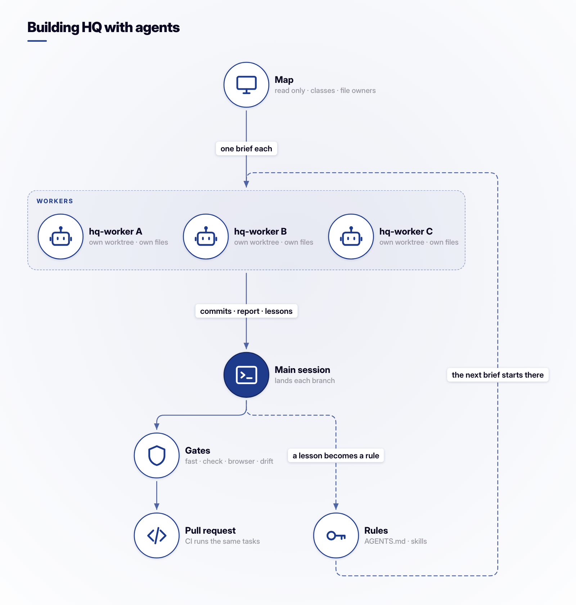
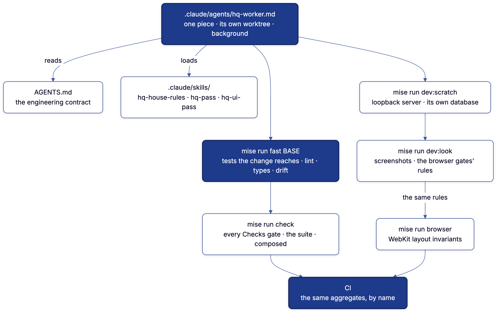
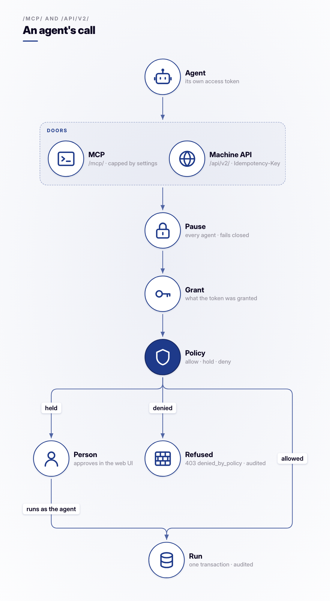
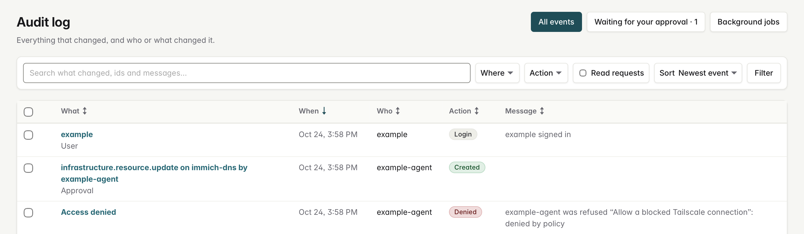
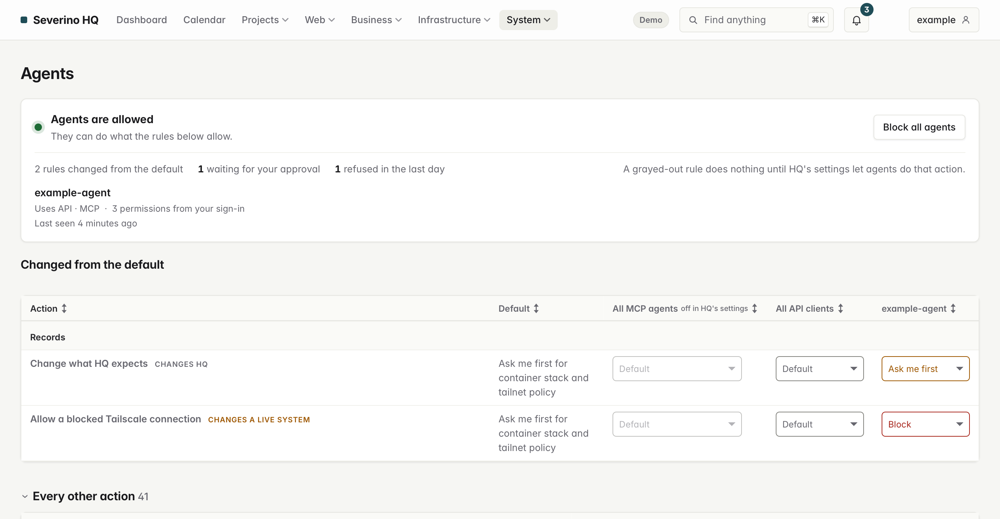
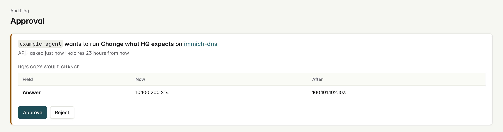

# AI and HQ

HQ is built by one person working with AI agents, and agents also operate it.
This page covers both: how agents build it and the gates
that hold their work to the same bar as anyone's, then the two doors an agent
uses to read and change HQ, and the limits on what it can do through them.

## Building HQ with agents

### The agent and its skills

The worker and its procedures live in a Claude Code plugin of their own, kept
out of this repository while they change from week to week. What each does:

| Part | What it is |
| --- | --- |
| `hq-worker` | The worker. It builds one bounded piece of HQ or of an extension, in a worktree of its own, in the background, and reports back. Its report ends with a `Worktree:` line and one `Lesson:` line for each thing that cost it time. |
| `hq-house-rules` | Preloaded by the worker. Fewer, stronger tests; `mise run fast <base>` as the gate; scratch scripts in the worktree's gitignored `var/`. |
| `hq-pass` | Run by the main session: briefs, launch, and integrating several workers into one host branch. |
| `hq-ui-pass` | For any change to what a page shows: look at every page it reaches with `mise run dev:look`, fix the shared primitive, and look again until `mise run dev:look all --rule survey` exits 0. |

Every agent reads [`AGENTS.md`](../AGENTS.md), the engineering contract
(`CLAUDE.md` is a link to it). The skills add to it and never restate it.

### How a pass runs

Figure source: [`docs/images/ai/build-loop.fig`](images/ai/build-loop.fig).

1. **Map.** A read-only agent measures the change before anything is built:
   what is wrong, grouped by the shared rule or partial that causes it, and
   which files each worker will own, so no two workers edit the same file.
2. **Brief and launch.** Each worker is an `hq-worker`. Its brief quotes the
   decisions it must follow from the plan and names its `Base SHA:`, the
   pass's base, which every worker starts from.
3. **Build.** A worker changes only its own files, commits on its own branch,
   and runs its own server: `mise run dev:scratch` serves on loopback only,
   with a database of that checkout's own, so servers in different worktrees
   run side by side
   ([Development](Development.md#development-servers)).
4. **Integrate.** The main session lands the workers on one branch from the
   base. A rebase conflict in a derived file is settled by `mise run regen`.
   Then `mise run check` and `REQUIRE_COMPOSED=1 mise run suite:as-image`, and
   `hq-ui-pass` for a change to what a page shows.
5. **Lessons.** Each `Lesson:` line names what cost time and what would have
   prevented it. The main session changes the rule it points at, so the next
   brief starts from the fixed rule.

The main session integrates every piece into one host pull request, and CI
runs the same gates on it.

### The tools a worker uses

Diagram source: [`docs/diagrams/agent-tools.mmd`](diagrams/agent-tools.mmd),
pre-rendered with [`diagram`](https://github.com/joeseverino/tools/blob/main/bin/diagram) as `diagram docs/diagrams/`.

### What holds the work to the bar

An agent's report is checked against gates, and the gates are the same mise
tasks a person runs. CI runs each job's aggregate by name
([`ci.yml`](../.github/workflows/ci.yml) runs `mise run -c checks`), so a pass
on a laptop and a pass in CI mean the same thing.

| Gate | What it holds |
| --- | --- |
| `mise run fast [BASE]` | The tests the changed files reach through the import graph, the architecture tests, Ruff, mypy, the structural gate and every drift gate ([What `fast` runs](Development.md#what-fast-runs)). |
| `mise run check` | Every Checks gate, the suite as production configures it, and the suite composed with the extensions ([What `check` and `ci` run](Development.md#what-check-and-ci-run)). |
| `mise run browser` | WebKit layout invariants over a stress estate and the example estate, at phone through desktop widths ([Browser layout](Development.md#browser-layout)). |
| `mise run drift` | Every derived file is what its source generates; `mise run regen` writes them. |
| `mise run checks:structural` | No new near-duplicate pair outside tests, and its baseline never grows to pass ([Structural Gate](Structural-Gate.md)). |
| `mise run checks:source` | The tests tagged `source`, which read the repository rather than run the product. |

`fast` and `check` close on a verdict line naming each failed task and test
(`tools/gate/verdict.py`). Heavy tasks take turns on one lock
(`tools/lib/heavy.sh`), so several agents on one machine never run two suites
at once ([Heavy gates take turns](Development.md#heavy-gates-take-turns)).

The architecture is held by tests rather than by review:

- `hq/platform/application/tests/test_architecture.py`:
  `test_web_views_do_not_mutate_models_directly`,
  `test_mcp_services_do_not_access_django_models`,
  `test_paginated_list_views_use_the_shared_table_engine`, and the style
  contract tests for the stylesheet.
- `hq/platform/application/tests/test_plugins.py`:
  `test_the_host_source_never_names_an_installed_extension`.
- `python -m hq_sdk.validation` refuses an extension that imports anything but
  `hq_sdk`.

The rest of the bar is written down where every agent reads it:
[Rules that eliminate bug classes](../AGENTS.md#rules-that-eliminate-bug-classes)
and the [definition of done](../AGENTS.md#definition-of-done) in `AGENTS.md`,
and the test rules in `hq-house-rules`.

### What stays private

Some of the setup belongs to the operator rather than to HQ, and is kept out
of this public repository:

- The agent and its skills, described above, while they change.
- Claude Code's local settings and agent worktrees, which `.gitignore` leaves
  out of the repository.
- `CLAUDE.local.md`, the operator's notes on deployment and the private
  extensions, which `.gitignore` also excludes.
- The hooks that check every shell command an agent runs, the read-only agent
  that maps a pass, a worker for other repositories, and the rules shared
  across all of them. These live in a private repository, because they carry
  one operator's machine, accounts and other projects.

HQ's own rules do not depend on that private setup: the contract and the
gates are in this repository.

## Operating HQ with agents

An agent reaches HQ through MCP at `/mcp/` or through the machine API at
`/api/v2/`. Both are delivery adapters over the same capability layer as the
web UI and the CLI: the API "adds no capability, no domain model and no
business rule" ([API](API.md)).

Figure source: [`docs/images/ai/agent-call.fig`](images/ai/agent-call.fig).

### Reads and one write

HQ's MCP server offers fifteen tools (`HANDLERS` in
`hq/platform/mcp/declarations.py`). Fourteen read what HQ already holds:
capabilities, resources, connections, topology, findings, recent activity and
health. One, `execute_capability`, can change anything, and it runs a
capability the same way the API's `POST /api/v2/capabilities/<name>/` does.
Every derived read is one `ResourceSpec` that serves the API, MCP, the CLI and
the SDK alike ([What each surface exposes](API.md#what-each-surface-exposes)).

Every write goes through `execute_capability` in
`hq/platform/application/capabilities.py`:

| Step | Where |
| --- | --- |
| Authorized against the caller's grant, before its payload or target is read | `_authorized_run` calls `authorize_capability` first |
| Validated against the command's schema; an unknown field is an error | `_refuse_unknown_fields`, and Pydantic commands that inherit `StrictCommand` |
| Run once, with every audit event naming the caller and the capability | `_run` sets the actor, interface and operation for the handler |
| Safe to retry | an `Idempotency-Key` header on the API, or `idempotency_key` in the payload on every interface ([Safe retries](API.md#safe-retries)) |

### An agent is its own identity

From [Security](Security.md#what-hq-enforces):

> Agents authenticate to `/mcp/` with identity-provider access tokens, verified
> as the machine API verifies them, so each agent is its own attributable,
> revocable principal.

and from [API](API.md#setting-up-a-client):

> the token's `client_id` becomes the actor in HQ's audit log, so an import is
> traceable to the credential that caused it.

In the example estate, the operator has blocked the agent from allowing
Tailscale connections. It asked to allow one, and the audit log records the
refusal under its name, beside the change it asked for next:

### Holds, approvals and the pause switch

The **Agents** page (`/agents/`) sets, per capability and per surface or
agent, whether a call runs, waits for a person, or is refused. From
[Security](Security.md#what-hq-enforces):

> Rules only narrow the identity provider's grant. An explicit rule beats the
> default, and between a surface and an agent rule the stricter wins. With no
> rules, gated infrastructure changes are held, and anything destructive an
> agent asks for is held too.

> approval requires the web interface, so no token can approve its own. The
> change runs as the agent that asked, so its audit events name that agent;
> the person who approved or declined it is the request's `decided_actor`,
> which a decided request cannot be saved without.

> An operator can pause every agent from the menu. The switch is global, read
> on every request to `/mcp/` and to the machine API (`/api/`), and fails
> closed.

A held call waits in the audit log's approvals queue (`/audit/?awaiting=1`)
and on the "Needs you" list, where a person approves or rejects it. In the
example estate, the operator asks to see every record the agent changes
first, and the agent asked to answer the photos library's name with the
server's tailnet address. The request shows that address beside the one it
replaces:

A client sees three outcomes ([What policy can do to a call](API.md#what-policy-can-do-to-a-call)):

| Outcome | Response | Client should |
|---|---|---|
| Allowed | the capability's result | carry on |
| Held | `200`, `status: "awaiting_approval"`, with `approval.review_url` | report it and stop; retrying returns the same request |
| Refused | `403`, error code `denied_by_policy` | stop |

Tests that hold these promises:

| Promise | Test |
| --- | --- |
| An agent's delete waits, and happens only once approved | `test_an_agents_delete_waits_and_happens_only_once_approved` in `hq/platform/application/tests/test_capability_policy.py` |
| An agent rule cannot loosen its surface's rule | `test_an_agent_rule_cannot_loosen_its_surface`, same file |
| No credential governed by policy may change the policy | `test_nothing_governed_by_policy_may_set_it`, same file |
| No token can approve its own request, even one holding every capability | `test_a_token_cannot_approve_its_own_request`, `test_a_token_holding_every_capability_still_cannot_approve` in `test_approvals.py` |
| The pause switch fails closed, and no credential can change it | `test_an_unreadable_switch_refuses_agents`, `test_no_credential_can_change_it` in `test_agent_access.py` |

### What an agent can and cannot do

It can do what its token was granted and no more. From [API](API.md):

> A token's principal holds exactly the permissions the token was granted,
> never widened.

On `/mcp/`, the grant is capped again by the `SEVERINO_MCP_ENABLE_*` settings,
which gate writes, never reads
([Security](Security.md#what-hq-enforces),
[API](API.md#what-each-surface-exposes)).

It cannot approve its own held request, change capability policy, or pause
and resume agents. And from
[What HQ does not do](Security.md#what-hq-does-not-do):

> Expose arbitrary commands, Django shell, raw SQL, SSH, deployments, receipt
> file contents, or runbook bodies through MCP.
