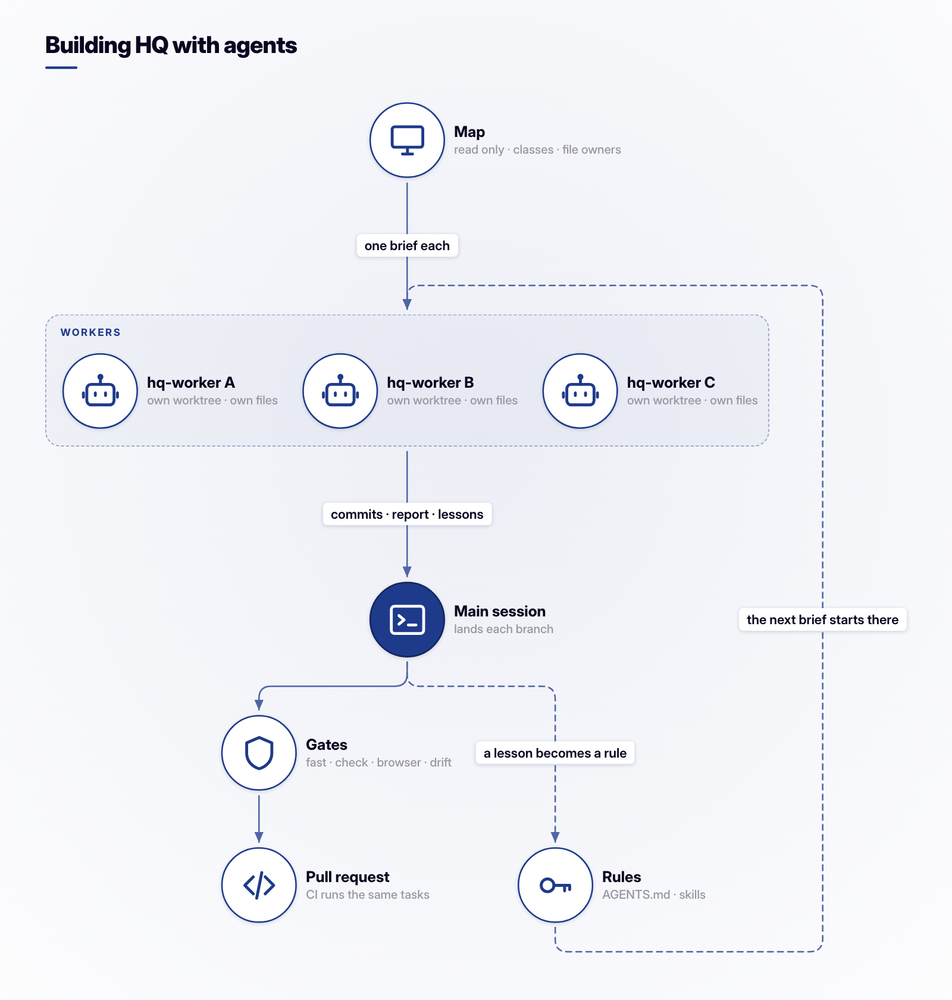
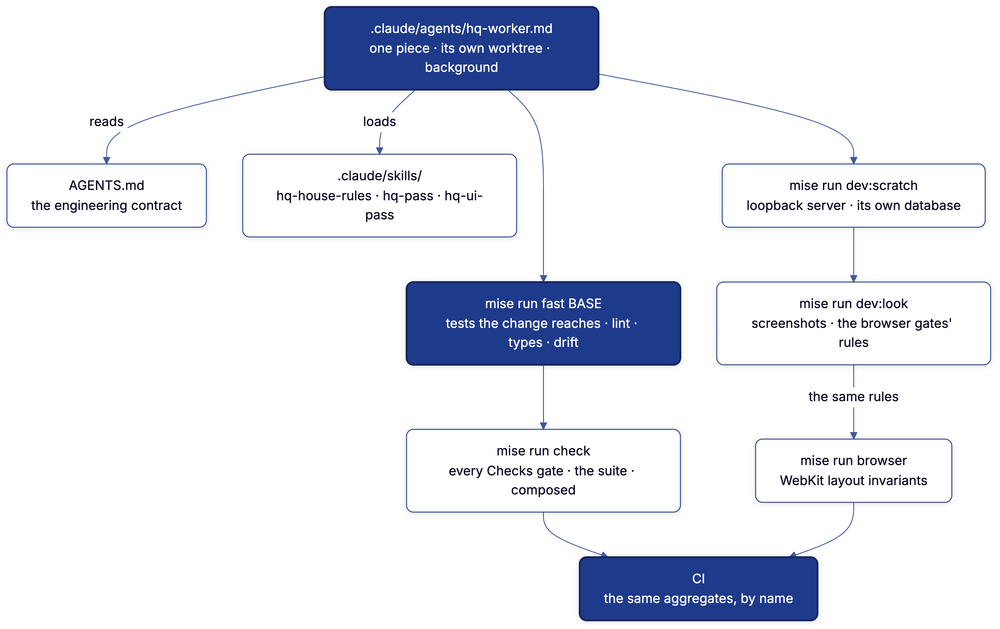
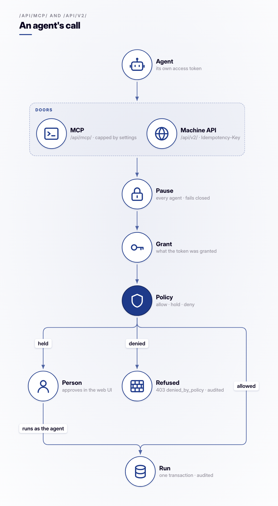
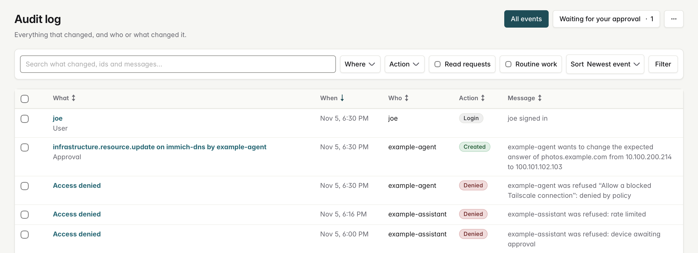
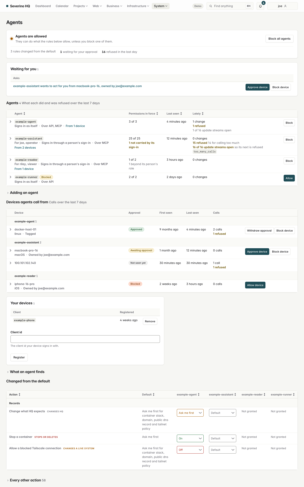
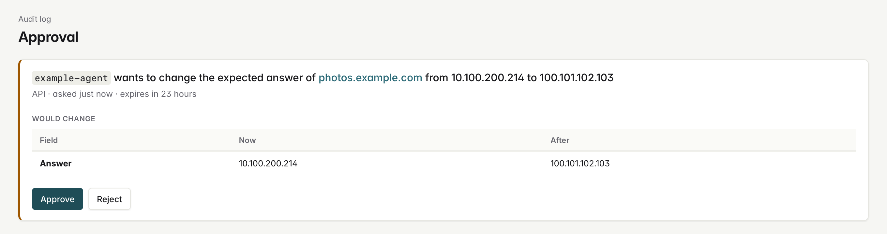

# AI and HQ

HQ is built by one person working with AI agents, and agents also operate it.
This page covers how agents build it and the gates that hold their work to the
same bar as anyone's. It then covers the two doors an agent uses to read and
change HQ, and the limits on what it can do through them.

## Building HQ with agents

### The agents and their skills

The agents and their procedures live in a Claude Code plugin of their own,
kept out of this repository while they change from week to week. What each
does:

| Part | What it is |
| --- | --- |
| `orchestrate` | The main session's procedure. It writes each brief (goal, base commit, the files the worker owns, the gates that say done) and launches the agents. It lands each finished worktree onto the pass's branch with one command, and turns every lesson into a rule that same turn. |
| `auditor` | A read-only agent, enforced by its tools. It measures and maps before workers are briefed, with file and line evidence from the code, the code graph, the vault and HQ's live state. |
| `hq-worker` | The worker. It builds one bounded piece of HQ or of an extension, in a worktree of its own, in the background, and reports back. Its report ends with what is done and not done, the gates it ran, and one `Lesson:` line for each thing that cost it time. |
| `hq-pass` | What a pass on HQ adds to `orchestrate`: workers start from the base branch's checkout, and an extension's piece gets a worktree of the same branch name in its own repository. |
| `hq-house-rules` | Preloaded by the worker. Fewer, stronger tests; `mise run fast <base>` as the gate; scratch scripts in the worktree's gitignored `var/`. |
| `hq-ui-pass` | For any change to what a page shows: look at every page it reaches with `mise run dev:look`, fix the shared primitive, and look again until `mise run dev:look all --rule survey` exits 0. |
| `ship-hq` | From a gated branch to production: push and open the pull request, read a CI failure's annotations and sealed logs on the first round, merge, and confirm the Deploy job is green. |
| [Vault MCP](https://github.com/joeseverino/severino-vault-mcp) | The operator's Obsidian vault over MCP: runbooks, each project's queue of open work and decisions, and the session log a later session picks up from. |

Every agent reads [`AGENTS.md`](../AGENTS.md), the engineering contract
(`CLAUDE.md` is a link to it). The skills add to it and never restate it.

### How a pass runs

Source: [`docs/images/ai/build-loop.fig`](images/ai/build-loop.fig), pre-rendered with [`brand`](https://github.com/joeseverino/branding-engine) by `mise run fix:figures`.

1. **Map.** The auditor measures the change before anything is built:
   what is wrong, grouped by the shared rule or partial that causes it, and
   which files each worker will own, so no two workers edit the same file.
2. **Brief and launch.** Each worker is an `hq-worker`. Its brief quotes the
   decisions it must follow from the plan and names its `Base SHA:`, the
   pass's base, which every worker starts from.
3. **Build.** A worker changes only its own files, commits on its own branch,
   and runs its own server: `mise run dev:scratch` serves on loopback only,
   with a database of that checkout's own, so servers in different worktrees
   run side by side
   ([Development](Development.md#development-servers)).
4. **Integrate.** The main session lands the workers on one branch from the
   base. A rebase conflict in a derived file is settled by `mise run fix`.
   Then `mise run check` and `REQUIRE_COMPOSED=1 mise run test --composed`, and
   `hq-ui-pass` for a change to what a page shows.
5. **Lessons.** Each `Lesson:` line names what cost time and what would have
   prevented it. The main session changes the rule it points at, so the next
   brief starts from the fixed rule.

The main session integrates every piece into one host pull request, CI runs
the same gates on it, and `ship-hq` takes it to production.

### The tools a worker uses

Source: [`docs/diagrams/agent-tools.mmd`](diagrams/agent-tools.mmd), pre-rendered with [`diagram`](https://github.com/joeseverino/tools/tree/main/lib/diagram).

### What holds the work to the bar

An agent's report is checked against gates, and the gates are the same mise
tasks a person runs. Each CI job is named for the task it runs
([`ci.yml`](../.github/workflows/ci.yml)'s lint job runs `mise run lint`), so a pass
on a laptop and a pass in CI mean the same thing
([The gates](Development.md#the-gates)). Heavy tasks take turns on one lock,
so several agents on one machine never run two suites at once
([Heavy gates take turns](Development.md#heavy-gates-take-turns)). The
architecture is held by tests and lint rules, among them
`test_architecture.py`, `lint:ast-grep` and
`test_the_host_source_never_names_an_installed_extension`. The rest of the
bar is written down where every agent reads it:
[Rules that eliminate bug classes](../AGENTS.md#rules-that-eliminate-bug-classes)
and the [definition of done](../AGENTS.md#definition-of-done) in `AGENTS.md`,
and the test rules in `hq-house-rules`.

### What stays private

Part of the setup is the operator's own and stays out of this public
repository:

- The agents and their skills, described above, while they change.
- Claude Code's local settings and agent worktrees, which `.gitignore` leaves
  out of the repository.
- `CLAUDE.local.md`, the operator's notes on deployment and the private
  extensions, which `.gitignore` also excludes.
- The hooks that check every shell command an agent runs, a worker for other
  repositories, and the rules shared across all of them. These live in a private repository, because they carry
  one operator's machine, accounts and other projects.

HQ's own rules do not depend on that private setup: the contract and the
gates are in this repository.

## Operating HQ with agents

An agent reaches HQ through MCP at `/api/mcp/` or through the machine API at
`/api/v2/`. Both are delivery adapters over the same capability layer as the
web UI and the CLI: the API "adds no capability, no domain model and no
business rule" ([API](API.md)).

Source: [`docs/images/ai/agent-call.fig`](images/ai/agent-call.fig), pre-rendered with [`brand`](https://github.com/joeseverino/branding-engine) by `mise run fix:figures`.

### Reads and one write

HQ's MCP server offers one tool for each handler in `HANDLERS`
(`hq/platform/mcp/declarations.py`). All but one read what HQ already holds:
capabilities, resources, connections, topology, findings, recent activity and
health, and `export_year_summary` also records its export in the audit log.
One, `execute_capability`, can change anything, and it runs a capability the
same way the API's `POST /api/v2/capabilities/<name>/` does.
Every derived read is one `ResourceSpec` that serves the API, MCP, the CLI and
the SDK alike ([What each surface exposes](API.md#what-each-surface-exposes)).

Every write goes through `execute_capability` in
`hq/platform/application/capabilities.py`:

| Step | Where |
| --- | --- |
| Authorized against the caller's grant, before its payload or target is read | `_authorized_run` calls `authorize_capability` first |
| Validated against the command's schema; an unknown field is an error | `_refuse_unknown_fields`, and Pydantic commands that inherit `StrictCommand` |
| Run once, with every audit event naming the caller and the capability | `_run` sets the actor, interface and operation for the handler |
| Safe to retry | an `Idempotency-Key` header on the API, or `idempotency_key` in the payload on every interface ([Safe retries](API.md#safe-retries)) |

### An agent is its own identity

From [Security](Security.md#what-hq-enforces):

> Agents authenticate to `/api/mcp/` with identity-provider access tokens, verified
> as the machine API verifies them, so each agent is its own attributable,
> revocable principal.

and from [API](API.md#setting-up-a-client):

> the token's `client_id` becomes the actor in HQ's audit log, so an import is
> traceable to the credential that caused it.

In the example estate, the operator has blocked the agent from allowing
Tailscale connections. It asked to allow one, and the audit log records the
refusal under its name, beside the change it asked for next:

### Holds, approvals and the pause switch

The **Agents** page (`/agents/`) sets, per capability and per surface or
agent, whether a call runs, waits for a person, or is refused. From
[Security](Security.md#what-hq-enforces):

> Rules only narrow the identity provider's grant. An explicit rule beats the
> default, and between a surface and an agent rule the stricter wins. With no
> rules, gated infrastructure changes are held, and anything destructive an
> agent asks for is held too.

> approval requires a person, in the browser or on their own device, and
> never the caller that asked, so no agent's token approves anything. The
> change runs as the agent that asked, so its audit events name that agent;
> the person who approved or declined it is the request's `decided_actor`,
> which a decided request cannot be saved without.

> An operator can pause every agent from the menu. The switch is global, read
> on every request to the machine API (`/api/v2/`) and on every tool call on
> `/api/mcp/`, and fails closed.

A held call waits in the audit log's approvals queue (`/audit/?awaiting=1`)
and on the "Needs you" list, where a person approves or rejects it. In the
example estate, the operator asks to see every record the agent changes
first, and the agent asked to answer the photos library's name with the
server's tailnet address. The request shows that address beside the one it
replaces:

A client sees three outcomes ([What policy can do to a call](API.md#what-policy-can-do-to-a-call)):

| Outcome | Response | Client should |
|---|---|---|
| Allowed | the capability's result | carry on |
| Held | `200`, `status: "awaiting_approval"`, with `approval.review_url` | report it and stop; retrying returns the same request |
| Refused | `403`, error code `denied_by_policy` | stop |

Tests that hold these promises:

| Promise | Test |
| --- | --- |
| An agent's delete waits, and happens only once approved | `test_an_agents_delete_waits_and_happens_only_once_approved` in `hq/platform/application/tests/test_capability_policy.py` |
| An agent rule cannot loosen its surface's rule | `test_an_agent_rule_cannot_loosen_its_surface`, same file |
| No credential governed by policy may change the policy | `test_nothing_governed_by_policy_may_set_it`, same file |
| No token can approve its own request, even one holding every capability | `test_a_token_cannot_approve_its_own_request`, `test_a_token_holding_every_capability_still_cannot_approve` in `test_approvals.py` |
| The pause switch fails closed, and no credential can change it | `test_an_unreadable_switch_refuses_agents`, `test_no_credential_can_change_it` in `test_agent_access.py` |
| Pausing agents refuses an agent on every surface through one helper, and never pauses a person | `test_the_helper_pausing_refuses_an_agent_on_every_surface`, `test_no_surface_reads_the_switch_around_the_helper`, `test_a_person_is_never_paused` in `hq/platform/application/tests/test_one_pause.py` |
| Pausing agents or blocking one holds what it already asked for: its held request can be declined but not approved, and its queued work is not claimed, until the brake lifts | `test_a_held_request_cannot_be_approved_until_the_brake_lifts`, `test_a_held_request_stays_declinable`, `test_queued_work_is_not_claimed_until_the_brake_lifts` in `hq/platform/application/tests/test_brakes_hold_asked_work.py` |
| A held request is its asker's: a second agent asking the same change gets its own, approved as itself, the change applies once, and an agent reads only its own held requests while a person reads every one | `test_two_callers_asking_the_same_change_each_hold_their_own`, `test_approving_the_second_callers_request_runs_as_that_caller`, `test_the_same_change_approved_for_both_callers_applies_once`, `test_the_action_queue_carries_only_the_callers_own_held_requests` in `hq/platform/application/tests/test_holds_belong_to_their_asker.py` |
| A write the agent switches withhold is refused on MCP and the machine API alike | `test_a_write_the_deployment_withholds_is_refused_on_both_surfaces` in `hq/platform/api/tests/test_agent_ceiling.py` |

### How much an agent may ask

Each agent is held to a call rate and to a number of calls at once, on both
doors, so one busy or broken agent cannot slow the others or the operator's
brakes. The numbers are settings, read by `hq/platform/application/agent_limits.py`:

| Limit | Setting | Default | Past it |
| --- | --- | --- | --- |
| Calls a minute, and the burst it may spend at once | `SEVERINO_AGENT_CALLS_PER_MINUTE`, `SEVERINO_AGENT_CALL_BURST` | 120, 30 | `rate_limited` |
| One agent's calls at once | `SEVERINO_AGENT_CALLS_AT_ONCE` | 4 | `too_many_calls` |
| Every agent's calls at once together | `SEVERINO_AGENT_CALLS_AT_ONCE_OVERALL` | 8 | `too_many_calls` |
| How long an MCP tool call is waited for | `SEVERINO_AGENT_CALL_TIMEOUT_SECONDS` | 60 | `call_timed_out` |

Each door says how long to wait in the refusal's `error.retry_after`, in
whole seconds. The machine API answers a limit with `429` and repeats it as
`Retry-After`. `/api/mcp/` answers each tool call with an error result
carrying the code, with the wait repeated in its `_meta.retry_after`. A prompt
or resource read refused for its rate carries it in the protocol error's
`data`. The door still serves `initialize` and the tool list, since a client
drops a server whose connection is refused. A refused call runs nothing. The rate is spent before
the agent is observed, so a flood writes no row past its refusals, and those
are one audit row an agent a minute, with their count.

A timed-out call is answered and logged (`mcp.call.timed_out`), but its
thread cannot be stopped: it runs on, may still finish what it was asked, and
holds one of its agent's calls at once until it ends. A write is retried with
the same `idempotency_key`, so a late finish and a retry act once.

Each MCP request runs its synchronous work on a thread of its own, as
Django's handler gives each web request, so one slow call never queues
another agent's. The door enters `thread_of_its_own`
(`hq/platform/core/outside_requests.py`), the one way HQ's work outside
Django's request cycle gets that thread and its connections checked before
and closed after; `lint:ast-grep` holds that nothing else does it. The counts are kept in the serving process's memory, which
is right only while the image serves from one process; an agent not calling
holds nothing there.

| Promise | Test |
| --- | --- |
| One agent's slow call never holds up another agent's call | `test_a_slow_call_holds_up_no_other_agent` in `hq/platform/mcp/tests/test_calls_at_once.py` |
| Work outside a request runs on a thread of its own, its connections closed after it and never inside an open transaction | `hq/platform/core/tests/test_outside_requests.py` |
| Each limit is answered on both doors in their own protocol | `hq/platform/application/tests/test_agent_limits_at_the_doors.py` |
| A flood of refusals is one row a window, with its count | `hq/platform/application/tests/test_limited_denials.py` |
| Two writes at once with one retry key act once | `test_two_writes_at_once_with_one_key_act_once` in `hq/platform/mcp/tests/test_retry_key_race.py` |
| The image serves from one process | `hq/platform/application/tests/test_one_serving_process.py` |

### What an agent can and cannot do

It can do what its token was granted and no more. From [API](API.md):

> A token's principal holds exactly the permissions the token was granted,
> never widened.

On `/api/mcp/` and the machine API alike, the grant is capped again by the
`SEVERINO_AGENT_ENABLE_*` settings, which gate writes, never reads
([Security](Security.md#what-hq-enforces),
[API](API.md#what-each-surface-exposes)).

It cannot approve its own held request, change capability policy, or pause
and resume agents. And from
[What HQ does not do](Security.md#what-hq-does-not-do):

> Expose arbitrary commands, Django shell, raw SQL, SSH, deployments, receipt
> file contents, or runbook bodies through MCP.
