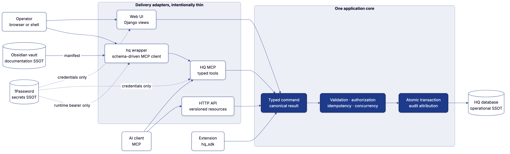
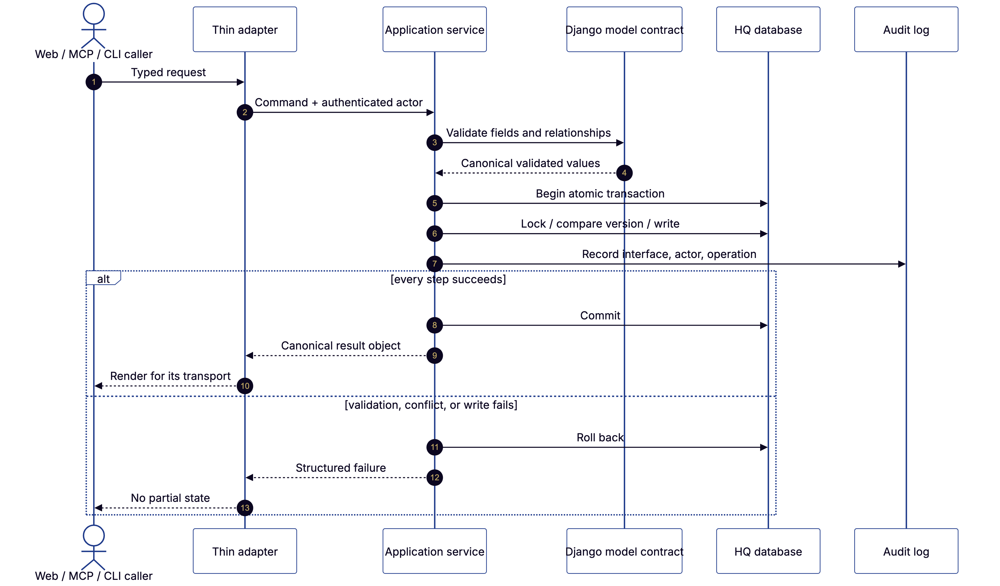
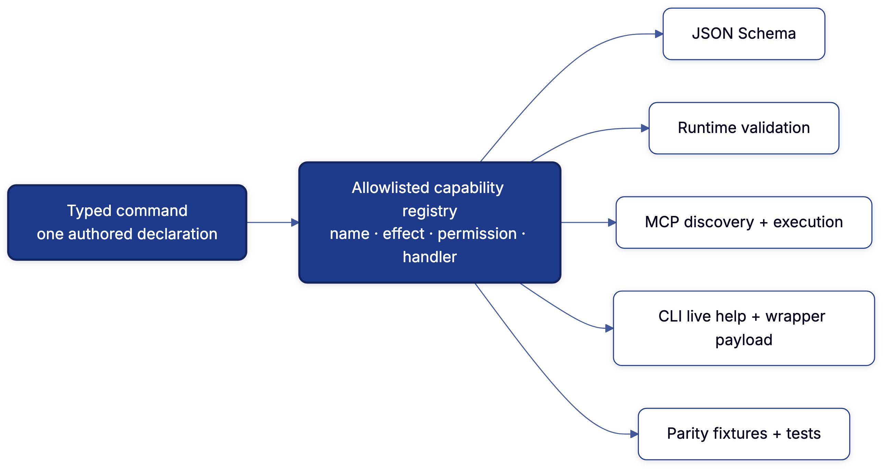
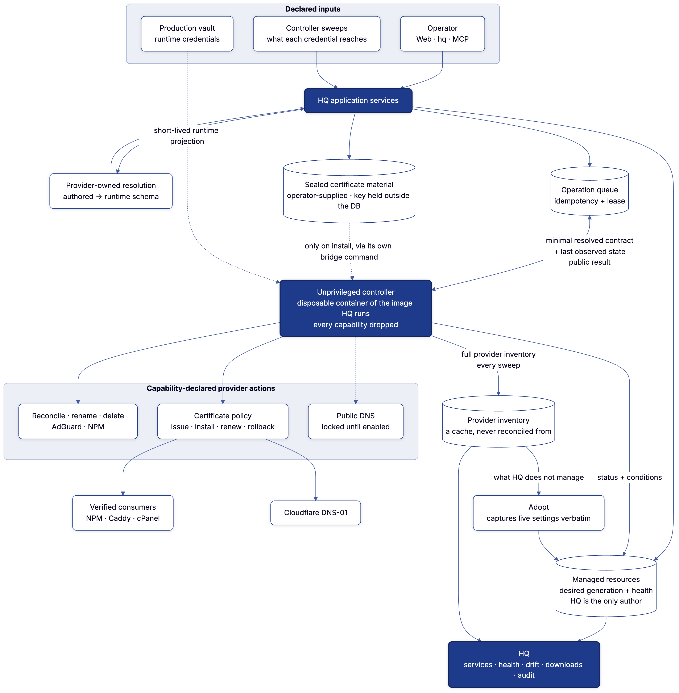
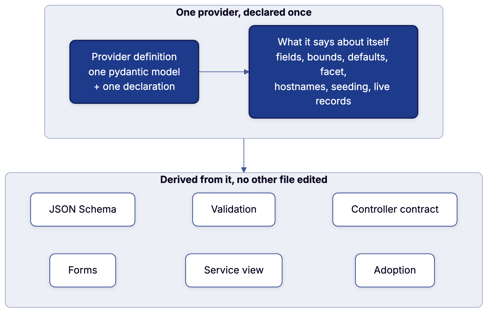

# Architecture

HQ has one application core and several delivery adapters over it: the web UI,
the `/api/v2/` machine API, MCP, the CLI and the extension SDK. Another
interface adds an adapter, never a second implementation.

This page is for anyone changing HQ's code. Read
[The boundary](#the-boundary) and
[One operation, end to end](#one-operation-end-to-end) first: together they
are the shape of the whole. Each later section is a reference for one part,
from what a request costs to the
[infrastructure control plane](#infrastructure-control-plane), its controller
and its automation worker.



<sup>Source: [`docs/diagrams/application-core.mmd`](diagrams/application-core.mmd), pre-rendered with [`diagram`](https://github.com/joeseverino/tools/tree/main/lib/diagram).</sup>

## The boundary

`hq/platform/application/` owns everything that must be identical whoever
started an operation:

| Concern | Owner |
|---|---|
| Request shape | Typed application command |
| Field and relationship validity | Application service and the Django model contract |
| Authorization | Application service |
| Idempotency and stale-write protection | Application service |
| Transaction and locking | Application service |
| Persistence | Django ORM inside that transaction |
| Actor and interface attribution | Shared audit context |
| Returned data | Canonical result object |
| HTML, MCP JSON, terminal prose | Delivery adapter only |

A view may translate a form, an MCP tool typed arguments, the `hq` CLI its
flags into the advertised JSON Schema. None decides what a valid mutation is or
writes around the service.

## One operation, end to end



<sup>Source: [`docs/diagrams/operation-lifecycle.mmd`](diagrams/operation-lifecycle.mmd), pre-rendered with [`diagram`](https://github.com/joeseverino/tools/tree/main/lib/diagram).</sup>

A browser submit, an API call, an MCP tool call and a CLI command follow the
same lifecycle. The adapter parses and steps aside. The service validates,
authorizes, opens the transaction, guards against stale state, writes, audits
and returns one result. The adapter only chooses how it looks.

A view reaches a domain write only through `execute_capability`.
`test_view_writes` follows every call made from the module of each view the
URL configuration routes, and of its bases. An audit row, a refusal or an
agent's identity observation is not a domain write.

A job whose process stopped and an approval nobody answered in time are
computed by the read that shows them, and marked by the hourly `due` work.

Reads cross the same boundary. `hq.platform.application.resources.ResourceSpec`
is the registry of readable domains. Query projections live in their
application services and `hq/platform/application/read_models.py`. Adapters
filter or render those results; they do not import models or rebuild result
shapes. An architecture test rejects model access from the MCP service adapter.

Projections declare their `select_related()` plans and read through
`projection.guarded`. Under `DEBUG` and in tests, Django's `FETCH_RAISE` mode
makes an omitted relationship fail at the projection. In production,
`FETCH_PEERS` fetches it once for the whole page instead of once per row.

## Projections

Each page that more than one adapter shows is derived once and serialized by
every adapter:

| Projection | Module | Also served as |
|---|---|---|
| Dashboard snapshot: KPIs, priority work, recent records, upstream state, activity | `dashboard.py` | MCP `dashboard_snapshot` |
| A managed resource's allowed actions, removal mode, machines, services, readout, certificate expiry | `resource_context.py` | `derived` on the `infrastructure` detail |
| The tailnet page | `tailnet_context.py` | the `tailnet` resource |
| The connections page | `connection_context.py` | the `connections` resource |
| HQ's own page: release, machine and container, units, readings, problems | `hq_context/` (`release`, `work`, `sight`, composed in `__init__`) | the `hq` resource |
| How HQ reaches a connection: network, machine, tailnet peering | `connection_reach.py` | inside `connections` |
| Days left on anything | `expiry.py` | every page that says it |

Each view renders its projection object and nothing beside it. Infrastructure
reads return public desired state, health and operation evidence, never
provider credentials.

### The dashboard glance

The page-head glance is a projection, never an owner. Whole-host CPU, memory
and storage are stored as the machine's telemetry reading
(`machine-telemetry:<key>`, `hq/platform/application/readings.py`), so the
machine page, the resource API and the dashboard summarize one timestamped
fact. The operator picks the machine with "Show on dashboard" on its edit form;
the choice lives in `DashboardConfiguration`. Weather is the configured point's
`WeatherObservation`, edited in the dashboard's Settings popover.

`GET /dashboard/glance/` only reads. A refresh is a CSRF-protected POST to the
same address:

| Who asks | For what |
|---|---|
| The refresh button | every panel |
| The dashboard, opening on a reading older than five minutes (`freshness.GLANCE_EVERY`) | the due panels only (`scope=stale`) |

Either way HQ records a credential-free `DashboardRefreshRequest` and rings the
glance doorbell. That starts a glance pass beside any controller pass
([Units](Deployment.md#units)), and the controller derives target and
connection from the machine graph. The browser follows that one request for a
bounded interval and keeps no page-lifetime polling loop.

An SSH-capable connection yields whole-host readings. A Portainer fallback is
labeled as container and Docker scope, not machine utilization.

Machine and weather readings show their observation time at every width. A
reading three intervals old (15 minutes) is marked out of date. That is
presentation freshness, separate from the provider's reported health, and a
refresh keeps the previous reading visible until a new one arrives.

Dashboard cards are grouped by contributing domain. Card providers run once per
projection scope and are still checked for cross-domain collisions. A
contributor with several metrics may supply a typed `DomainOverview`. The host
never infers a domain from a card ID or invents a contributor's reporting
window.

A domain holds a highlight card of its own when it has a chart to lead with or
at least three figures (`dashboard.CARD_FIGURES`). One with fewer reads its
figures in the compact strip. Below the highlights, each domain's leading chart
takes a row of its own. The calendar, recent projects and the rest share the
next row, as many to a row as fit. The machine snapshot keeps flat cards; the
grouping is presentation.

### Priority work

Every domain's `Insight` provider is composed by `domain_attention_items()`.
The dashboard preview, `/action-items/` and the machine snapshot project that
one queue. Each flattened item keeps its `action` and JSON-safe `workflow` (or
`null`) beside its label, evidence, severity, count and URL. Neutral and good
insights stay out of the queue; the contributing domain decides whether a
reading needs a decision.

The dashboard and the full queue share one row partial and one resolution
renderer. Workflow forms keep their action URLs, methods and CSRF protection.
Rendering a workflow neither runs it nor grants authority.

Every item HQ raises carries help: a remedy HQ runs, the exact command to run,
or HQ's reason it can offer neither. A finding rule declares two fields:

| Field | Carried as | When |
|---|---|---|
| `operator_action` | `steps`, each an `OperatorStep`: a label, a command HQ never runs, notes; the API and MCP's `get_findings` both return `operator_steps` beside the remedies, which MCP writes as tool calls | the operator has a command to run |
| `no_help_reason` | the reason | there is no remedy and no command |

A queue `Insight` keeps the SDK's shape. A remedy is one of its `actions`; a
command or reason is a `run` or `cannot` step of its `workflow`
(`hq/platform/application/item_help.py`).
The ast-grep rule `attention-item-carries-help` (lint:ast-grep) fails on host
source that builds an item without help, and
`hq/platform/application/tests/test_item_help.py` reads the composed queue
through the `item_help` gauge defined there.

A rule is declared beside the detector that decides it: each module that raises
findings (`perimeter_findings`, `controller_findings`, `docker_estate`,
`dns_findings` and the rest) exports `RULES`, built from the vocabulary in
`hq/platform/application/finding_model.py`. `hq.platform.application.findings.RULES`
is derived from the closed `RULE_MODULES` tuple; that module keeps only the
pipeline: estate, derivation, suppression, resolution, serialization.

Findings group downstream symptoms under a shared controller when the topology
proves one, while each exact resource and kind fact stays addressable. The
frontend renders the subject's already-authorized actions as "what HQ can do
now"; there is no second action catalog. Focus and dependency-trace links come
from one canonical topology address (`action_links.topology_url`). Contextual
command links carry a same-origin return path through Command Center's result
screen.

A stale-controller finding derives the registered controller-refresh
capability from its node. Running it rings the credential-free doorbell, and
the controller still pulls and decides what is due. "Refresh" is that
capability with a subject: a stored `ReadRequest` that HQ's `sweep-due` answer
turns into the kinds read next ([API](API.md#refresh)).

The resolution plan is domain-neutral and exported through `hq_sdk.workflows`.
A domain emits a stable claim, supporting actions, authorized remedies and its
own verification. HQ derives the ordered understand, act, verify projection and
the machine-readable `claim_absent` completion condition.

Analytics freshness has the same shape. A read site-day is a fact, HQ derives
the missing windows, and the controller backfills them without a backfill
policy of its own.

Large projections run inside
`hq.platform.application.projection.projection_scope()`. A reading is reused
while one answer is assembled and discarded when the scope exits, so no
process-cached state reaches a later request.

The dashboard's contact rows, unread total and upstream health come from the
controller's `cloudflare.contact_submission` reading. Pages, the header count
and search read the stored result. A review or deletion waits in the
`cloudflare.contact_inbox` declaration until the controller applies it.

## What a request costs

### What a process loads

Every HQ process imports lazily (PEP 810). `manage.py` and the ASGI and WSGI
applications call `hq.config.imports.lazily()` before anything else. A module
loads when a name it binds is first used, so a process holds only what its work
reached.

Registration is therefore never an import's side effect. HQ's lives in each
app's `ready()` and Django's autodiscovery (apps, URLconfs, template
libraries), which import by name and so load at once.

A library that registers as it loads, or reads its own namespace as it loads,
is named in `EAGER` there, and its imports run at once. So does every import of
another library that loads while it does, so a library an entry pulls in needs
no entry of its own. The rest of the entry's own library stays lazy.

`test_lazy_imports.py` boots HQ three ways, each eagerly and lazily: through
the ASGI application, through `manage.py`, and through `manage.py` once a test
overrides a setting. It fails on:

- any model, URL, check, receiver, lookup, template tag, capability, resource
  or navigation entry a lazy boot lacks;
- any receiver that overriding a setting connects;
- a package that binds a name one of its submodules has (loading the submodule
  rebinds it).

Some processes judge what HQ reaches by what it loaded: the image checks that
name a package or a part of Django shipped and never loaded, and the eager boot
above. Each calls `imports.eagerly()` first, so an entrypoint's `lazily()`
leaves its imports as written. Lazily, a module-level import its own run never
used would never load.

Python's `-X lazy_imports` and `PYTHON_LAZY_IMPORTS` only set the mode a
process starts in, which `lazily()` replaces. The module budgets in
`test_startup.py` measure the lazy start on purpose.

### A page

`manage.py bench_pages` builds Django's test database, never the real one. It
fills it with `hq.platform.core.bench.seed`, a few years of one operator's
records: 4,000 expenses, 3,000 receipts, 300 assets, 6,000 audit rows, and a
swept estate of about 270 managed resources. Then it requests every route that
answers a GET as a signed-in operator, through the whole middleware stack.

It reports median and p95 time, the query count, how many queries repeat one
already made in the request, and the response size.

```bash
DJANGO_STATIC_ROOT=/tmp/hq-static mise run manage -- bench_pages
mise run manage -- bench_pages --only dashboard --sql
mise run manage -- bench_pages --scale 0.25 --rounds 10
```

`--only` with `--sql` prints one page's queries; `--scale` and `--rounds` make
a quicker pass.

Pages come from the URL configuration. A route with arguments is requested
with the seeded record `SAMPLES` names for it; one with no sample is listed
under "Not benched". An empty database hides every cost that grows with rows,
which is why the bench seeds first.

Timings move with the machine; query counts do not. Compare two trees back to
back and read the counts first.

### A page while HQ writes

SQLite has one write lock, so the cost that matters is a page's while
something else writes. `manage.py bench_contention` seeds the same estate and
browses every page from several threads twice. First it browses alone. Then it
browses beside the two writers production has: the controller's report
(`--sweep-every` seconds), and an import job run by the runner, batches back to
back.

It times every statement. So it reports the lock waits behind each page, report
and batch against the busy timeout, what each writes, derivations, and the
slowest pages.

```bash
DJANGO_STATIC_ROOT=/tmp/hq-static mise run manage -- bench_contention
mise run manage -- bench_contention --no-ahead --seconds 10
```

Three rules keep a page from waiting on a writer:

- A request stores an answer it derived only if the write lock is free
  (`database.without_waiting`). It already has the answer; the pass stores it
  once the writer commits.
- SQLite keeps no queue for its write lock. A waiting connection retries every
  100 ms, and a job that begins its next transaction within a millisecond of
  the last would win every time. So a job lets go after each second of writing
  (`database.gives_way`, applied by the runner to every job).
- A request never waits on the derive-ahead pass: it derives what it does not
  find stored, and the pass then finds it stored. While writes keep landing
  during passes, the pass waits longer for them to settle
  (`ahead.SETTLES_LONGEST`), since what it derives would be unsettled before
  anyone read it.

A running HQ reports the same per request. Every response carries
`Server-Timing: app;dur=<ms>`, and the access log line (`severino.request`,
`duration_ms`) is written from the same measurement. A request at or over
`SLOW_REQUEST_MS` (`hq/platform/core/middleware.py`) logs a warning.

`hq/platform/core/tests/test_page_budgets.py` pins each page's queries against
the same seed, at two sizes where a per-row read would show.

The first request after a change derives what it needs and stores it, about
five statements per derivation on top of the reads. One change of the estate
costs seven derivations in all, whichever pages ask first:

- the queue, the catalog and the relation graph;
- the topology and findings, once for the queue's reader and once for the
  operator's.

`test_page_budgets.py` pins both: each stored page's queries at two sizes with
no derivation run, and the derivations a change costs.

What a stored page still costs is its own reads and its template: the findings
page renders 700 KB, and the forms that offer every expense as an option (new
receipt, new documentation, new content) render 4,000 `<option>` elements.
Those are changes to the page, not to a derivation.

### A part of a page

A page that changes one region does not fetch itself. The region asks for its
part by name (`X-Fragment`), the view renders that ``, and a
part whose inputs are known by revision answers "unchanged" with 304
(`hq.platform.application.fragments`; the contract is in
[Design](Design.md), "A read is a fragment"). `bench_pages` measures each part
and validator a page names beside the page, so a new part is measured without
being listed.

`hq/platform/application/tests/test_fragments.py` holds the dashboard to
composing only the part asked for, and the poll to answering 304 until
something is written.

### Derived once per change

The topology, the service catalog, the findings and the action queue are
functions of a few tables, of who is reading, and of the clock. They are
declared that way and computed once per change of those inputs:

```python
@derivation("estate.topology", reads=ESTATE_READS, vary=estate_variant)
def _derive(principal): ...
```

`hq.platform.application.derivations` answers a call from the first place that
has it:

1. the projection in progress;
2. the `derived` cache;
3. running the function, which stores the result.

The cache is Django's database cache in the same SQLite file. So every process
reads one copy, and a value stored inside a transaction commits or rolls back
with the rows it came from.

The key is the derivation's name, what `vary` returns for the arguments, and
the revision of every table in `reads`. It sits behind the cache's
`KEY_PREFIX`, the identity of the running code
(`hq.platform.application.code_identity`): a digest of the interpreter, the
installed distributions and the source of the host and every extension.

A value is pickled, so it is served only to the code that stored it. An edit a
development server reloads on, or a deploy that changes any of that code,
starts from an empty cache.

**Revisions.** `core.Revision` holds one counter per table. Insert, update and
delete triggers on every model table move it inside the writing statement. So
`save()`, `QuerySet.update()`, `bulk_create()`, a cascade and raw SQL all move
it, and a counter never commits apart from its rows.

`hq.platform.core.revisions.install` restores the triggers after every
`migrate`, since SQLite drops them when a migration rebuilds a table. It also
creates the cache table. Reading the revisions also reads which triggers exist,
in one statement. A table without its triggers has no revision, and its
derivations run on every call.

**The clock.** A derivation does not read the clock. It asks `reached`,
`passed`, `since`, `whole` or `today` (and `expiry.days_until`), and each
answer records the moment it stops being true. A stored value carries the
earliest such moment and is derived again after it, so a certificate crosses
its warning threshold and "3 hours ago" becomes "4 hours ago" on time, with no
write. Ages a template prints (`|when`) are rendered per request from the
stored timestamp.

**What else it varies by.** `estate_variant`: the reader (a projection is
narrowed to what they may see), the address and port the request reached HQ
on, and whether HQ is in use, which sets the sweep interval a finding quotes.
A derivation that composes every domain varies by `composed_variant`, which
adds the providers composing it. A person's pins and set-aside items are
applied after the derivation.

**It fails toward deriving.** Unreadable revisions, a missing trigger, an
unreadable cache or a value that does not load all mean the function runs.

A table a derivation reads beyond its `reads` is learned and keyed on from then
on. One derivation that calls another must declare the other's tables, or the
call raises, unless its own reads are learned. What one derivation reads and
how long it stands passes to whatever asks it, on every call.

`test_derivations` holds every declared derivation to its `reads` over the
bench estate. It forbids a direct clock read inside one, and writes a row every
way Django can to show the revision moves.

**An extension's part.** What an extension contributes to a shared composition
(attention items, dashboard cards, overview, each calendar source's events) is
asked through a derivation the host declares as it meets the provider,
`extension.<plugin id>.<provider>`. It declares no reads: its tables are
learned from the statements the provider runs, in a projection of its own. It
varies by whether the reader asked for a demo and by which function answers.

The host cannot follow an extension to the clock, so the answer is `unseen`. It
stands until what it asked of the helpers changes, at most one minute
(`UNSEEN`), and never past local midnight. A count of days turns at midnight,
and nothing HQ words is finer than a minute. So that bound keeps every
statement within one unit of the truth. Whatever asks an unseen derivation
stands no longer than it does. The rules an extension keeps are in
[Extensions](Plugins.md#derived-reads).

**Asked again when the change lands.** The controller reports every few
minutes while HQ is in use, and every report moves a revision the estate reads.
The first request after each would otherwise derive while a person waits.

So every top-level question a request asks is remembered, with its arguments,
context and seeded projection. `hq.platform.core.ahead` watches every
statement a connection runs. One that writes a table a remembered question
reads wakes one thread after its transaction commits, and `derive_ahead` asks
again whatever no longer stands. The same thread wakes when the earliest
remembered answer's moment comes.

| Of the pass | Rule |
|---|---|
| Where it runs | for the life of the web application (the ASGI lifespan), never inside the writing transaction |
| A rolled-back write | says nothing |
| Writes that land together | one pass, which starts once none has landed for 50 ms and no later than 0.5 s after the first |
| Writes during a pass | answered by one more |
| How often a question is derived | at most once per state of its tables, and by one thread when two want it |
| A request | never waits on the pass: it derives what it does not find stored, and the pass waits between questions while a request is deriving |
| `ahead=` on a derivation | how many ways of asking are kept current (eight by default); a way nobody asked for in a day is forgotten |
| A question asked ahead | counts as HQ being in use |

The declared derivations:

| Group | Derivations |
|---|---|
| Estate | `estate.topology`, `estate.relations`, `estate.findings`, `estate.services` |
| Attention | `attention.queue` (the host's part of the queue), `attention.work` (the composed queue), `attention.count` (how many wait on one person), `attention.by_subject` (the host's open items by the page each is about) |
| Dashboard | `dashboard.sections`, `dashboard.highlights`, `dashboard.snapshot`, `dashboard.links` |
| Calendar | one per calendar source the host owns (`calendar.*`) |

A new one is a decorator and a line in `SAMPLES` in `test_derivations`.
`derivation_testing.uncached()` bypasses the store. It is for budgets on what a
derivation itself costs, and for tests that replace an input no stored answer
varies by.

**The header's count** (`/action-items/count/`) is `attention.count`, so
asking costs the table revisions and one stored number. Its `ETag` names the
answer (the count and whose it is), not its inputs: a browser holding it gets
`304` while the count is unchanged, whatever was written in between, with every
extension installed.

### What a request waits on

Nothing outside the process. A page or a button answers from what HQ holds;
work that reaches a network, starts a process or sleeps runs where waiting
costs nobody:

- **A reading of the outside world is the controller's.** It holds the
  credentials and the egress, and reads concurrently. The web side stores a
  read request (`hq.platform.application.cadence.request_reads`), rings the
  doorbell and answers; the reading arrives through the sweep's ingest. A
  reading whose provider rations calls keeps its own clock
  (`ObservationSpec.every`): HQ tells the controller when it is due.
  `github.profile` is the example (`hq/domains/control_plane/observations/github.py`); a reading's
  procedure is in [Derived Facts](Derived-Facts.md#readings).
- **Long local work is a job** (`hq/domains/jobs/`): its own thread, progress
  notes, a heartbeat, one live job per kind. A project's refresh is one.

The request that asks answers at once, in one shape for both
(`hq.platform.application.asks`): how the work stands and, while it is live, a
status resource, with 202. `partials/_ask.html` draws the control and one
script behavior follows it ([Design](Design.md), "Asked-for work is an ask").

The interpreter holds the rule (`hq/platform/core/outbound.py`). Python raises
an audit event whenever any library opens a connection, resolves a name,
starts a process or sleeps. While a request is served, that event raises
`OutboundInRequest`, so the call never leaves.

A place a request must wait is a named entry in `ALLOWED` with its reason,
entered with `allowed("name")`. There are three: signing in (bounded by
`OIDC_TIMEOUT`), a public lookup an operator asked for by name, and the
question to tailscaled on HQ's own host of which tailnet device sent an
agent's call ([Security](Security.md), devices).
`RequestNeverWaitsTests` holds the entries to their places.

The setting `SEVERINO_OUTBOUND_IN_REQUEST = "report"` logs
`outbound.in_request` and lets the call go. It is for a composition whose
extensions still reach out from a request. An extension moves that work to
[outbound work](Plugins.md#outbound-work).

`bench_pages` measures actions too. Every route that answers a POST is one, and
`ACTIONS` names what each is posted. One with no entry is listed under "Actions
not exercised", with `UNSAFE`'s reason where it cannot be posted against a
scratch database.

An action is posted inside a rolled-back transaction, with the doorbell unrung
and a job's work held, so the time is the request's own.
`hq/platform/core/tests/test_action_budgets.py` pins each converted action's
queries at two estate sizes, and asserts it answers before the work it asked
for.

### An agent's call

Each MCP request runs its synchronous work on a thread of its own, as Django's
handler gives each web request, so one slow call never queues another agent's.
The door enters `thread_of_its_own` (`hq/platform/core/outside_requests.py`),
the one way HQ's work outside Django's request cycle gets that thread and its
connections checked before and closed after; `lint:ast-grep` holds that nothing
else does it. A listen stream gives its request's thread and connections back
once admitted, so an open stream holds neither; its brakes each borrow a thread
for the moment they are asked. The agent limits' counts are kept in the serving
process's memory, and the listen bus (`hq/platform/mcp/listen.py`) reaches
every stream from there. That is right only while the image serves from one
process (`test_one_serving_process.py`). An agent not calling holds nothing
there. The Agents page reads each agent's open streams from those counts, and
says when it holds all of them, since its next is refused `too_many_calls`.

## Search

`hq.platform.application.search` is the search boundary for web tables, the
CLI and MCP. It takes a named scope and a query and returns stable domain
identifiers; adapters do not know how text is indexed.

Every entry point requires a `Principal`. Ordinary scopes need `READ`; the
`audit` scope needs `READ_AUDIT_LOG`, which least-privilege principals (MCP)
do not hold, so a new adapter cannot expose search without deciding whose
authority it acts under.

`global_search`, behind `/search/`, returns relevance-ranked hits per scope
with FTS5 `snippet()` extracts as `(text, is_match)` parts, so each renderer
escapes and marks up independently. Presentation metadata (group label, title
field, badge, timestamp) lives on the `SearchDefinition` its `ResourceSpec`
carries. Scopes a principal cannot search are omitted, not rendered empty.

Contact submissions live in Cloudflare D1, not the local database. The web view
adds the matching rows of the controller's last read (by submitter name) as a
group beside the registry scopes. Email and message text are searched on the
contacts page.

Ranking is stated once, in the backend: FTS5's `rank` (bm25, lower is better),
then object id compared as text, numbered per scope with `ROW_NUMBER()`. Equal
ranks order by object id as text (`10` before `9`), one rule for every scope.

`global_search` asks it about every permitted scope in one query and keeps each
scope's first hits. It reads their `snippet()` from a second reference to the
FTS table, because an FTS5 auxiliary function is only valid in the query that
reads the table with `MATCH`. A scope with no hit costs no record fetch.

A searched list annotates each row with its position among the hits
(`_search_rank`, NULL for a non-hit). It does so through a subquery whose
ranking is materialized once, so the statement has three parameters whether
three rows match or five thousand.

Without the FTS table there is no rank. The ORM fallback matches by substring,
and a list falls back to primary-key order.

`search_index.SearchDocument` is a derived projection. On SQLite an FTS5
external-content table indexes it with Unicode tokenization and 2-, 3- and
4-character prefix indexes. Triggers keep the FTS structure atomic with
projection writes, and domain-model signals keep the projection atomic with the
record, so a rollback removes all three changes. The backend is replaceable
without changing table views, query parameters, CLI output or models.

```bash
mise run manage --scratch -- search_hq projects "certificate automation"
mise run manage --scratch -- rebuild_search_index
```

`hq.platform.application.tables.TableListMixin` composes indexed search with
multi-value filters, workflow toggles, allowlisted ordering and database
pagination, over a model's queryset or a projection's rows
(`get_table_rows`, as Jobs lists HQ's jobs and automation runs as one). The browser enhances that GET contract with debounced, cancelable
requests; plain links and forms remain the complete fallback.

## Emit once, derive everywhere



<sup>Source: [`docs/diagrams/emit-once-capabilities.mmd`](diagrams/emit-once-capabilities.mmd), pre-rendered with [`diagram`](https://github.com/joeseverino/tools/tree/main/lib/diagram).</sup>

Three registries declare everything an adapter offers. What an extension
declares in each, and the fields it sets, is in [Extensions](Plugins.md#contract-boundary).

**Capabilities.** The allowlisted registry binds each typed command to one
operation name, effect, required permissions and handler. From it:

| Surface | What it derives |
|---|---|
| `describe_capabilities` | deterministic JSON Schemas |
| `execute_capability` | validates a JSON object and returns one success or error envelope |
| The API and the MCP endpoint | expose that catalog and executor |
| The Command Center | an authorized form for every capability, extensions' included, with no capability-specific view |
| Management commands | remain an in-process break-glass adapter |
| Tests | their contract assertions, from the emitted schemas |

The executor is not generic database access. It runs only registered
operations, each through the typed principal, the capability check and the
application transaction.

**Resources.** One `ResourceSpec` says whether a resource is searchable,
listable, addressable, or any combination, binds its capabilities and supplies a
strict Pydantic query schema. The API and MCP readers run only registered
handlers, and the search index derives its definitions from the same specs.
Managed infrastructure is in that projection, so `tailscale` or `cloudflare`
finds the stored resources and the connection family that reaches them; a
Command Center keystroke never calls a provider.

**Connections.** `ConnectionSpec` says which family exists, the abilities and
provider scopes it can carry, which principal may inspect it, and how to read
locally cached instances. Static discovery never calls instance providers; the
Connections workspace and machine list do, after authorization.

Instances have no secret field, and links are local or HTTP(S). URL userinfo,
query strings and fragments are rejected when controller inventory enters HQ
and when an extension's instance leaves its provider.

A permission is something proven. An ability declares how its authority is
proven, and an instance reports the credential observed. HQ derives
per-ability evidence and a per-connection lifecycle from the two. It fails
closed on a missing or rejected grant, and names an undeclared one rather than
counting it as authorized.

The controller's connection providers carry their credential model beside the
providers, so reach a sweep reports is never mistaken for permission. The
Connections security posture is a query-free projection over the authorized
catalog and the current request. It does not claim to attest the router and
firewall the process cannot observe.

The gateway that owns an endpoint owns its declaration: a host domain attaches
a connection callable to its domain integration, an extension emits connections
beside its capabilities and resources through one `PluginIntegration`. A
keyless service is a connection too when it is a real external boundary; it
reports its reduced mode, and a credential upgrades the observation rather than
creating a second kind of integration.

**One graph.** At composition HQ compiles the emitted specs and standalone
search projections into one frozen `IntegrationGraph`, indexed by name. The
compiler owns contract validation, uniqueness and every cross-spec edge. It
collects every violation in one pass, so a failed composition reports the whole
repair list. A direct compiler caller gets the same guarantees as runtime
composition.

The graph is memoized for the process, since composition is fixed at boot. The
one reset of the extension composition clears both extension identity and the
graph. The test runner applies it between fixtures, and isolated composition
proofs use an explicit graph override. Reversible web routes remain a Django
startup check, because URL resolution belongs to that adapter.

The Command Center is a projection of that graph:

| Edge | Declared by |
|---|---|
| A resource link | `ResourceSpec.web_route` |
| An operation to its domain | `CapabilitySpec.subject_resource` |
| A searched ability to the commands that act on those kinds | `ConnectionAbility.subject_resource` with `governs_kinds` |
| An ability to an exact command | `ConnectionAbility.capability` |

That ability is the only authored connection-to-capability edge. Capabilities
keep no reciprocal list, and no command is invented from a credential scope.

The form is derived from the JSON Schema. Unknown and repeated fields are
rejected, and targets use the registered label. Eligible choices come from the
authorized local `ResourceSpec` query, so opening a command never calls a
provider.

A zero-network preview shows the selected target and reason beside the
handler, resource, authority, effect and execution notes, then calls
`execute_capability`. Retry keys are generated and hidden. Infrastructure and
destructive effects require confirmation, and successful writes use
POST/Redirect/GET.

**Topology.** The Topology workspace is the relational projection of the same
declarations and observations: `ConnectionSpec` supplies abilities,
`ConnectionInstance` observed targets and dependencies, controller readings
their observer, `ManagedResource` the desired-state nodes. One function emits
the node-and-edge graph the web, API and MCP use, and it stores no snapshot. Its
actions point back to registered capabilities, so changing a node crosses the
usual authorization, validation, audit, transaction, policy and retry
boundaries. How readings become edges is in
[Derived Facts](Derived-Facts.md#topology).

**Retries.** How every write is made safe to retry, in every interface, is in
[API](API.md#safe-retries).

## Source of truth

Each domain has its own source of truth, and HQ's database holds only what
nothing else is the authority for.

| Domain | Source of truth | What HQ stores |
|---|---|---|
| Authored documentation | Obsidian vault | Validated metadata, relationships and vault pointers |
| Projects, assets, expenses, workflow state | HQ database | The authoritative records |
| Credentials and tokens | 1Password | Nothing secret, with one exception below |
| Which connections exist, what they permit and reach | The owning provider, or 1Password and the controller | A typed, timestamped `ConnectionInstance`, never the credential |
| Mutation behavior | `hq/platform/application/` | The one executable business contract |
| Interface presentation | Web, MCP, the `hq` CLI | No business state |
| Which machines exist, and what reaches them | Sweeps, plus a declaration for what nothing sweeps | Derived first; declared only where nothing can observe |
| Desired infrastructure state | HQ database | The only copy |
| What a provider actually holds | The provider | A timestamped cache, never reconciled from |
| Provider authored and resolved contracts | Provider definition registry | No parallel resolver schema |
| Controller actions and automation | Validated controller capability document | Queued operations and observations |

The exception is a certificate an operator generated and asked HQ to install,
its key sealed to the controller ([Secrets](Secrets.md#sealing-to-the-controller))
and opened only there, after its own bridge action hands it over sealed. The vault emits
a validated manifest; HQ never walks the vault or stores Markdown bodies.

## Record use cases

Projects, assets, content, expenses and documentation are record domains: each
declares its model, command and save function once as `records` on its
`DomainDescriptor` ([New Domain](New-Domain.md)). The web form, API, MCP and
CLI all call that save function.

Every save validates through the model contract, runs in one transaction and
locks the row on update. It takes an optional `expected_updated_at` for
stale-write protection, and records the interface, actor and operation.
`AdapterParityTests` holds the adapters to one result shape.

| Use case | Owner | Its own rule |
|---|---|---|
| Projects | `projects.save_project` | Relationship-safe serialization |
| Assets | `assets.save_asset` | Project slugs resolve before writing; one missing slug rolls back; deductible values normalize through the model |
| Content | `content.save_content` | Project, asset, expense and documentation references resolve before writing |
| Expenses | `expenses.save_expense` | Deductible calculation; money as a string in every result |
| Documentation | `documentation.save_documentation` | Restricted records stay manageable on the web; MCP and CLI results redact their vault, repository, URL and notes pointers |
| Receipts | `receipts.upload_receipt`, `receipt.update` | Files enter only through an authenticated web upload and the shared file policy; JSON and MCP get `receipt.update`, which changes metadata and links but never reads, uploads or returns file bytes or a storage path |
| Deletes | `deletion.delete_record`, built per domain by `records.deleter` | A `destructive` capability with an exact target confirmation, a row lock and optional `expected_updated_at`; receipt storage is cleaned only after commit; MCP needs both the write and delete switches |

MCP results omit sensitive and restricted documentation identifiers throughout.

**Documentation sync.** `hq.platform.application.sync.execute_hq_sync()` is the
one external sync. The local vault MCP emits the manifest and `hq sync` sends
it as one `hq.sync` capability call, applied in one transaction. The vault
describes documentation and nothing else; HQ derives the infrastructure.

The sync is safe to repeat and preflight-validated against the frontmatter
contract. It is bounded to 2,000 records (`MAX_MANIFEST_ITEMS`) and never
imports Markdown bodies. It prunes only with `prune_orphans=true` and the
separate `confirm_prune=true`.

## Security inside the core

The security design is in [Security](Security.md). Inside the core:

- tools expose task-shaped capabilities, never SQL or arbitrary model mutation;
- a typed `Principal` carries explicit capabilities into the service, which
  authorizes;
- `capability_policy.decide` answers allow, hold or deny before a capability
  runs, from the agent's own rule or else the default hold;
- services revalidate every input and own their transactional writes;
- restricted documentation is removed from AI-facing results;
- every success leaves an attributed audit event, and every refusal a `Denied`
  one.

The `hq` CLI reaches HQ through the authenticated MCP endpoint. In-process
management commands are break-glass recovery, not a second transport.

## Adding a capability

1. Define the typed command and result in `hq/platform/application/`; a plain
   record domain declares `records` instead ([New Domain](New-Domain.md)).
2. Implement validation, authorization, locking, persistence and audit there.
   It refuses with a host refusal from `record_errors.py` (`not_found`,
   `conflict`, `precondition`, `invalid_material`, `invalid_input`). Every
   adapter answers with its reason as it stands: a literal, or a `Sentence`
   carried from where HQ wrote it, never a request's or a dependency's text
   (`RefusalTextTests` reads every one). Any other exception's text stays
   inside HQ.
3. Register it. The web form, API, MCP and CLI derive from the registry; add an
   adapter only where one needs translating.
4. Prove identical result shapes with an adapter-parity test.
5. Prove rollback and the relevant idempotency, permission and conflict cases.
6. Regenerate the API document (`manage.py api_openapi`).

Business logic in a view, an MCP registration function or a management command
is an architecture regression.

## Infrastructure control plane



<sup>Source: [`docs/diagrams/infrastructure-control-plane.mmd`](diagrams/infrastructure-control-plane.mmd), pre-rendered with [`diagram`](https://github.com/joeseverino/tools/tree/main/lib/diagram).</sup>

**HQ owns the topology.** A machine is derived from what a credential reaches
and what a sweep found, and declared only where nothing can observe it (a
printer, an offline CA). A certificate states its names and the targets it
installs on. How a target takes a certificate is stated once on the target,
because that is a property of the place.

Desired state therefore spans two resources. Saving a target recomputes the
desired state of everything installed there, and advances the generation of
whatever resolved differently. Otherwise a certificate would report itself in
sync against a world that moved.

HQ stores typed intent, resource generations, public observations and audited
operation requests, and no provider credential. Each provider definition owns
its authored schema, reference resolver and resolved runtime schema, and the
web, MCP, scheduler and controller consume the same resolved output.

### Providers

A provider definition also declares how it takes part in the surfaces above it:

- which facet of a service it supplies;
- how to read hostnames out of a resolved spec;
- how to describe itself in one line;
- how to rebuild a spec from a record the provider holds.

The service view, the generated create and edit forms and adoption are written
once and name no provider, so a provider added to the registry appears on all
of them. A container a systemd unit runs is stopped, started and restarted
through that unit ([A container its unit runs](#a-container-its-unit-runs)).



<sup>Source: [`docs/diagrams/provider-registry.mmd`](diagrams/provider-registry.mmd), pre-rendered with [`diagram`](https://github.com/joeseverino/tools/tree/main/lib/diagram).</sup>

Each provider is one module in `hq/domains/control_plane/provider_adapters/`:
its spec models, kind constants, the functions its declaration names, and the
declaration. The vocabulary (`ProviderSpec`, `ProviderModel`, action policies,
`NameContext`) is `hq/domains/control_plane/provider_spec.py`, which imports no
registry. `hq.domains.control_plane.providers.PROVIDERS` is derived from the
package's closed `ADMITTED` tuple, in its order.

A provider module also declares the connection its credential arrives through
(`CONNECTIONS`, a `ConnectionKind` per provider name).
`hq.domains.control_plane.connection_kinds` gathers them from the admitted set.
A kind naming a connection provider no admitted module declares fails at
import.

A provider's readings are a module in
`hq/domains/control_plane/observations/`, registered by discovery in name
order ([Derived Facts](Derived-Facts.md#readings)). The edges its declarations
produce are in [Derived Facts](Derived-Facts.md#topology).

Adding a provider is writing its modules and adding one name to `ADMITTED`.
`hq/domains/control_plane/provider_adapters/tests/test_admission.py` holds that
to be enough.

**GitHub's hourly allowance is shared**, so the controller keeps its own reads
far from it. The installation's allowance (5,000 requests an hour) also pays for
the deploy pipeline's reports and the dependency update run. Three promises
follow, each held by `controller/providers/github_spend_test.go`:

- A sweep where no repository changed spends next to nothing.
  One GraphQL query a sweep, on GraphQL's separate points budget, asks
  whether each repository changed
  (`controller/providers/github_probe.go`). The controller reads in full only
  a repository whose answer moved from the fingerprint its held record was
  read under, or one HQ's clock makes due. The clock is
  `observations.github.FULL_READ_EVERY`, at a point in the hour of its own for
  each repository (`hq/platform/application/github_repositories.py`). Any
  other repository is sent carried, and HQ keeps its record
  (`ObservationSpec.from_last`). A conditional request would not do this job:
  GitHub's ETag follows the token's text, and every sweep mints a new token.
- A fuse caps each installation's spend
  (`controller/providers/github_limit.go`). It counts each answer GitHub
  counts, and stops reads under that installation for the rest of the sweep at
  a ceiling per sweep, or when GitHub says the installation has fewer requests
  left than a floor. What is still to read is carried where HQ holds it.
- A read refused for an allowance names it, with when it lifts ("rate limited
  until 18:06 UTC, the last reading stands"), never as a permission to grant.

Each sweep reports the hour it spent from as the `github.allowance` reading,
one record per installation, from the fuse's own count. A record holds the
limit, used and remaining before the sweep's first request, the reset, and what
the sweep spent. The first three are GitHub's first free `/rate_limit` answer,
less what the sweep had spent before asking. A reading read from what the
others did is a tally (`Registry.tally`), read after every other kind of its
provider and with any of them. HQ derives, as it stores the reading
(`observations.github.with_others_spent`), what everything else spent between
two sweeps of the same hour: used at the second's start, less used at the
first's and the first's own spend. A pair across a reset is not judged.
`controller/providers/github_allowance_test.go` holds the controller's half to
GitHub's own count, and the finding that reads it is
[Security](Security.md#a-leaked-github-app-credential).

**One address-to-machine resolver**, `hq/platform/application/locate.py`.
Every surface that draws a line between two things asks it: a proxy and the
box it forwards to, a credential and the machine it opens, a service and where
it runs. Surfaces differ only in the evidence they hand it. A rendered label is
never a join key; the resolver joins on declared addresses, sweep readings and
connection endpoints.

Names and addresses are separate namespaces. A machine may be named like an
address while another answers at it, and one dictionary keeps whichever was
written last.

Endpoints are parsed in one place, `hq.platform.core.network.split_host_port`.
Splitting at the last colon is right for `host:port` and wrong for every IPv6
form.

**Identity is declared separately from hostnames**, because one name can carry
several records. A zone apex routinely carries several TXT and CAA records and
two MX records. Identified by hostname they would collapse into one, and
adoption would keep whichever the provider listed first. Types that carry
policy rather than an address declare no hostname, and would be invisible to
the screen that finds unmanaged records.

A provider that holds several records per name says what makes each itself.
What it serves is answered separately: for many record types, nothing.

Which surface offers creating a resource is declared too: a kind that only
makes sense inside something else names that surface, so the generic "what do
you want to add?" page keeps no list of kinds to leave out.

Three verbs exist beyond reconciliation:

| Verb | What it does | Why |
|---|---|---|
| **Delete** | removes the record at the provider, and only then lets HQ forget its declaration | dropping the row alone would abandon the record |
| **Rename** | works because the contract carries what the provider was last seen holding | without it a changed hostname would create a second record beside the one it meant to move |
| **Adopt** | writes a record the provider holds into a new declaration with its live settings | the first reconciliation after adopting changes nothing |

Two surfaces read those declarations and store nothing:

| Surface | What it is |
|---|---|
| A **service** | one hostname and everything that must be true for it to answer, the question asked when something is broken |
| A **domain** | one zone and everything published in it. A DMARC policy, a CAA restriction and an MX record are not services, yet getting them wrong stops mail or lets anyone obtain a certificate for the domain |

Both derive from the same declarations and the last sweep, so they cannot
disagree. That is why there is no Service model and no Zone model.

A domain page states a zone's posture descriptively, not as drift. HQ's DNS
credential reads and writes records and nothing else, so it cannot change a
zone's TLS posture and holds no opinion on it. "DMARC: p=none" is true and
useful; calling it drift would invent a policy nobody declared. The exception
is a record wrong by its own definition: a left-over ACME challenge outlived
its issuance and is garbage whoever asks.

Certificates arrive two ways. HQ issues one from Let's Encrypt over DNS-01 and
keeps it renewed and deployed. Or an operator generates one against the offline
CA, whose root key never leaves that machine, and hands HQ the result to
install and hold.

**A reference is a derived link.** A declaration names another thing in its
`spec`: the domain a DNS record is in, the connection a record is read and
changed through. The database derives each into an indexed `GeneratedField` of
the same name (`ManagedResource.zone`, `ManagedResource.connection_ref`). So a
filter or join reads a column that cannot differ from the spec.

A name that matches nothing is allowed, because a declaration may name what HQ
only reads. The `names-nothing` finding
(`hq/platform/application/reference_findings.py`) reports a record whose
connection no controller has, or whose domain HQ neither expects nor has read.

### The controller

Controllers claim operations with an expiring lease and receive a minimal,
versioned, desired-only JSON contract. A controller resolves connection
references, runs provider adapters, verifies each declared consumer, and
reports only public status and conditions. Expired claims return to the queue,
all but a run's (below); only one queued or claimed operation may exist per
resource and action.

A claim names the `kind:action` pairs its claimant has a handler for, and one
naming none is offered nothing, so no worker takes work only another has a
handler for. A claim may carry an `attempt` name: retried under the same
name, as Amazon SQS's receive attempt id is, it is answered the operation it
already leased rather than a second one. A claimed run's answer carries its
`input` (`RunInput`), what it was asked and approved to run; a peek, and a
claim of other work, carry none.

Long work keeps its lease through `renew`, which only the claimant may call and
only before the lease runs out. It answers `continue: false` once the asker is
held by the pause or a block (the lease is still extended, so the worker has
time to stop and report) or the operation was cancelled. A run whose lease
lapses may have changed machines. So the next claim ends it `failed` with
`reason: OutcomeUnknown` instead of queuing it again, unless its manifest's
`retry` is `safe`. `observe_first` fails the same way and says so, and the
observation is the worker's to make. A run's report writes nothing to its
playbook's record: a `status` is refused. Its `events` land on the run's
result: each task's outcome on one machine, bounded by the contract's
`RunEvent` and struck of secrets at the bridge's door. Each changed or failed
one is an audit row under the run's own id that leads back to the ask.

A provider's declaration is Django's. Its controller half is Go, in
`controller/providers/`: one file set per integration, each registering its
readers, actions and probes in its `admit…` function, which `providers.New`
calls.

The controller asks HQ for its declarations through the bridge's `registry`
action. It claims only declared actions it has a handler for, and refuses a
locked action with the registry's reason.

Vendor responses decode into types generated from each vendor's OpenAPI
description (`controller/api/vendor/`). Bridge messages decode into types
generated from `controller/api/hq-controller.openapi.json`.

**The bridge contract is emitted, and each fact in it has one owner.**

| Half | Written by | Holds |
|---|---|---|
| What the bridge alone defines | hand, in `hq/domains/control_plane/bridge_base.json` | each action's path, parameters and payload; the messages that are not registry facts (claims, reports, sweep verdicts, problems) |
| Everything the registry owns | `bridge_registry`, from the registry's declarations | resource kinds, swept kinds, connection providers, failure classes, reading parts, the record of every reading (from the Pydantic model HQ validates it with), and the values both sides check |

A module that owns such a value (a Caddyfile token pattern, the
`github.delivery` defaults, a certificate name) declares it once in `SHARED`.
It uses the same type in its own models.

`manage.py bridge_contract` joins the two and writes the document; `--check` is
a gate. `go generate` regenerates the controller's types under its own no-diff
gate. A name both halves state, or a reference to a schema neither states,
fails the join.

HQ never reads the written file. Its bridge application builds routes and
parses requests from the same join in memory, so an action, parameter or limit
exists once.

What the Go generator does not emit (a pattern, a default, a bound) the
controller reads from the copy embedded in its binary
(`controller/api/contract.go`). A keyword the contract does not state stops the
controller at start. A constant's name is a function of the registry name it
stands for (`bridge_registry.go_name`), so a renamed kind fails the
controller's build wherever the old constant was used.

**A connection is a typed value.** The shapes a credential arrives in (a login,
an API token, an OAuth client, an SSH transport) are declared once, in
`hq/domains/control_plane/connection_shapes.py`. Each declares its settings'
names and whether each is required or secret. A `ConnectionKind` names its
shape.

The same command emits two files from them:

- the renderer's registry (`hq/config/controller-connections.json`);
- the connections document's schema
  (`controller/api/hq-connections.openapi.json`), from which the Go types the
  renderer and the controller share are generated
  (`controller/connections/document.gen.go`).

The controller decodes the document once into one typed value per connection,
and hands a provider its own (`runtime.Connections.For`).
`runtime.Environment` is a struct of the facts that are not connections.

No setting is looked up by a name spelled at the call, which a test in
`controller/providers` holds. So two connections cannot collide, and a provider
cannot read a setting of a shape it was not handed. A vendor's base URL is the
`servers` entry of its vendored description, generated as a constant. The
document itself is in [Secrets](Secrets.md#where-each-secret-lives).

**No secret reaches a log or a report.** Two mechanisms hold it, so no message
has to be worded around a credential:

- Each generated settings type with a secret setting prints and logs with that
  setting redacted (`String`, `Format`, `LogValue`). The generator emits these
  methods from the `secret` tag, so a new secret setting gets them too.
- Each binary learns every secret value where it enters the process
  (`controller/internal/mask`). Those are a connection's secret settings, a
  sealed value opened, a token minted or sent in a request header, and the
  Connect token. So are a concealed field, each application variable the
  renderer reads, and a hand-off's token. Every form of a learned value (plain,
  quoted, JSON, URL and base64 encoded) is then struck from each log line
  (`mask.Logger`, the only logger a binary builds). It is struck from clipped
  text such as a report's failure (`runtime.Clip`), and from every payload the
  bridge sends HQ.

**The run.** `hq-host controller` (the units are in
[Deployment](Deployment.md#units)) starts a disposable container from the image
HQ runs. It drops every capability and sets `no-new-privileges`. Its
entrypoint is `/usr/local/bin/hq-controller`, the static Go binary the image's
`controller` stage built, so the host needs no toolchain and cannot drift from
the deployed application. It runs as the web process's unprivileged UID, which
is what lets it reach the bridge socket.

| What | Enters |
|---|---|
| Owner-scoped connections and SSH identities | copied into the run by the launcher |
| Provider variables, the ACME lineage and deployment identities | only that container, never HQ's database or application environment |
| The private keys HQ seals secrets to | only that container: the launcher writes the first one as root and lends the directory read-only; HQ is given only the public half, as root's file ([Secrets](Secrets.md#sealing-to-the-controller)) |

The binary reaches HQ through the bridge: the contract's actions as HTTP on a
Unix socket HQ's running process serves (`SEVERINO_BRIDGE_SOCKET`). Django is
already started, so a call costs the work it asks for. With the real Django
side on a development machine, a call takes about a millisecond, and an idle
applying pass of ten calls about 40 ms.

`go test -bench BridgeCall ./runtime` and the pass in
`hq/domains/control_plane/tests/test_bridge_live.py` reproduce it. A budget in
each fails if a call comes to cost a process again.

- **One listener, one application.**
  `hq/domains/control_plane/bridge_application.py` is an ASGI application of its
  own, served by a second listener in the web process
  (`hq/platform/core/unix_server.py`). It is not a route of the web
  application, it refuses a request that arrived on a network listener, and it
  serves no web route.
- **The socket is the authorization.** It sits in a directory only the web
  account can enter (a volume mounted read-only into the controller's
  container), owned by that account with mode 0600. Each side asks the kernel
  who the other is (`SO_PEERCRED`). HQ drops a connection from any other uid
  before reading it. The controller refuses a directory, socket or listener
  that is not its own account's, a link, or a wider mode.
- **No credential or key crosses it.** No provider credential crosses the
  bridge in either direction, and no key either. The account both sides share
  means anything the bridge carries has only the web's own integrity, so the
  public sealing key reaches HQ from root instead.
- **Bounded.** A request or answer over the contract's `BridgeBody` size is
  refused on both sides, every call has a deadline (`BridgeTimeout`), and a
  refusal is an RFC 9457 problem the controller reports as a `BridgeError`. A
  call the controller gave up on may still finish in HQ; a claim never received
  expires with its lease.
- **Held to the contract.** Every payload is validated against its operation's
  schema (`bridge_contract.Operation.violation`, JSON Schema 2020-12) before an
  action sees it, so an action coerces nothing. A report with one departing
  member is refused whole with 422 and the JSON Pointer of that member, naming
  the member and keyword, never the value.
- **A refusal is kept until the call is accepted.** A refused call runs nothing
  of its action, so the bridge keeps it apart, in one `RefusedReport` row per
  action and controller (`hq/platform/application/refused_reports.py`). The
  `report-refused` finding says so, and a reading too old to judge names it as
  the reason it was not replaced. The row holds what the controller was already
  answered: the action, the controller its query named once the query passed
  the contract and held no secret, and the problem's detail, struck of secrets
  and cut to its length. Never the payload. A repeated refusal replaces its
  row, the next accepted call of that action by that controller deletes it, and
  the controller is answered whether or not it is kept.
- **Calls may run together.** Each runs on a thread with its own database
  connection; transactions begin `IMMEDIATE` and a writer waits up to the busy
  timeout for the one ahead.
- **No bridge, no pass.** While the web container restarts there is no socket,
  or nothing listening. The pass fails with that reason and the next one runs;
  nothing weaker is tried.
- **Scheduled work is one more action.** What the host asks HQ for by name is
  declared once, in `hq/platform/application/scheduled_work.py`. That is
  pruning routine audit events, deleting expired sessions, reading the contact
  inbox, pulling the content index, reading the public registries, and reading
  unit state after a failure.
- **A unit runs it as a job.** A unit runs `hq-controller job NAME` inside the
  web container. The running process does the work as a job and answers how it
  ended, so a failed job is a failed unit and every run has a row. No unit
  starts a Python process, and a test holds the shipped units to the declared
  names. HQ starts the same job itself when it learns something is due sooner.

Plan mode authenticates and peeks without leasing work. Apply mode schedules
due work, then claims only supported kind and action pairs.

The validated capability document declares which actions are automatic. A
generic scheduler derives reconciliation for generation and health drift, and
the TLS provider adds expiry-window renewal. Every declared action dispatches
through one kind-and-action map.

| Provider | In apply mode |
|---|---|
| AdGuard | reconciles |
| NPM | reconciles. One managed certificate is uploaded once, and every enabled proxy host its SANs cover is found, rebound, reloaded and live-verified |
| TLS reconciliation | reuses the existing lineage without contacting ACME |
| TLS renewal | issues through DNS-01 only when needed, snapshots the rollback artifact, deploys to every consumer, and verifies one fingerprint everywhere before reporting success |

Issuance is the controller's Go ACME client
(`controller/providers/tls_acme.go`). It signs in with one account key per
certificate authority, kept 0600 under `account/` in the ACME state. The first
issuance carries over the key certbot registered there, if there is one, so the
authority sees the same account. Otherwise it registers a new P-256 key with
the ACME connection's email.

Each name is proved with a `_acme-challenge` TXT record created through the
`cloudflare_dns` connection. The record is given `ACME_PROPAGATION_SECONDS`
(default 30) to propagate, and removed once the order ends, whether it
succeeded or not. The DNS token is never written to disk.

The certificate gets a fresh P-256 key, and is saved only after it is checked
against its names and key. `fullchain.pem` and `privkey.pem` are written beside
`config/live/<name>/` and exchanged with it in one rename, so a reader sees the
old pair or the new one.

Public DNS records reconcile and delete; their zone is declaration-only,
because changing a zone's settings needs a credential the controller does not
hold. Short-lived NPM tokens stay in memory. Before an action reads a payload,
the bridge strikes every secret in it to `[redacted]` and logs where. A secret
is a string shaped like a credential the controller handles, or the value of a
member named as one where the contract leaves the shape open
(`hq/domains/control_plane/secret_shapes.py`). It strikes rather than refuses
because an outsider writes some of those strings, such as a contact form's
message. A query holding one is refused, since only the controller writes it.

Public DNS is also gated by a deployment switch, which governs acting rather
than being visible. A declaration whose every action is locked changes nothing,
so refusing it would only stop an operator recording which domains HQ is
responsible for.

The contact form's D1 table is reached only by the controller, through the
`cloudflare_api` connection. The web process holds no Cloudflare credential.
DNS-01 uses its own least-privilege connection.

| Part | What it does | Grant |
|---|---|---|
| The `cloudflare.contact_submission` reading | reads every database holding the table | D1 Read |
| The `cloudflare.contact_inbox` declaration | carries HQ's reviews and deletions for the controller to apply | D1 Edit (D1 Write in the API), and the connection must manage |

The records are people's names, addresses and messages, so the reading is
`withheld`. The generic readings resource counts them and lists none, and only
the contacts capability reads them.

The declaration is `withheld` too, because reviews carry the operator's notes.
The records API, MCP, record pages, reports, search and the audit log show its
status and never its contents, and the generic writer refuses it.

### A container its unit runs

A container a systemd unit keeps running would be started again by that unit
after a stop asked of Docker. A start asked of Docker would skip what the unit
runs first.

Such a container names its unit in the label `severino-hq.unit` (`unit.Label`,
beside HQ's `severino-hq.run` and `severino-hq.role`), and its record carries
the unit. Stop, Start and Restart on it go through the unit and never through
Docker. `portainerCycler` hands them to `providers.UnitControl`. Where no unit
control reaches the container's machine, it refuses in a plan and a run alike.

HQ shows the same. On the machine HQ runs on, the verbs name the unit.
Elsewhere they are disabled with the reason, and a request is refused.

The one unit control is root's `hq-host unit --serve` (`controller/host/unit`),
behind `severino-hq-unit.socket` on the machine HQ runs on. Each connection
starts one `severino-hq-unit@.service`, which reads one line, `VERB NAME`, and
answers one line of JSON. The controller dials it at `SEVERINO_UNIT_SOCKET`. A
machine reached over SSH would be a second carrier of the same line.

What decides whether root acts is read from the machine, never from the
request:

- **A closed grammar.** The verb is stop, start or restart, the name a plain
  `.service` unit: no template instance, path or option, at most 256 bytes.
- **The directory is the boundary.** The socket sits in `/run/severino-hq-unit`,
  which only the controller's account and root may enter, and only the
  controller's container mounts it, never the web container's. The two share
  an account, so the socket's peer check (root or that account, by
  `SO_PEERCRED`) is defense in depth.
- **The label is not trusted alone.** Portainer's credential can create a
  container with any label. So at least one container on the machine, running
  or stopped, must name the unit. And the unit's own `ExecStartPre` and
  `ExecStart`, which are root's, must run docker on every container that names
  it.
- **A container is named where docker reads its name.** That is the container
  `docker start`, `stop` or `restart` names, or the `--name` of `docker run` or
  `create`. Or it is one that `docker compose up`, `create`, `start` or
  `restart` brings up, named as compose names it from the project's own files
  (`docker compose config`: a service's `container_name`, or
  `project-service-N`).
- **What the creator chooses counts for nothing.** The container's creator
  chooses its name and every other label. So an argument that only spells the
  name, or a copied `com.docker.compose.project.working_dir`, counts for
  nothing. A command with an option the tables do not know names no container.
- **The unit is loaded under exactly that name**, so an alias cannot stand in
  for another unit.

An account that takes over the controller gains a stop, start or restart of
units that already run a labeled container on that machine, which its
Portainer token can already do to those containers through Docker. Planting a
labeled container can only block a real unit from being acted on: a refusal,
never an action.

### Operation manifests

An automation procedure (an Ansible playbook a worker runs against a host) is
declared beside its playbook, in the repository the worker reads
([Declaring a playbook](#declaring-a-playbook)). HQ learns a repository's
procedures by a Refresh, which proposes them as that repository's tip declares
them, and runs one only once a person has adopted the proposal through
approval. Each procedure of the adopted commit is then an `OperationManifest`
(`hq/platform/application/automation_manifest.py`), and an
`OperationRegistry` is built from them. No extension supplies a manifest, and
the host's source names no procedure. The registry refuses two manifests with
one id and answers an unknown id with `UnknownOperation`.

A manifest is frozen and strict: an unknown field, a value of the wrong type
or one out of range is refused when it is built. What it holds, and why:

| Field | What it holds | Why |
| --- | --- | --- |
| `id` | A dotted name, `example.service_logs` | A run, an approval and a grant name the procedure by it. |
| `revision` | The adopted commit, 40 lowercase hex | What was reviewed is what runs. A new commit is a new procedure, and an approval of the old one no longer holds. |
| `playbook` | The playbook's path inside the project at that commit, `playbooks/service_logs.yml`: relative, each part starting with a letter, digit or underscore, ending `.yml` | The manifest names what runs, and only one spelling of it, so an approval pins it. The repository and the project's directory come from the host's root configuration, never from a manifest or a claim. |
| `input_type` | A `StrictCommand` subclass | A run's parameters are validated the way every capability's are. |
| `target_kinds` | The resource kinds it may act on, at least one | A run's target is held to what the procedure was written for. |
| `hosts` | The hosts it may act on, empty for any of those kinds | A procedure written for one machine says so. |
| `privilege` | `None`, or the reviewed profile it escalates through | Escalation is reviewed per procedure, since Ansible's `become` bounds nothing. |
| `effect` | `read`, `infrastructure_change` or `destructive` | The capability effects, so approval and grants treat a run as they treat any command. |
| `timeout_seconds` | 1 to 3600 | A stalled run holds what it acts on for a bounded time. |
| `preconditions` | What must hold before it runs | A run that cannot start safely stops before it changes anything. |
| `verification` | What shows it did what it says | Success is the intended postcondition, observed. |
| `recovery` | How to recover from a partial run | A cancel or a failure cannot undo what was applied. |
| `retry` | `never`, `observe_first` or `safe` | After an uncertain failure, whether the run may repeat, or must be observed first. |

`admits(kind, host)` says whether a target is one the manifest names.

Two declarations are refused as over-privileged. A read names no privilege
profile, since check mode is no sandbox and a read that escalates is not a
read. And the input type is closed: it and every model inside it forbid
undeclared fields and take no free-form mapping or `Any`. None names Ansible
Runner's or Ansible's own execution settings, however the name is spelled: a
playbook, an inventory, extra-vars, a limit, tags, a module, SSH options,
`become`. A run's playbook, inventory and connection come from its manifest and
HQ's facts, never from the caller.

### Declaring a playbook

A procedure is a playbook, `<name>.yml`, with a sidecar beside it,
`<name>.hq.yml`, anywhere in the repository. The sidecar says what HQ needs to
know that Ansible has no word for. That is the manifest's `id`, `target_kinds`,
`hosts`, `privilege`, `effect`, `timeout_seconds`, `recovery` and `retry`, as
the table above has them. It also holds `inputs`, which gives each text input
its roles' argument specs declare a `pattern` and a `max_length`. The rest is
Ansible's own, read from the playbook and its roles at the commit ([Refreshing
the playbooks](#refreshing-the-playbooks)), and a sidecar names no playbook,
revision or repository.

The sidecar's format is published as a JSON Schema,
`hq/platform/application/hq-procedure.schema.json`, written from
`ProcedureDeclaration` (`hq/platform/application/automation_sources.py`), the
model HQ holds a sidecar to, by the generator every schema HQ publishes comes
from (`hq/platform/application/json_schemas.py`, Pydantic's own beneath). `mise run fix` rewrites it,
and `lint:drift-procedure-schema` fails while it is behind the model. A
repository of procedures lints its sidecars against the file at the HQ commit
it targets, with [check-jsonschema](https://check-jsonschema.readthedocs.io/):

```sh
check-jsonschema --schemafile hq-procedure.schema.json playbooks/*.hq.yml
```

check-jsonschema reads YAML as it reads JSON, takes a schema by path or URL,
and ships as a pre-commit hook and as a Python tool (`pipx:check-jsonschema`
in mise). It validates with python-jsonschema, the library HQ's own test of
the schema judges a sidecar with.

The schema holds a sidecar's shape: every key, its type and range, the dotted
names, the enumerations, and the inputs' names. What it cannot say HQ still
refuses at a Refresh, naming each in the proposal. That is a read that names a
privilege, a host not in HQ's spelling, a statement that is only whitespace, an
input `pattern` Python cannot compile, and two sidecars with one id.

### Running a playbook

Each supplied manifest is run through a command of its own,
`automation.<id>.run` (`hq/platform/application/automation_runs.py`), so a
grant or a rule names the procedures it allows one by one. Its effect is the
manifest's: a read runs under `read`, and a change or a destructive one needs
`manage_infrastructure` and waits for a person's approval every time an agent
asks. No agent rule allows such a run (`waits_for_a_person(every_call)`), so
the Agents page offers none, while a person's own Run in the browser is their
consent and queues at once. A run passes the
one capability checkpoint like any command (authority, retry key, validation,
pause, approval) and queues an operation for the automation worker; nothing
runs in the request, and the controller never claims one. How the worker
holds its lease and reports: [The controller](#the-controller).

The command takes `hosts` (machines by their name in HQ), `parameters` (the
manifest's input type), an optional `correlation` (up to 200 printable
characters, kept with the run so an investigation can find it) and `reason`.
Anything else is refused, inside the parameters too. Each host resolves to a
machine `machine_catalog()` knows, by its name or an alias, and is held to
`admits`. The operation's `input` carries `operation`, `revision`,
`parameters` as validated, `hosts` as resolved and `correlation`; the web
process holds no SSH user, key or host key, which stay in the connections
document the worker reads. Each resolved host is also an `OperationHost` row
written in the same transaction, so a machine's runs, and the one-writer check
below, are one indexed query.

Each procedure has one record, of kind `automation.operation`, written when a
run is first asked for and pinned to the manifest at every ask. Its spec is the
manifest as data, the input type standing as its schema's digest. While the
adopted catalog names the procedure, its record lives on the procedure's
command page and offers no hand edit or removal (`ProviderSpec.sourced`); once
the catalog drops it, the record is back on its own page with its removal. One
run per procedure is active at a time, and two runs never share a machine while
either waits or works; the refusal's `details.holding` is the run in the way. A
held run is measured against the manifest as supplied, its parameters as
validated and its hosts as they resolve then (`approvals.measured_by`). So a
new revision, a parameter that validates to another value, or a host that now
resolves elsewhere stales the approval.

A queued run is stored, then announced: once its transaction commits, HQ
rings the automation worker's doorbell (`cadence.ring_automation_doorbell`),
a file named `automation-doorbell` beside the controller's, which starts the
worker on the host. It says only that a run waits; the worker claims it over
the bridge, so a forged or replayed ring starts a worker that finds nothing.
A refused run, or a retry answered with the run already queued, rings nothing.

### The automation worker

`hq_runner/` is the worker that claims a run (`automation.operation:run`) and
runs it. It imports nothing of HQ, ships in an image of its own (the web image
holds neither it nor ansible-runner, its `runner` dependency group), and talks
to HQ only over the bridge socket, trusted as the controller trusts it. `python
-m hq_runner` claims runs one pass at a time until none is left, then exits.
Its environment names everything it reads, each as an `HQ_AUTOMATION_*`
variable (`hq_runner/__main__.py`), since on the host "runner" is the Actions
runner's word. Those are the bridge socket, the journal, the connections
document, the ssh directory, and the scratch space each pass works in. They
also name the repository its playbooks come from, whose root is an Ansible
project, and the file holding the token that repository is fetched with.
Nothing in a claim names any of them.

What runs is the procedure its claim names, at the claim's reviewed revision
(`hq_runner/procedures.py`). Each pass fetches that one commit into a fresh
directory of its scratch space (`git fetch --depth 1` by the commit's id, then
a detached checkout). It runs only once the checkout's `HEAD` is that commit,
so an id that names a tag or any other object is refused. Git reads no
configuration but the worker's own, set through its environment: no system or
global file, no hooks, https alone, every received object checked, and the
token as an `http.extraHeader`, never on its command line. The playbook is the
claim's `spec.playbook`, checked again by the worker: a plain relative `.yml`
path that, once every link is followed, stays inside the checkout.

Each of the run's hosts is reached through one login and nothing else
(`hq_runner/connections.py`). It is the `ssh_transport` connection whose role
is `runner`, whose `machine` is the host's name, and whose `profile` is the
privilege profile the run needs, read from the connections document as the
controller reads it. A playbook that names a privilege runs through that
privilege's login, and one that names none, every read among them, through the
`read` login. So a read and a change never share an account. One account per
privilege profile requires that, since Ansible cannot limit escalation to
certain commands. A connection's ref is its identity's file name, so a
machine's logins are connections of their own, and the controller refuses a
runner connection that names no machine or profile, or a machine and profile
another one names (`controller/connections/document.go`). A host no such login
reaches is refused before anything runs. HQ refuses it earlier, when the run is
asked for. Each scan reports every machine and profile the worker has a login
for, never an address, user or key, and a run is held to the newest scan's
(`automation_runs.reached`). The refusal lists each missing pair in
`details.missing`, and says that a login added since the last Refresh is seen
after the next one. That list is the worker's word, so a worker that lies can
only make the early refusal wrong. The worker's own check at the claim still
holds.

A run through the `read` login never escalates. The worker sets
`ansible_become` to false as an extra var, after the run's parameters, so no
parameter can turn it back on (`ansible.extravars`). An extra var is the one
place Ansible ranks above everything a project sets. Against ansible-core
2.22.0, a play's, block's, task's or role's `become: true`, `become_user` and
`become_method`, and `ansible_become` set in a play's or task's `vars`, by
`set_fact` or by `include_vars`, each escalate past an inventory
`ansible_become=false`, and none escalates past the extra var. The smoke holds
that against the pinned release, with a read that asks to escalate in each of
those ways. The account has no sudo, which is the boundary beneath it. A scan
is the second layer. A read whose plays name escalation anywhere they reach is
a problem of that playbook, so it is never adopted. They reach the playbook, a
file it imports or includes by name, and every file of each role it lists,
includes or depends on. `become: false` and `ansible_become: false` alone
escalate to nothing.

Its inventory entry is that
connection's address, port and user, its identity file alone (no agent, no
password), its pinned `known_hosts` with host key checking on, and its
`shell_type` when it carries one. The hosts and extra-vars come from the
claim's `input`, and every ansible-runner argument is fixed in
`hq_runner/ansible.py`, with its artifacts, Ansible's own working files and
ssh's control sockets in a private directory removed when the run ends.
Ansible reads the worker's own empty configuration through `ANSIBLE_CONFIG`,
never a project's `ansible.cfg`, and every plugin and module path is pinned
to a directory that does not exist; roles come from the project's `roles/`.
What Ansible loads from beside a playbook or inside a role, no setting turns
off, so a scan reports each such directory. While it runs the worker renews
the lease and stops when HQ answers stop or a renewal fails, and
ansible-runner's own job timeout ends it at the manifest's `timeout_seconds`. Its report carries one event
per task and machine, built from Ansible's message alone and struck of
secrets: the run's secret parameters, the token and each identity's path. A
journal names each claim before it is sent and records a run once it starts,
so a claim retried after a crash is answered the same run, which is reported
as unknown and never run again. `mise run smoke:runner` runs a real playbook
on the local machine through its entry point, fetched from a repository on
the same machine.

### Refreshing the playbooks

HQ learns which playbooks the worker's repository offers only when a person
asks: `automation.source.refresh` (Refresh) queues one scan of the
`automation.source` record and rings the doorbell, with no timer and no
webhook. A Refresh while one waits is answered that one. The worker claims it
as `automation.source:scan`, asks the repository which commit its default
branch points at, fetches that commit as it fetches a run's, and runs nothing
of it (`hq_runner/catalog.py`). A playbook HQ may run has a sidecar,
`<name>.hq.yml`, beside it as `<name>.yml`, anywhere in the tree. Its
title is the first play's name, and its preconditions and verification the
names of the `ansible.builtin.assert` tasks in `pre_tasks` and `post_tasks`.
Its inputs are each listed role's argument spec, read through ansible-runner's
`get_role_argspec` with the pinned configuration ([Declaring a
playbook](#declaring-a-playbook)). The report (`SourceCatalog` in the bridge
contract) also lists every file with its git object id, and each configuration,
plugin, collection or variables directory Ansible would read past a playbook
and its roles. It lists the commit's signature as GitHub verifies it, and each
machine and privilege profile the worker has a login for ([The automation
worker](#the-automation-worker)).

HQ holds each sidecar to `ProcedureDeclaration`
(`hq/platform/application/automation_sources.py`), adds every way it falls
short, and a second sidecar with the same id, to that playbook's problems,
and stores the whole as a `SourceProposal` of the scan. A proposal runs
nothing: its playbooks become manifests only when a person adopts it
([Adopting the playbooks](#adopting-the-playbooks)).

### Adopting the playbooks

`automation.source.adopt` (Adopt) makes one proposal the catalog HQ runs
from (`hq/platform/application/automation_adoption.py`). It writes an
`AdoptedCatalog` row, and the newest row is the one declaration every
playbook's command, its input type and the spec a held run is measured
against are built from. Its digest names it, so each process builds its
commands anew at its next request once another process adopts, with no
restart.

`plan()` judges a proposal before anything is written, and refuses it with
every reason at once, in `details.refused`:

- a commit whose signature GitHub did not verify, as the scan recorded it
  with the worker's token (the web process holds none);
- an `ansible.cfg` or a directory Ansible loads code from, which a run would
  load beside every playbook;
- a playbook with a problem the scan or HQ found, or an input no closed type
  can take.

A commit it would adopt is compared with the catalog adopted now, playbook by
playbook and file by file, and each way it lets a run do more is a widening. A
widening is a playbook that may run on more machines or kinds of record, a
raised effect, a new privilege, or a write whose files change. So is a new
playbook that does more than read, and a changed file every playbook may read
or that names the collections a run may use. Adopting is a person's act: a
person adopts at once, an agent's ask waits for a person, and a widening waits
whatever the agent's rule allows. A held adoption is measured against the
proposal and the catalog adopted now, so another adoption while it waits makes
it stale, and its card lists the widenings above the comparison.

The Playbooks page (`control_plane:procedures`) is where a person does all
of this. Refresh is followed while its scan runs, and the title's line says
when a scan last read the repository and why the newest failed. A held
adoption is drawn by the approval card its audit entry draws
(`partials/approval_card.html`), with the widenings above the comparison and
Approve and Reject in place. The newest commit no card holds and no adoption
made follows: its refusals, or its comparison and widenings with Adopt for a
person who may; any proposal is reached by its id the same way. The catalog
adopted now closes the page, its commit in the section's lede and each
playbook linking its command page. Every value is the catalog's or a scan's
(`automation_sources.standing`), and the repository the commit belongs to is
the deployment's configuration, never named on the page. The
`automation.source` record lives on this page, where a held adoption's card
links it, and offers no hand edit or removal (`ProviderSpec.sourced`), since
the host's configuration names the source.

### The automation worker on the host

On a host the worker runs as the glance does, a oneshot unit a path starts.
HQ's doorbell, `severino-hq-automation.path`, starts
`severino-hq-automation.service`, and a 15-minute timer is its floor. Root's
`hq-host automation` (`controller/host/automation.go`) launches it as a
controller pass is launched, in a short-lived container of its own image
(`AutomationImage`, pinned in the tree). Where the procedures come from is the
host's `automation` entry, never a claim ([Tokens on the
host](Deployment.md#tokens-on-the-host)).

Its image is verified at deploy, as the controller's is: the controller runs
the composition `hq-host deploy` verified and pulled. The release's own
`hq-host release` verifies the worker image its tree pins against the same
compose workflow identity (`Source.Signer()`). It checks that the pin names the
source's runner image by digest (`Source.RunnerImage`), and pulls it before
anything live is held. A worker image that fails either check refuses the
release. `hq-host automation` then runs that digest with `--pull never`, and
refuses, naming `hq-host deploy`, when the host does not hold it. A digest
names its content, so every run gets the bytes the deploy verified, and the
unit needs no network, registry credential or Sigstore trust root of its own.

It runs on a network of its own, `severino-hq-automation`, confined by an
nftables table as the Renovate run is, rather than on the host's network as the
controller is: that is the least it can reach. Docker masquerades a container's
packet as it leaves the host, changing its source "to an address on the host
interface the packet is sent on" (Docker, [Port publishing and
mapping](https://docs.docker.com/engine/network/port-publishing/), "Masquerade
or SNAT for outgoing packets"). So a machine the worker reaches over the
tailnet sees the host's tailnet address, which the login its runner connection
names allows. A packet to the host itself is delivered locally, through the
prerouting and input hooks alone (nftables, [Netfilter
hooks](https://wiki.nftables.org/wiki-nftables/index.php/Netfilter_hooks)). So
no masquerade applies, and it would arrive from the network's own subnet
(`AutomationSubnet`, its one declaration), which the host's runner login
refuses. sshd's `from=` and `AllowUsers` and the PAM check of the source's
tailnet node all know the host by its own address. So the table's nat chain on
the input hook, at srcnat, after every filter has seen the subnet, gives each
such connection the address it was sent to as its source. That is one of the
host's own (nft(8), "NAT STATEMENTS": snat is valid in the input chain). The
login then sees the host, which is what the connection is. Nothing new is
granted, since any process on the host can already connect from that address.
The subnet stays HQ's alone, and the login's gates are not widened for it. Only
a packet delivered locally reaches the input hook, so the chain rewrites no
connection the host forwards.

What it is given, and what that means:

- **Account.** The unit runs as root under the shared sandbox, widened by
  netlink in the host's network namespace to load the table
  (`CAP_NET_ADMIN`) and the web account's files (`CAP_CHOWN`,
  `CAP_DAC_OVERRIDE`). The container runs as the web account, which the
  bridge's peer check requires, with no capability, no way to gain one, a
  read-only root, a `noexec` scratch tmpfs, and caps on its memory and
  processes.
- **Custody.** It holds the runner-role connections and their identities alone,
  the pinned host keys and the grant's token. They are copied under the
  renderer's lock into a directory of its own on the renderer's tmpfs and lent
  read-only. Its journal directory is the one host path it writes. No
  controller or glance pass holds a runner connection or its key
  (`lendConnections`), and the controller never dials one (`SSHRefs`). It is
  given no other credential, no web volume, no seal key, certificate state,
  unit socket or docker socket.
- **Reach.** The table lets its network reach each lent connection's address
  and port, and public IPv4 addresses (GitHub, the public resolvers). It drops
  everything else: the LAN, the tailnet, the host's other services, other
  containers, IPv6 and a forged source. A runner connection whose host is not
  an IPv4 address cannot be named by the table, so it is not lent.
- **A compromised worker** reaches the runner login on each machine lent to it,
  with the rights that machine gives the login. It gets an hour's read of the
  playbooks' repository, and the whole bridge as the web account, as the
  controller does, since the socket authorizes by account.
- **A reviewed playbook's local tasks** run as the worker's account, and can
  read the token file and the identity files, as any Ansible controller's
  can.
- **Bounds.** A run ends at its manifest's `timeout_seconds` and its lease;
  root removes the container at `AutomationBound`, and the unit's
  start timeout outlasts that. A run in flight then is reported unknown and
  never run again; one queued behind it waits for the next start.
