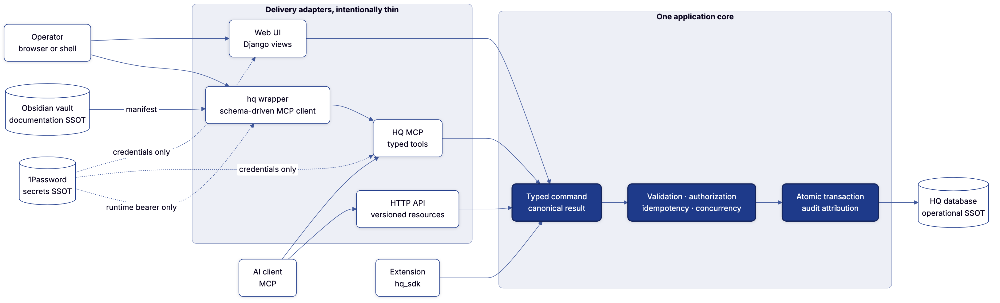
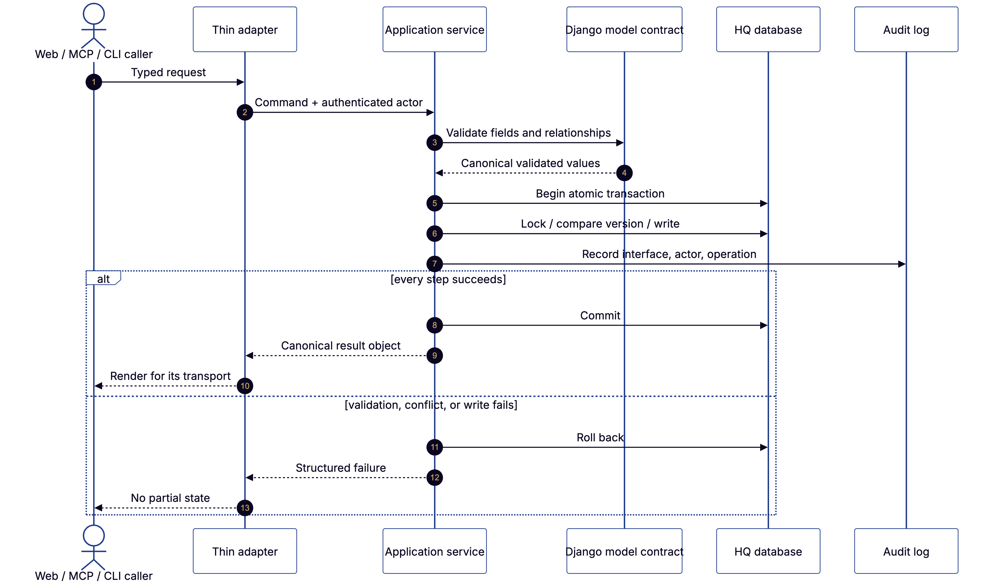
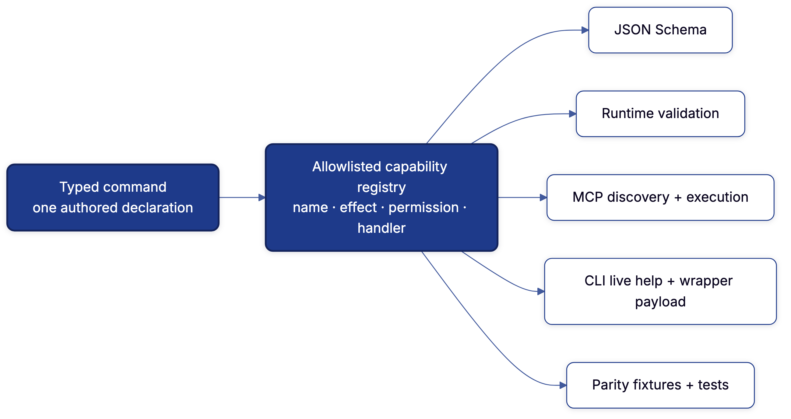
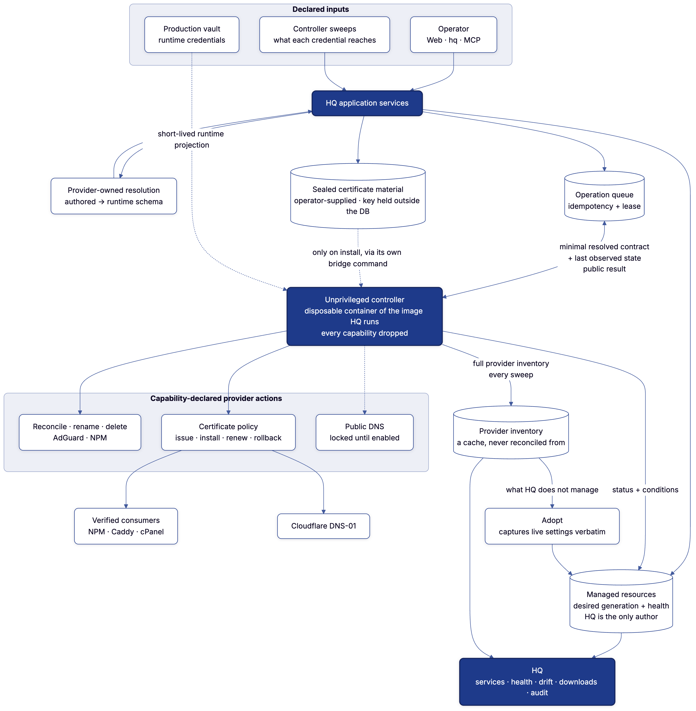
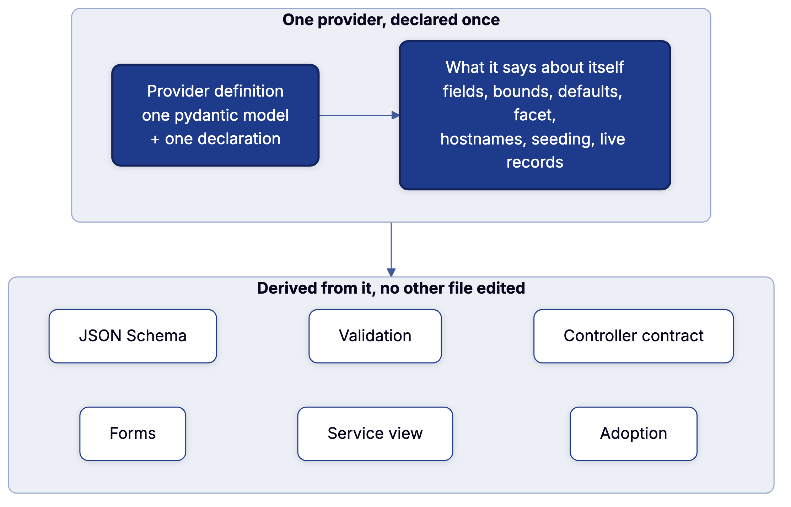

# Architecture

HQ has one application core and several delivery adapters over it: the web UI,
the `/api/v2/` machine API, MCP, the CLI and the extension SDK. A fourth or
fifth interface adds an adapter, never a second implementation.



<sup>Diagram source:
[`application-core.mmd`](diagrams/application-core.mmd), rendered with the
canonical [`diagram`](https://github.com/joeseverino/tools/tree/main/bin/diagram)
tool.</sup>

## The boundary

`hq/platform/application/` owns everything that must be identical whoever
started an operation:

| Concern | Owner |
|---|---|
| Request shape | Typed application command |
| Field and relationship validity | Application service and the Django model contract |
| Authorization | Application service |
| Idempotency and stale-write protection | Application service |
| Transaction and locking | Application service |
| Persistence | Django ORM inside that transaction |
| Actor and interface attribution | Shared audit context |
| Returned data | Canonical result object |
| HTML, MCP JSON, terminal prose | Delivery adapter only |

A view may translate a form, an MCP tool typed arguments, the `hq` CLI its
flags into the advertised JSON Schema. None decides what a valid mutation is or
writes around the service.

## One operation, end to end



<sup>Diagram source:
[`operation-lifecycle.mmd`](diagrams/operation-lifecycle.mmd).</sup>

A browser submit, an API call, an MCP tool call and a CLI command follow the
same lifecycle. The adapter parses and steps aside. The service validates,
authorizes, opens the transaction, guards against stale state, writes, audits
and returns one result; the adapter only chooses how it looks.

Reads cross the same boundary. `hq.platform.application.resources.ResourceSpec`
is the registry of readable domains; query projections live in their
application services and `hq/platform/application/read_models.py`. Adapters
filter or render those results; they do not import models or rebuild result
shapes. Projections declare their `select_related()` plans and then opt into
Django's `FETCH_RAISE` mode, so an omitted relationship fails at the projection
instead of becoming an N+1 query in production. An architecture test rejects
model access from the MCP service adapter.

## Projections

Each page that more than one adapter shows is derived once and serialized by
every adapter:

| Projection | Module | Also served as |
|---|---|---|
| Dashboard snapshot: KPIs, priority work, recent records, upstream state, activity | `dashboard.py` | MCP `dashboard_snapshot` |
| A managed resource's allowed actions, removal mode, machines, services, readout, certificate expiry | `resource_context.py` | `derived` on the `infrastructure.resources` detail |
| The tailnet page | `tailnet_context.py` | the `tailnet` resource |
| The connections page | `connection_context.py` | the `connection.standing` resource |
| HQ's own page: release, machine and container, units, readings, problems | `hq_context/` (`release`, `work`, `sight`, composed in `__init__`) | the `hq` resource |
| How HQ reaches a connection: network, machine, tailnet peering | `connection_reach.py` | inside `connection.standing` |
| Days left on anything | `expiry.py` | every page that says it |

Each view renders its projection object and nothing beside it. Infrastructure
reads return public desired state, health and operation evidence, never
provider credentials.

### The dashboard glance

The page-head glance is a projection, never an owner. Whole-host CPU, memory
and storage are stored as the machine's telemetry reading
(`machine-telemetry:<key>`, `hq/platform/application/readings.py`), so the
machine page, the resource API and the dashboard summarize one timestamped
fact. The operator picks the machine with "Show on dashboard" on its edit form;
the choice lives in `DashboardConfiguration`. Weather is the configured point's
`WeatherObservation`, edited in the dashboard's Settings popover.

`GET /dashboard/glance/` only reads. A refresh is a CSRF-protected POST to the
same address: the refresh button asks for every panel, and the dashboard, when
it opens on a reading older than five minutes (`freshness.GLANCE_EVERY`), asks
for the due panels only (`scope=stale`). Either way HQ records a
credential-free `DashboardRefreshRequest` and rings the controller's doorbell;
the controller derives target and connection from the machine graph. The
browser follows that one request for a bounded interval and keeps no
page-lifetime polling loop. An SSH-capable connection yields whole-host
readings; a Portainer fallback is labeled as container and Docker scope, not
machine utilization.

Machine and weather readings show their observation time at every width. A
reading three intervals old (15 minutes) is marked out of date. That is
presentation freshness, separate from the provider's reported health, and a
refresh keeps the previous reading visible until a new one arrives.

Dashboard cards are grouped by contributing domain. Card providers run once per
projection scope and are still checked for cross-domain collisions. A
contributor with several metrics may supply a typed `DomainOverview`. The host
never infers a domain from a card ID or invents a contributor's reporting
window. The machine snapshot keeps flat cards; the grouping is presentation.

### Priority work

Every domain's `Insight` provider is composed by `domain_attention_items()`.
The dashboard preview, `/action-items/` and the machine snapshot project that
one queue. Each flattened item keeps its `action` and JSON-safe `workflow` (or
`null`) beside its label, evidence, severity, count and URL. The dashboard and
the full queue share one row partial and one resolution renderer; workflow
forms keep their action URLs, methods and CSRF protection, and rendering a
workflow neither runs it nor grants authority. Neutral and good insights stay
out of the queue; the contributing domain decides whether a reading needs a
decision.

Every item HQ raises carries help: a remedy HQ runs, the exact command to run,
or HQ's reason it can offer neither. A finding rule declares `operator_action`
(carried as `steps`, `OperatorStep`: a label, a command HQ never runs, notes;
the API returns `operator_steps` beside the remedies) and `no_help_reason`,
carried whenever there is no remedy and no command. A queue `Insight` keeps
the SDK's shape: a remedy is one of its `actions`, a command or reason a `run`
or `cannot` step of its `workflow` (`hq/platform/application/item_help.py`).
`hq/platform/application/tests/test_item_help.py` fails on a host provider that
builds an item without help.

A rule is declared beside the detector that decides it: each module that raises
findings (`perimeter_findings`, `controller_findings`, `docker_estate`,
`dns_findings` and the rest) exports `RULES`, built from the vocabulary in
`hq/platform/application/finding_model.py`. `hq.platform.application.findings.RULES`
is derived from the closed `RULE_MODULES` tuple; that module keeps only the
pipeline: estate, derivation, suppression, resolution, serialization.

Findings group downstream symptoms under a shared controller when the topology
proves one, while each exact resource and kind fact stays addressable. The
frontend renders the subject's already-authorized actions as "what HQ can do
now"; there is no second action catalog. Focus and dependency-trace links come
from one canonical topology address (`action_links.topology_url`). A
stale-controller finding derives the registered controller-refresh capability
from its node; running it rings the credential-free doorbell, and the
controller still pulls and decides what is due. "Read now" is that capability
with a subject: a stored `ReadRequest` that HQ's `sweep-due` answer turns into
the kinds read next ([API](API.md#read-now)). Contextual command links carry a
same-origin return path through Command Center's result screen.

The resolution plan is domain-neutral and exported through `hq_sdk.workflows`:
a domain emits a stable claim, supporting actions, authorized remedies and its
own verification; HQ derives the ordered understand, act, verify projection and
the machine-readable `claim_absent` completion condition. Analytics freshness
has the same shape: a read site-day is a fact, HQ derives the missing windows,
and the controller backfills them without a backfill policy of its own.

Large projections run inside
`hq.platform.application.projection.projection_scope()`: a reading is reused
while one answer is assembled and discarded when the scope exits, so no
process-cached state reaches a later request. The dashboard's contact rows,
unread total and upstream health come from the controller's
`cloudflare.contact_submission` reading; pages, the header count and search
read the stored result, and a review or deletion waits in the
`cloudflare.contact_inbox` declaration until the controller applies it.

## What a request costs

### A page

`manage.py bench_pages` builds Django's test database (never the real one),
fills it with `hq.platform.core.bench.seed` (a few years of one operator's
records: 4,000 expenses, 3,000 receipts, 300 assets, 6,000 audit rows, a swept
estate of about 270 managed resources), and requests every route that answers
a GET as a signed-in operator through the whole middleware stack. It reports
median and p95 time, the query count, how many queries repeat one already made
in the request, and the response size.

```bash
DJANGO_STATIC_ROOT=/tmp/hq-static python manage.py bench_pages
python manage.py bench_pages --only dashboard --sql
python manage.py bench_pages --scale 0.25 --rounds 10
```

`--only` with `--sql` prints one page's queries; `--scale` and `--rounds` make
a quicker pass. Pages come from the URL configuration. A route with arguments
is requested with the seeded record `SAMPLES` names for it; one with no sample
is listed under "Not benched". An empty database hides every cost that grows
with rows, which is why the bench seeds first. Timings move with the machine;
query counts do not, so compare two trees back to back and read the counts
first.

### A page while HQ writes

SQLite has one write lock, so the cost that matters is a page's while
something else writes. `manage.py bench_contention` seeds the same estate and
browses every page from several threads twice: alone, then beside the two
writers production has, the controller's report (`--sweep-every` seconds) and
an import job run by the runner, batches back to back. It times every
statement, so it reports the lock waits behind each page, report and batch
against the busy timeout, what each writes, derivations, and the slowest pages.

```bash
DJANGO_STATIC_ROOT=/tmp/hq-static python manage.py bench_contention
python manage.py bench_contention --no-ahead --seconds 10
```

Three rules keep a page from waiting on a writer:

- A request stores an answer it derived only if the write lock is free
  (`database.without_waiting`). It already has the answer; the pass stores it
  once the writer commits.
- SQLite keeps no queue for its write lock. A waiting connection retries every
  100 ms, and a job that begins its next transaction within a millisecond of
  the last would win every time, so a job lets go after each second of
  writing (`database.gives_way`, applied by the runner to every job).
- A request never waits on the derive-ahead pass: it derives what it does not
  find stored, and the pass then finds it stored. While writes keep landing
  during passes, the pass waits longer for them to settle
  (`ahead.SETTLES_LONGEST`), since what it derives would be unsettled before
  anyone read it.

A running HQ reports the same per request. Every response carries
`Server-Timing: app;dur=<ms>`, and the access log line (`severino.request`,
`duration_ms`) is written from the same measurement. A request at or over
`SLOW_REQUEST_MS` (`hq/platform/core/middleware.py`) logs a warning.
`hq/platform/core/tests/test_page_budgets.py` pins each page's queries against
the same seed, at two sizes where a per-row read would show.

The first request after a change derives what it needs and stores it, about
five statements per derivation on top of the reads. One change of the estate
costs seven derivations in all, whichever pages ask first: the queue, the
catalogue, the relation graph, and the topology and findings once for the
queue's reader and once for the operator's. `test_page_budgets.py` pins both:
each stored page's queries at two sizes with no derivation run, and the
derivations a change costs.

What a stored page still costs is its own reads and its template: the findings
page renders 700 KB, and the forms that offer every expense as an option (new
receipt, new documentation, new content) render 4,000 `<option>` elements.
Those are changes to the page, not to a derivation.

### A part of a page

A page that changes one region does not fetch itself. The region asks for its
part by name (`X-Fragment`), the view renders that ``, and a
part whose inputs are known by revision answers "unchanged" with 304
(`hq.platform.application.fragments`; the contract is in
[Design](Design.md), "A read is a fragment"). `bench_pages` measures each part
and validator a page names beside the page, so a new part is measured without
being listed.

`hq/platform/application/tests/test_fragments.py` holds the dashboard to
composing only the part asked for, and the poll to answering 304 until
something is written.

### Derived once per change

The topology, the service catalogue, the findings and the action queue are
functions of a few tables, of who is reading, and of the clock. They are
declared that way and computed once per change of those inputs:

```python
@derivation("estate.topology", reads=ESTATE_READS, vary=estate_variant)
def _derive(principal): ...
```

`hq.platform.application.derivations` answers a call from the projection in
progress, then from the `derived` cache, then by running the function and
storing the result. The cache is Django's database cache in the same SQLite
file, so every process reads one copy and a value stored inside a transaction
commits or rolls back with the rows it came from. The key is the derivation's
name, what `vary` returns for the arguments, and the revision of every table in
`reads`.

**Revisions.** `core.Revision` holds one counter per table. Insert, update and
delete triggers on every model table move it inside the writing statement, so
`save()`, `QuerySet.update()`, `bulk_create()`, a cascade and raw SQL all move
it, and a counter never commits apart from its rows.
`hq.platform.core.revisions.install` restores the triggers after every
`migrate` (SQLite drops them when a migration rebuilds a table), creates the
cache table and clears it, so a value from the previous build is never read.
Reading the revisions also reads which triggers exist, in one statement; a
table without its triggers has no revision, and its derivations run on every
call.

**The clock.** A derivation does not read the clock. It asks `reached`,
`passed`, `since`, `whole` or `today` (and `expiry.days_until`), and each
answer records the moment it stops being true. A stored value carries the
earliest such moment and is derived again after it, so a certificate crosses
its warning threshold and "3 hours ago" becomes "4 hours ago" on time, with no
write. Ages a template prints (`|when`) are rendered per request from the
stored timestamp.

**What else it varies by.** `estate_variant`: the reader (a projection is
narrowed to what they may see), the address and port the request reached HQ
on, and whether HQ is in use, which sets the sweep interval a finding quotes.
A derivation that composes every domain varies by `composed_variant`, which
adds the providers composing it. A person's pins and set-aside items are
applied after the derivation.

**It fails toward deriving.** Unreadable revisions, a missing trigger, an
unreadable cache or a value that does not load all mean the function runs. A
table a derivation reads beyond its `reads` is learned and keyed on from then
on; one derivation that calls another must declare the other's tables or the
call raises, unless its own reads are learned. What one derivation reads and
how long it stands passes to whatever asks it, on every call.
`test_derivations` holds every declared derivation to its `reads` over the
bench estate, forbids a direct clock read inside one, and writes a row every
way Django can to show the revision moves.

**An extension's part.** What an extension contributes to a shared composition
(attention items, dashboard cards, overview, each calendar source's events) is
asked through a derivation the host declares as it meets the provider,
`extension.<plugin id>.<provider>`. It declares no reads: its tables are
learned from the statements the provider runs, in a projection of its own. It
varies by whether the reader asked for a demo and by which function answers.
The host cannot follow an extension to the clock, so the answer is `unseen`: it
stands until what it asked of the helpers changes, at most one minute
(`UNSEEN`), and never past local midnight. A count of days turns at midnight and
nothing HQ words is finer than a minute, so that bound keeps every statement
within one unit of the truth. Whatever asks an unseen derivation stands no
longer than it does. The rules an extension keeps are in
[Plugins](Plugins.md#derived-reads).

**Asked again when the change lands.** The controller reports every few
minutes while HQ is in use, and every report moves a revision the estate reads,
so the first request after each would otherwise derive while a person waits. Every top-level
question a request asks is remembered with its arguments, context and seeded
projection. `hq.platform.core.ahead` watches every statement a connection runs;
one that writes a table a remembered question reads wakes one thread after its
transaction commits, and `derive_ahead` asks again whatever no longer stands.
The same thread wakes when the earliest remembered answer's moment comes. It
runs for the life of the web application (the ASGI lifespan), never inside the
writing transaction, and a rolled-back write says nothing. Writes that land
together are one pass, which starts once none has landed for 50 ms and no later
than 0.5 s after the first; writes during a pass are answered by one more. A
question is derived at most once per state of its tables, and by one thread
when two want it. A request never waits on the pass: it derives what it
does not find stored, and the pass waits between questions while a request is
deriving. `ahead=` on a derivation is
how many ways of asking are kept current (eight by default), and a way nobody
asked for in a day is forgotten. A question asked ahead counts as HQ being in
use.

The declared derivations are `estate.topology`, `estate.relations`,
`estate.findings`, `estate.services`; `attention.queue` (the host's part of the
queue), `attention.work` (the composed queue), `attention.count` (how many wait
on one person) and `attention.by_subject` (the host's open items by the page
each is about); `dashboard.sections`, `dashboard.highlights`,
`dashboard.snapshot` and `dashboard.links`; and one per calendar source the
host owns (`calendar.*`). A new one is a decorator and a line in `SAMPLES` in
`test_derivations`. `derivations.uncached()` bypasses the store, for budgets on
what a derivation itself costs and for tests that replace an input no stored
answer varies by.

**The header's count** (`/action-items/count/`) is `attention.count`, so
asking costs the table revisions and one stored number. Its `ETag` names the
answer (the count and whose it is), not its inputs: a browser holding it gets
`304` while the count is unchanged, whatever was written in between, with every
extension installed.

### What a request waits on

Nothing outside the process. A page or a button answers from what HQ holds;
work that reaches a network, starts a process or sleeps runs where waiting
costs nobody:

- **A reading of the outside world is the controller's.** It holds the
  credentials and the egress, and reads concurrently. The web side stores a
  read request (`hq.platform.application.cadence.request_reads`), rings the
  doorbell and answers; the reading arrives through the sweep's ingest. A
  reading whose provider rations calls keeps its own clock
  (`ObservationSpec.every`): HQ tells the controller when it is due.
  `github.profile` is the example (`observations/github.py`).
- **Long local work is a job** (`hq/domains/jobs/`): its own thread, progress
  notes, a heartbeat, one live job per kind. A project's refresh is one.

The request that asks answers at once, in one shape for both
(`hq.platform.application.asks`): how the work stands and, while it is live, a
status resource, with 202. `partials/_ask.html` draws the control and one
script behaviour follows it ([Design](Design.md), "Asked-for work is an ask").

The interpreter holds the rule (`hq/platform/core/outbound.py`). Python raises
an audit event whenever any library opens a connection, resolves a name,
starts a process or sleeps; while a request is served, that event raises
`OutboundInRequest`, so the call never leaves. A place a request must wait is a
named entry in `ALLOWED` with its reason, entered with `allowed("name")`:
signing in (bounded by `OIDC_TIMEOUT`) and a public lookup an operator asked
for by name.
`RequestNeverWaitsTests` holds the entries to their places.
`SEVERINO_OUTBOUND_IN_REQUEST=report` logs `outbound.in_request` and lets the
call go, for a composition whose extensions still reach out from a request; an
extension moves that work to [outbound work](Plugins.md#outbound-work).

`bench_pages` measures actions too: every route that answers a POST is one,
`ACTIONS` names what each is posted, and one with no entry is listed under
"Actions not exercised", with `UNSAFE`'s reason where it cannot be posted
against a scratch database. An action is posted inside a rolled-back
transaction, with the doorbell unrung and a job's work held, so the time is the
request's own. `hq/platform/core/tests/test_action_budgets.py` pins each
converted action's queries at two estate sizes and asserts it answers before
the work it asked for.

## Search

`hq.platform.application.search` is the search boundary for web tables, the
CLI and MCP. It takes a named scope and a query and returns stable domain
identifiers; adapters do not know how text is indexed.

Every entry point requires a `Principal`. Ordinary scopes need `READ`; the
`audit` scope needs `READ_AUDIT_LOG`, which least-privilege principals (MCP)
do not hold, so a new adapter cannot expose search without deciding whose
authority it acts under.

`global_search`, behind `/search/`, returns relevance-ranked hits per scope
with FTS5 `snippet()` extracts as `(text, is_match)` parts, so each renderer
escapes and marks up independently. Presentation metadata (group label, title
field, badge, timestamp) lives on the `SearchDefinition` its `ResourceSpec`
carries. Scopes a principal cannot search are omitted, not rendered empty.
Contact submissions live in Cloudflare D1, not the local database; the web view
adds the matching rows of the controller's last read (by submitter name) as a
group beside the registry scopes, and email and message text are searched on
the contacts page.

Ranking is stated once, in the backend: FTS5's `rank` (bm25, lower is better),
then object id compared as text, numbered per scope with `ROW_NUMBER()`.
`global_search` asks it about every permitted scope in one query, keeps each
scope's first hits, and reads their `snippet()` from a second reference to the
FTS table, because an FTS5 auxiliary function is only valid in the query that
reads the table with `MATCH`. A scope with no hit costs no record fetch. A
searched list annotates each row with its position among the hits
(`_search_rank`, NULL for a non-hit) through a subquery whose ranking is
materialized once, so the statement has three parameters whether three rows
match or five thousand. Equal ranks order by object id as text (`10` before
`9`), one rule for every scope. Without the FTS table there is no rank: the ORM
fallback matches by substring and a list falls back to primary-key order.

`search_index.SearchDocument` is a derived projection. On SQLite an FTS5
external-content table indexes it with Unicode tokenization and 2-, 3- and
4-character prefix indexes. Triggers keep the FTS structure atomic with
projection writes, and domain-model signals keep the projection atomic with the
record, so a rollback removes all three changes. The backend is replaceable
without changing table views, query parameters, CLI output or models.

```bash
python manage.py search_hq projects "certificate automation"
python manage.py rebuild_search_index
```

`hq.platform.application.tables.TableListMixin` composes indexed search with
multi-value filters, workflow toggles, allowlisted ordering and database
pagination. The browser enhances that GET contract with debounced, cancelable
requests; plain links and forms remain the complete fallback.

## Emit once, derive everywhere



<sup>Diagram source:
[`emit-once-capabilities.mmd`](diagrams/emit-once-capabilities.mmd).</sup>

Three registries declare everything an adapter offers. What an extension
declares in each, and the fields it sets, is in [Plugins](Plugins.md#contract-boundary).

**Capabilities.** The allowlisted registry binds each typed command to one
operation name, effect, required permissions and handler. From it,
`describe_capabilities` emits deterministic JSON Schemas; `execute_capability`
validates a JSON object and returns one success or error envelope; the API and
the MCP endpoint expose that catalog and executor; the Command Center derives
an authorized form for every capability, extensions' included, with no
capability-specific view; management commands remain an in-process break-glass
adapter; and tests derive their contract assertions from the emitted schemas.
The executor is not generic database access: it runs only registered
operations, each through the typed principal, the capability check and the
application transaction.

**Resources.** One `ResourceSpec` says whether a resource is searchable,
listable, addressable, or any combination, binds its capabilities and supplies a
strict Pydantic query schema. The API and MCP readers run only registered
handlers, and the search index derives its definitions from the same specs.
Managed infrastructure is in that projection, so `tailscale` or `cloudflare`
finds the stored resources and the connection family that reaches them; a
Command Center keystroke never calls a provider.

**Connections.** `ConnectionSpec` says which family exists, the abilities and
provider scopes it can carry, which principal may inspect it, and how to read
locally cached instances. Static discovery never calls instance providers; the
Connections workspace and machine list do, after authorization. Instances have
no secret field; links are local or HTTP(S); URL userinfo, query strings and
fragments are rejected when controller inventory enters HQ and when an
extension's instance leaves its provider. Permission is evidence, not a label:
an ability declares how its authority is proven, an instance reports the
credential observed, and HQ derives per-ability evidence and a per-connection
lifecycle from the two, failing closed on a missing or rejected grant and
naming an undeclared one rather than counting it as authorized. The
controller's connection providers carry their credential model beside the
providers, so reach a sweep reports is never mistaken for permission. The
Connections security posture is a query-free projection over the authorized
catalog and the current request; it does not claim to attest the router and
firewall the process cannot observe.

The gateway that owns an endpoint owns its declaration: a host domain attaches
a connection callable to its domain integration, an extension emits connections
beside its capabilities and resources through one `PluginIntegration`. A
keyless service is a connection too when it is a real external boundary; it
reports its reduced mode, and a credential upgrades the observation rather than
creating a second kind of integration.

**One graph.** At composition HQ compiles the emitted specs and standalone
search projections into one frozen `IntegrationGraph`, indexed by name. The
compiler owns contract validation, uniqueness and every cross-spec edge, and
collects every violation in one pass, so a failed composition reports the whole
repair list; a direct compiler caller gets the same guarantees as runtime
composition. The graph is memoized for the process, since composition is fixed
at boot. The one plugin-composition reset clears both plugin identity and the
graph; the test runner applies it between fixtures, and isolated composition
proofs use an explicit graph override. Reversible web routes remain a Django
startup check, because URL resolution belongs to that adapter.

The Command Center is a projection of that graph. Its resource links come from
`ResourceSpec.web_route`; `CapabilitySpec.subject_resource` ties an operation
to its domain. `ConnectionAbility.subject_resource` with `governs_kinds` ties a
searched ability to the commands that act on those kinds, and
`ConnectionAbility.capability` names an exact command otherwise. That ability
is the only authored connection-to-capability edge; capabilities keep no
reciprocal list, and no command is invented from a credential scope. The form
is derived from the JSON Schema: unknown and repeated fields are rejected,
targets use the registered label, and eligible choices come from the authorized
local `ResourceSpec` query, so opening a command never calls a provider. A
zero-network preview shows the selected target and reason beside the handler,
resource, authority, effect and execution notes, then calls
`execute_capability`. Retry keys are generated and hidden, infrastructure and
destructive effects require confirmation, and successful writes use
POST/Redirect/GET.

**Topology.** The Topology workspace is the relational projection of the same
declarations and observations: `ConnectionSpec` supplies abilities,
`ConnectionInstance` observed targets and dependencies, controller readings
their observer, `ManagedResource` the desired-state nodes. One function emits
the node-and-edge graph the web, API and MCP use, and it stores no snapshot. Its
actions point back to registered capabilities, so changing a node crosses the
usual authorization, validation, audit, transaction, policy and retry
boundaries. How readings become edges is in
[Derived Facts](Derived-Facts.md#topology).

**Retries.** Every capability whose effect is not `read` accepts an optional
`idempotency_key` in its payload: `capability_schema`
(`hq/platform/application/integration_specs.py`) derives that from the effect
for the published schema and for unknown-field rejection, and
`execute_capability` replays the first result for a repeated key. A command
type declares the field only when its handler stores the key with what it
queues. The API and the Command Center add durable transport replay on top
([API](API.md#safe-retries)).

## Source of truth

Each domain has its own source of truth. One database owning everything would
make the system less honest, not more unified.

| Domain | Source of truth | What HQ stores |
|---|---|---|
| Authored documentation | Obsidian vault | Validated metadata, relationships and vault pointers |
| Projects, assets, expenses, workflow state | HQ database | The authoritative records |
| Credentials and tokens | 1Password | Nothing secret, with one exception below |
| Which connections exist, what they permit and reach | The owning provider, or 1Password and the controller | A typed, timestamped `ConnectionInstance`, never the credential |
| Mutation behavior | `hq/platform/application/` | The one executable business contract |
| Interface presentation | Web, MCP, the `hq` CLI | No business state |
| Which machines exist, and what reaches them | Sweeps, plus a declaration for what nothing sweeps | Derived first; declared only where nothing can observe |
| Desired infrastructure state | HQ database | The only copy |
| What a provider actually holds | The provider | A timestamped cache, never reconciled from |
| Provider authored and resolved contracts | Provider definition registry | No parallel resolver schema |
| Controller actions and automation | Validated controller capability document | Queued operations and observations |

The exception is a certificate an operator generated and asked HQ to install,
sealed with `SEVERINO_SECRET_STORE_KEY` ([Secrets](Secrets.md#severino_secret_store_key))
and read only by the controller through its own bridge action. The vault emits
a validated manifest; HQ never walks the vault or stores Markdown bodies.

## Record use cases

Projects, assets, content, expenses and documentation are record domains: each
declares its model, command and save function once as `records` on its
`DomainDescriptor` ([New Domain](New-Domain.md)), and the web form, API, MCP
and CLI all call that save function. Every save validates through the model
contract, runs in one transaction, locks the row on update, takes an optional
`expected_updated_at` for stale-write protection, and records the interface,
actor and operation. `AdapterParityTests` holds the adapters to one result
shape.

| Use case | Owner | Its own rule |
|---|---|---|
| Projects | `projects.save_project` | Relationship-safe serialization |
| Assets | `assets.save_asset` | Project slugs resolve before writing; one missing slug rolls back; deductible values normalize through the model |
| Content | `content.save_content` | Project, asset, expense and documentation references resolve before writing |
| Expenses | `expenses.save_expense` | Deductible calculation; money as a string in every result |
| Documentation | `documentation.save_documentation` | Restricted records stay manageable on the web; MCP and CLI results redact their vault, repository, URL and notes pointers |
| Receipts | `receipts.upload_receipt`, `receipt.update` | Files enter only through an authenticated web upload and the shared file policy; JSON and MCP get `receipt.update`, which changes metadata and links but never reads, uploads or returns file bytes or a storage path |
| Deletes | `deletion.delete_record`, built per domain by `records.deleter` | A `destructive` capability with an exact target confirmation, a row lock and optional `expected_updated_at`; receipt storage is cleaned only after commit; MCP needs both the write and delete switches |

MCP results omit sensitive and restricted documentation identifiers throughout.

**Documentation sync.** `hq.platform.application.sync.execute_hq_sync()` is the
one external sync. The local vault MCP emits the manifest and `hq sync` sends
it as one `hq.sync` capability call, applied in one transaction. The vault
describes documentation and nothing else; HQ derives the infrastructure. The
sync is safe to repeat, preflight-validated against the frontmatter contract,
bounded to 2,000 records (`MAX_MANIFEST_ITEMS`), never imports Markdown
bodies, and prunes only with `prune_orphans=true` and the separate
`confirm_prune=true`.

## Security inside the core

The security design is in [Security](Security.md). Inside the core: tools
expose task-shaped capabilities, never SQL or arbitrary model mutation; a typed
`Principal` carries explicit capabilities into the service, which authorizes;
`capability_policy.decide` answers allow, hold or deny before a capability runs;
services revalidate every input and own their transactional writes; restricted
documentation is removed from AI-facing results; and every success leaves an
attributed audit event and every refusal a `Denied` one. The `hq` CLI reaches
HQ through the authenticated MCP endpoint; in-process management commands are
break-glass recovery, not a second transport.

## Adding a capability

1. Define the typed command and result in `hq/platform/application/`; a plain
   record domain declares `records` instead ([New Domain](New-Domain.md)).
2. Implement validation, authorization, locking, persistence and audit there.
3. Register it. The web form, API, MCP and CLI derive from the registry; add an
   adapter only where one needs translating.
4. Prove identical result shapes with an adapter-parity test.
5. Prove rollback and the relevant idempotency, permission and conflict cases.
6. Regenerate the API document (`manage.py api_openapi`).

Business logic in a view, an MCP registration function or a management command
is an architecture regression.

## Infrastructure control plane



**HQ owns the topology.** A machine is derived from what a credential reaches
and what a sweep found, and declared only where nothing can observe it (a
printer, an offline CA). A certificate states its names and the targets it
installs on. How a target takes a certificate is stated once on the target,
because that is a property of the place. Desired state therefore spans two
resources: saving a target recomputes the desired state of everything installed
there and advances the generation of whatever resolved differently; otherwise a
certificate would report itself in sync against a world that moved.

HQ stores typed intent, resource generations, public observations and audited
operation requests, and no provider credential. Each provider definition owns
its authored schema, reference resolver and resolved runtime schema, and the
web, MCP, scheduler and controller consume the same resolved output.

### Providers

A provider definition also declares how it takes part in the surfaces above it:
which facet of a service it supplies, how to read hostnames out of a resolved
spec, how to describe itself in one line, and how to rebuild a spec from a
record the provider holds. The service view, the generated create and edit
forms and adoption are written once and name no provider, so a provider added
to the registry appears on all of them.



<sup>Diagram source: [`diagrams/provider-registry.mmd`](diagrams/provider-registry.mmd).</sup>

Each provider is one module in `hq/domains/control_plane/provider_adapters/`:
its spec models, kind constants, the functions its declaration names, and the
declaration. The vocabulary (`ProviderSpec`, `ProviderModel`, action policies,
`NameContext`) is `hq/domains/control_plane/provider_spec.py`, which imports no
registry. `hq.domains.control_plane.providers.PROVIDERS` is derived from the
package's closed `ADMITTED` tuple, in its order.

A provider module also declares the connection its credential arrives through
(`CONNECTIONS`, a `ConnectionKind` per provider name), and
`hq.domains.control_plane.connection_kinds` gathers them from the admitted set;
a kind naming a connection provider no admitted module declares fails at
import. A provider's readings are a module in
`hq/domains/control_plane/observations/`, registered by discovery in name
order ([Derived Facts](Derived-Facts.md#readings)). Adding a provider is writing
its modules and adding one name to `ADMITTED`;
`hq/domains/control_plane/provider_adapters/tests/test_admission.py` holds that
to be enough. The edges its declarations produce are in
[Derived Facts](Derived-Facts.md#topology).

**One address-to-machine resolver**, `hq/platform/application/locate.py`.
Every surface that draws a line between two things (a proxy and the box it
forwards to, a credential and the machine it opens, a service and where it
runs) asks it; surfaces differ only in the evidence they hand it. Names and
addresses are separate namespaces, because a machine may be named like an
address while another answers at it, and one dictionary keeps whichever was
written last. Endpoints are parsed in one place,
`hq.platform.core.network.split_host_port`, because splitting at the last colon
is right for `host:port` and wrong for every IPv6 form. A rendered label is
never a join key; the resolver joins on declared addresses, sweep readings and
connection endpoints.

**Identity is declared separately from hostnames**, because one name can carry
several records: a zone apex routinely carries several TXT and CAA records and
two MX records. Identified by hostname they would collapse into one, and
adoption would keep whichever the provider listed first; types that carry
policy rather than an address declare no hostname and would be invisible to the
screen that finds unmanaged records. A provider that holds several records per
name says what makes each itself, and what it serves is answered separately:
for many record types, nothing.

Which surface offers creating a resource is declared too: a kind that only
makes sense inside something else names that surface, so the generic "what do
you want to add?" page keeps no list of kinds to leave out.

Three verbs exist beyond reconciliation. **Delete** removes the record at the
provider and only then lets HQ forget its declaration, because dropping the row
alone would abandon the record. **Rename** works because the contract carries
what the provider was last seen holding; without it a changed hostname would
create a second record beside the one it meant to move. **Adopt** writes a
record the provider holds into a new declaration with its live settings, so the
first reconciliation after adopting changes nothing.

Two surfaces read those declarations and store nothing. A **service** is one
hostname and everything that must be true for it to answer, the question asked
when something is broken. A **domain** is one zone and everything published in
it: a DMARC policy, a CAA restriction and an MX record are not services, yet
getting them wrong stops mail or lets anyone obtain a certificate for the
domain. Both derive from the same declarations and the last sweep, so they
cannot disagree, which is why there is no Service model and no Zone model.

A domain page states a zone's posture descriptively, not as drift. HQ's DNS
credential reads and writes records and nothing else, so it cannot change a
zone's TLS posture and holds no opinion on it. "DMARC: p=none" is true and
useful; calling it drift would invent a policy nobody declared. The exception
is a record wrong by its own definition: a left-over ACME challenge outlived
its issuance and is garbage whoever asks.

Certificates arrive two ways. HQ issues one from Let's Encrypt over DNS-01 and
keeps it renewed and deployed. Or an operator generates one against the offline
CA, whose root key never leaves that machine, and hands HQ the result to
install and hold.

**A reference is a derived link.** A declaration names another thing in its
`spec`: the domain a DNS record is in, the connection a record is read and
changed through. The database derives each into an indexed `GeneratedField` of
the same name (`ManagedResource.zone`, `ManagedResource.connection_ref`), so a
filter or join reads a column that cannot differ from the spec. A name that
matches nothing is allowed, because a declaration may name what HQ only reads;
the `names-nothing` finding (`hq/platform/application/reference_findings.py`)
reports a record whose connection no controller has, or whose domain HQ
neither expects nor has read.

### The controller

Controllers claim operations with an expiring lease and receive a minimal,
versioned, desired-only JSON contract. A controller resolves connection
references, runs provider adapters, verifies each declared consumer, and
reports only public status and conditions. Expired claims return to the queue;
only one queued or claimed operation may exist per resource and action.

A provider's declaration is Django's; its controller half is Go, in
`controller/providers/`: one file set per integration, each registering its
readers, actions and probes in its `admit…` function, which `providers.New`
calls. The controller asks HQ for its declarations through the bridge's
`registry` action, claims only declared actions it has a handler for, and
refuses a locked action with the registry's reason. Vendor responses decode
into types generated from each vendor's OpenAPI description
(`controller/api/vendor/`), bridge messages into types generated from
`controller/api/hq-controller.openapi.json`.

**The bridge contract is emitted, and each fact in it has one owner.** What the
bridge alone defines is written by hand in
`hq/domains/control_plane/bridge_base.json`: each action's path, parameters and
payload, and the messages that are not registry facts (claims, reports, sweep
verdicts, problems). Everything the registry owns is built from its
declarations by `bridge_registry`: resource kinds, swept kinds, connection
providers, failure classes, reading parts, the record of every reading (from
the Pydantic model HQ validates it with), and the values both sides check. A
module that owns such a value (a Caddyfile token pattern, the `github.delivery`
defaults, a certificate name) declares it once in `SHARED` and uses the same
type in its own models. `manage.py bridge_contract` joins the two and writes the
document; `--check` is a gate, and `go generate` regenerates the controller's
types under its own no-diff gate. A name both halves state, or a reference to a
schema neither states, fails the join.

HQ never reads the written file. Its bridge application builds routes and
parses requests from the same join in memory, so an action, parameter or limit
exists once. What the Go generator does not emit (a pattern, a default, a bound)
the controller reads from the copy embedded in its binary
(`controller/api/contract.go`); a keyword the contract does not state stops the
controller at start. A constant's name is a function of the registry name it
stands for (`bridge_registry.go_name`), so a renamed kind fails the
controller's build wherever the old constant was used.

**A connection is a typed value.** The shapes a credential arrives in (a login,
an API token, an OAuth client, an SSH transport) are declared once, in
`hq/domains/control_plane/connection_shapes.py`, with each setting's name and
whether it is required or secret; a `ConnectionKind` names its shape. The same
command emits the renderer's registry (`hq/config/controller-connections.json`)
and the connections document's schema
(`controller/api/hq-connections.openapi.json`), from which the Go types the
renderer and the controller share are generated
(`controller/connections/document.gen.go`). The controller decodes the document
once into one typed value per connection and hands a provider its own
(`runtime.Connections.For`); `runtime.Environment` is a struct of the facts that
are not connections. No setting is looked up by a name spelled at the call,
which a test in `controller/providers` holds, so two connections cannot collide
and a provider cannot read a setting of a shape it was not handed. A vendor's
base URL is the `servers` entry of its vendored description, generated as a
constant. The document itself is in [Secrets](Secrets.md#where-each-secret-lives).

**The run.** `hq-host controller` (the units are in
[Deployment](Deployment.md#units)) starts a disposable container from the image
HQ runs, with every capability dropped, `no-new-privileges`, and
`/usr/local/bin/hq-controller` as its entrypoint, the static Go binary the
image's `controller` stage built, so the host needs no toolchain and cannot
drift from the deployed application. It runs as the web process's unprivileged
UID, which is what lets it reach the bridge socket. The launcher copies
owner-scoped connections and SSH identities into the run; provider variables,
the ACME lineage and deployment identities enter only that container, and HQ's
database and application environment never do.

The binary reaches HQ through the bridge: the contract's actions as HTTP on a
Unix socket HQ's running process serves (`SEVERINO_BRIDGE_SOCKET`). Django is
already started, so a call costs the work it asks for: with the real Django
side on a development machine, about a millisecond, and an idle applying pass
of ten calls about 40 ms. `go test -bench BridgeCall ./runtime` and the pass in
`hq/domains/control_plane/tests/test_bridge_live.py` reproduce it, and a budget
in each fails if a call comes to cost a process again.

- **One listener, one application.**
  `hq/domains/control_plane/bridge_application.py` is an ASGI application of its
  own, served by a second listener in the web process
  (`hq/platform/core/unix_server.py`). It is not a route of the web
  application, it refuses a request that arrived on a network listener, and it
  serves no web route.
- **The socket is the authorization.** It sits in a directory only the web
  account can enter (a volume mounted read-only into the controller's
  container), owned by that account with mode 0600, and each side asks the
  kernel who the other is (`SO_PEERCRED`): HQ drops a connection from any other
  uid before reading it, and the controller refuses a directory, socket or
  listener that is not its own account's, a link, or a wider mode. No
  credential crosses the bridge in either direction.
- **Bounded.** A request or answer over the contract's `BridgeBody` size is
  refused on both sides, every call has a deadline (`BridgeTimeout`), and a
  refusal is an RFC 9457 problem the controller reports as a `BridgeError`. A
  call the controller gave up on may still finish in HQ; a claim never received
  expires with its lease.
- **Held to the contract.** Every payload is validated against its operation's
  schema (`bridge_contract.Operation.violation`, JSON Schema 2020-12) before an
  action sees it, so an action coerces nothing. A report with one departing
  member is refused whole with 422 and the JSON Pointer of that member, naming
  the member and keyword, never the value.
- **Calls may run together.** Each runs on a thread with its own database
  connection; transactions begin `IMMEDIATE` and a writer waits up to the busy
  timeout for the one ahead.
- **No bridge, no pass.** While the web container restarts there is no socket,
  or nothing listening. The pass fails with that reason and the next one runs;
  nothing weaker is tried.
- **Scheduled work is one more action.** What the host asks HQ for by name
  (prune routine audit events, delete expired sessions, read the contact inbox,
  pull the content index, read the public registries, read unit state after a
  failure) is declared once, in `hq/platform/application/scheduled_work.py`. A
  unit runs `hq-controller job NAME` inside the web container; the running
  process does the work as a job and answers how it ended, so a failed job is a
  failed unit and every run has a row. No unit starts a Python process, a test
  holds the shipped units to the declared names, and HQ starts the same job
  itself when it learns something is due sooner.

Plan mode authenticates and peeks without leasing work. Apply mode schedules
due work, then claims only supported kind and action pairs. The validated
capability document declares which actions are automatic; a generic scheduler
derives reconciliation for generation and health drift, and the TLS provider
adds expiry-window renewal. Every declared action dispatches through one
kind-and-action map. AdGuard and NPM reconcile in apply mode. TLS
reconciliation reuses the existing lineage without contacting ACME. For NPM,
one managed certificate is uploaded once and every enabled proxy host its SANs
cover is found, rebound, reloaded and live-verified. TLS renewal issues through
DNS-01 only when needed, snapshots the rollback artifact, deploys to every
consumer, and verifies one fingerprint everywhere before reporting success.

Issuance is the controller's Go ACME client (`controller/providers/tls_acme.go`). It signs in with one account key per certificate
authority, kept 0600 under `account/` in the ACME state; the first issuance
carries over the key certbot registered there, if there is one, so the
authority sees the same account, and otherwise registers a new P-256 key with
the ACME connection's email. Each name is proved with a `_acme-challenge` TXT
record created through the `cloudflare_dns` connection, given
`ACME_PROPAGATION_SECONDS` (default 30) to propagate, and removed once the
order ends, whether it succeeded or not. The DNS token is never written to
disk. The certificate gets a fresh P-256 key, and is saved only after it is
checked against its names and key: `fullchain.pem` and `privkey.pem` are
written beside `config/live/<name>/` and exchanged with it in one rename, so a
reader sees the old pair or the new one.

Public DNS records reconcile and delete; their zone is declaration-only, because
changing a zone's settings needs a credential the controller does not hold.
Short-lived NPM tokens stay in memory, and a report carrying a secret-bearing
key is rejected.

Public DNS is also gated by a deployment switch, which governs acting rather
than being visible: a declaration whose every action is locked changes nothing,
so refusing it would only stop an operator recording which domains HQ is
responsible for.

The contact form's D1 table is reached only by the controller, through the
`cloudflare_api` connection: its `cloudflare.contact_submission` reading reads
every database holding the table (D1 Read), and the `cloudflare.contact_inbox`
declaration carries HQ's reviews and deletions for it to apply (D1 Write, and
the connection must manage). The web process holds no Cloudflare credential.
The records are people's names, addresses and messages, so the reading is
`withheld`: the generic readings resource counts them and lists none, and only
the contacts capability reads them. The declaration is `withheld` too, because reviews carry the operator's notes. The records API, MCP, record pages, reports, search and the audit log show its status and never its contents, and the generic writer refuses it. DNS-01 uses its own least-privilege
connection.
