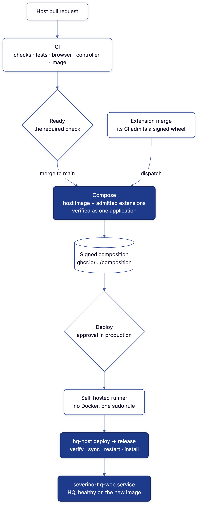

# Deployment

HQ runs on one Linux host, reachable only over a tailnet. systemd runs it: the
web container under `severino-hq-web.service`, the controller and the scheduled
work as oneshot units beside it. A merge to `main` reaches that host through
three workflows and one approval. Nothing on the host is built there or read
from a checkout.



<sup>Diagram source: [`diagrams/changes-reach-hq.mmd`](diagrams/changes-reach-hq.mmd).</sup>

## The pipeline

Each workflow is started by the one before it, naming the commit, so nothing
waits on a schedule.

| Workflow | Started by | Does |
| :--- | :--- | :--- |
| **CI** (`ci.yml`) | every pull request and push to `main` | Checks, Tests, Browser, Controller, CodeQL and Image (build, boot healthy, publish and sign the host image); on a pull request the image's checks and its composition beside them, then **Ready**, which writes HQ's review from their results; on `main`, **Release**, which starts Compose |
| **Compose** (`compose.yml`) | CI on a pull request (verify only); CI's Release on `main`; an extension's admission; a person | the host image plus every admitted extension, verified as one application; on `main`, published and signed |
| **Deploy** (`deploy.yml`) | Compose, once it has published; a person, to redeploy or roll back | waits for approval in the `production` environment, then deploys on the self-hosted runner |

Each CI job runs the `mise` aggregate of its name, so the gates are declared
once, in [`mise.toml`](../mise.toml) ([Development](Development.md)).

Production runs the composed image (`ghcr.io/joeseverino/severino-hq/composition`),
never the host image alone. How Compose admits, fingerprints and assembles
the extensions is in [Plugins](Plugins.md#composition). It stamps the released
commit into the image (`SEVERINO_HQ_REVISION`), so production reports the
commit it runs.

A pull request never starts Deploy, so no pull request's code reaches the
self-hosted runner. The runner dials out to GitHub; nothing inbound is opened.
To redeploy or roll back, run **Deploy** with the commit to put back. To
rebuild the current set, run **Compose**. A rollback to a composition from
before an extension was added drops it, so Deploy refuses it; run Compose at
that commit instead, which composes today's extensions onto that host commit.

A release that fails is undone whole. Its boot keeps a copy of the database
before migrating it (`manage.py boot_migrate`, at the path `hq-host run-web`
names), and the rollback stops HQ, puts that copy back and starts the previous
image on the schema it was built with; what the failed release wrote is lost
with it. A rollback by hand, to a release that already stood, keeps the
schema the newer release left: nothing unapplies a migration. So a migration is
one the release before it can run on (add a table or a column with a default,
remove one only in a later release), or that rollback starts from a backup
([Backup](Backup.md)). `scripts/host-boot-drill.sh` deploys a migrating
release that cannot serve and proves the previous one comes back on its schema.

### Checked once

When a pull request merges, the push to `main` asks
`scripts/proven-on-pr.sh` whether the pull request already proved it: its last
CI run passed, its image carries a `dev.severino.hq.tree` label equal to the
pushed commit's tree, and it is signed by that run. With all three, Checks,
Tests and Browser are skipped and Image promotes that image by digest to the
commit's tag. Short of all three, every gate runs again.

### Where HQ says it stands

HQ's GitHub App posts one check, linked to the run behind it:

- **Severino HQ · Review** on a pull request: *Checking*, then *Ready to
  merge* or *Held* with why and what fixes it. It is the one check the
  ruleset requires, and only HQ's app can post it.
- **Severino HQ · Production** on a commit to `main`: *Building HQ*, *Waiting
  for approval*, then *Live in production* or *Not deployed* with the reason,
  and one comment on the merged pull request.
- **Severino HQ · Production** on an extension's commit: posted by its
  admission, and marked live by the controller once production runs it, when
  its connection manages `github.delivery`.

Why a run failed comes from `deploy/diagnoses.json`: `scripts/diagnose.py`
matches the failed job's log against it and prints only the catalog's words.
A new failure is added there once, and named with its fix every time after.

### When a run fails

Every log is public, so each failure is reported at two levels:

| Where | Says | Holds |
| :--- | :--- | :--- |
| the run's log and HQ's check | the failed step, its diagnosis and fix, failing host test ids, counts | nothing that names an extension or the host |
| the sealed `failure-logs` artifact | what the log withheld: the composed suite's output, a refused composition's reason, a container's log | readable only with the operator's identity |
| the host, `/var/log/severino-hq/` | the pull, sync, install and failed-health output, root-only | the host's own detail |

Compose writes what it withholds to `WITHHELD_DIR`;
`scripts/seal-failure-logs.sh` encrypts it with [age](https://age-encryption.org)
to `FAILURE_LOG_RECIPIENT` in [`scripts/toolchain.env`](../scripts/toolchain.env).
`mise run failure-logs RUN_ID` opens it with the identity in
`SEVERINO_FAILURE_LOG_IDENTITY`. To rotate, generate a pair with
`age-keygen -pq`, store the identity, and replace the recipient; runs sealed
before then need the old identity.

Extension values never pass through a step's `env:` block, which the log
prints: they move between steps as files.

### HQ's GitHub App

One app, registered with no webhook and the permissions in
[`deploy/github-apps.json`](../deploy/github-apps.json) (a test holds them to
what HQ asks for), installed on the host repository and every extension. Each
use mints an hour-long token for only what it does:

| Who | Holds the key as | Asks for |
| :--- | :--- | :--- |
| the controller | an SSH Key item in the vault, rendered for openssl only | what each read or report needs |
| an extension's admission | `HQ_APP_KEY` on its `admission` environment, `main` only | Actions write here: start Compose |
| Compose, Deploy and CI | `HQ_APP_KEY` and `HQ_APP_CLIENT_ID` repository secrets | Actions and Contents read; Checks write |

`scripts/wire-github-app.py` reads the key from 1Password and sets those
secrets on this repository and each extension's `admission` environment,
through standard input. The client ID is a secret too: a variable is state
outside the repository that changes what a build does.

For the controller, keep the key as an SSH Key item beside a connection item
with `connection_ref`, `projection: github_app`, `env_prefix: GITHUB`,
`app_id` and `signing_key` (the SSH Key item's title). Leave `manages` off
until the sweep's view of each extension's admitted and running commit
matches GitHub, then set it and adopt the `github.delivery` record.

To rotate: generate a second key on the app, replace the SSH Key item's key,
run the script again, wait for the connection probe to show the new
fingerprint, then delete the old key on GitHub.

## The host

| Path | Holds | Written by |
| :--- | :--- | :--- |
| `/usr/local/lib/severino-hq/` | the root-owned tree: `scripts/`, `hq/config/`, `deploy/` (units, `bin/hq-host`, `bin/hq-secrets`) | `hq-host sync`, from the image |
| `/usr/local/lib/severino-hq-verifier/cosign` | root's pinned cosign, outside the tree a deploy replaces | `hq-host install` |
| `/etc/severino-hq/host.json` | the host's own values ([`deploy/host.example.json`](../deploy/host.example.json)) | the operator |
| `/etc/systemd/system/` | every unit and drop-in under `deploy/systemd`, plus the drop-ins `hq-host bootstrap` renders | `hq-host install`, `hq-host bootstrap` |
| `/etc/sudoers.d/severino-hq-deploy` | the runner's one rule: `deploy-image.sh` | `hq-host bootstrap` |
| `/etc/credstore.encrypted/` | the Connect token, as an encrypted systemd credential | the operator ([Secrets](Secrets.md)) |
| `/var/lib/severino-hq/release` | the digest-pinned image the web unit runs | a deploy |
| `/run/severino-hq-secrets/` | rendered credentials, on a root-only `noswap` tmpfs (`run-severino\x2dhq\x2dsecrets.mount`) | `hq-secrets` |
| `/run/severino-hq/` | the doorbell HQ rings when it queues controller work | `deploy/tmpfiles/severino-hq.conf` |
| `/opt/apps/severino-hq/secrets/` | the renderer's lock and the controller's ACME state | `hq-secrets`, the controller |
| docker volumes `severino-hq_severino_{data,media,exports,bridge}` | the database, uploads, exports and the bridge socket | HQ |
| `/var/log/severino-hq/` | output a deploy keeps off the public log, and `extensions.log`: which extensions a refused deploy would have dropped | `hq-host` |

### hq-host

`hq-host` (`controller/cmd/hq-host`) is the host's side of HQ. It runs as root,
from the tree, and every unit and the deploy call it.

| Command | Does |
| :--- | :--- |
| `run-web` | runs the web container (`severino-hq-web.service`); waits for the rendered environment, notifies systemd once HQ is healthy |
| `controller [--apply]` | one controller pass: plan, or claim and apply queued work |
| `deploy IMAGE` | verifies the signature, refuses an image that drops an extension production runs, pulls, and hands over to the image's own `hq-host release` |
| `release IMAGE` | syncs the tree, installs the web unit, restarts HQ on the image, then `install`; rolls back on any failure, the database with it when the release migrated it |
| `install` | installs every shipped unit, renders secrets, preflights the controller and the content index, enables every timer and path |
| `sync IMAGE` | replaces the tree with the image's, refusing a unit that names a path the tree lacks |
| `verify` | reports where the host differs from its release: tree, units, and anything retired (`severino-hq-script-drift.timer`, daily) |
| `bootstrap` | renders the drop-ins and sudo rule `host.json` decides |
| `backup` | runs `scripts/backup.sh` over HQ's volumes, where docker says they are |

### Units

`hq-host install` installs every unit and drop-in under `deploy/systemd`,
found by walking the directory (`controller/host/units.go`), and enables every
timer, path and unit with an `[Install]` section. Adding a unit is adding its
file. A unit a release no longer ships is disabled and removed. A drop-in the
host adds beside a shipped one is the host's, and `verify` does not compare it.

| Unit | Runs |
| :--- | :--- |
| `severino-hq-web.service` | the web container; the only thing that starts it |
| `severino-hq-secrets.service` / `.timer` | `hq-secrets`, hourly ([Secrets](Secrets.md)) |
| `severino-hq-controller.service` / `.timer` / `.path` | `hq-controller --apply`, when HQ rings the doorbell (work queued or a pass due), else 15 minutes after each run ends |
| `severino-hq-job@.service` | one scheduled job inside the web container (`hq-controller job NAME`) |
| `severino-hq-due.timer` | hourly, asks for `due`: every piece of scheduled work, the host's and the extensions', whose cadence (`every=`) has come round |
| `severino-hq-backup.service` / `.timer` | `hq-host backup`, nightly ([Backup](Backup.md)) |
| `severino-hq-script-drift.service` / `.timer` | `hq-host verify`, daily |

A unit that fails is reported to HQ with no wiring of its own:
`deploy/systemd/severino-hq-.service.d/10-on-failure.conf` (and the same for
timers and paths) sets `OnFailure=severino-hq-job@units.read.service` for
every unit whose name begins `severino-hq-`. The controller and the
`units.read` job carry an empty drop-in of that name, because each would
otherwise restart itself on failure. `scripts/test-systemd-units.sh` holds the
shipped units to those rules.

## A deploy

The Deploy job pipes the registry token to `sudo
/usr/local/lib/severino-hq/scripts/deploy-image.sh IMAGE`, the one command the
runner may run as root. The runner checks nothing itself and keeps no
checkout or credential: root does not trust it, so a check there would protect
nothing. That script runs `hq-host deploy`, which:

1. Refuses anything but a digest-pinned reference to the composition, and
   verifies its signature as root, against the Compose workflow on `main`
   (`Source.Signer` in `controller/host/deploy.go`, the one copy of that
   identity).
2. Reads the extensions the running release carries, from the lock in its
   image (pulled again by digest if the host no longer has it).
3. Prunes unused images, checks free space, pulls, and refuses the image if it
   drops an extension the running release carries that its composition does
   not declare retired ([Plugins](Plugins.md#composition)). The public log
   says how many; `/var/log/severino-hq/extensions.log` says which.
4. Copies the image's own `hq-host` out, so every step after the pull is the
   new release's code.
5. Stops every active timer and path the tree ships and waits up to three
   minutes for a controller run or secret render already in flight.
6. Replaces the tree with the image's, installs its web unit, records the
   image and restarts `severino-hq-web.service`, which returns once HQ is
   healthy on it.
7. Runs the new tree's `hq-host install`: the controller preflight is the
   release's first pass against the new bridge.
8. Starts what step 5 stopped.

A failure at any step puts back the previous image, tree and units, then
restarts what was held. A unit that was not active before the deploy is not
started by it.

### The bridge

The controller reaches HQ over a Unix socket the web container serves
(`/run/hq-bridge/bridge.sock`, in the `severino_bridge` volume). The socket
exists once the web process starts and is gone while the container is
replaced; a pass in that gap fails with the reason and the next one runs. The
volume takes its owner and mode from the image, and HQ refuses to start if the
directory is not its account's alone. The design is in
[Architecture](Architecture.md#infrastructure-control-plane).

## A new host

[Install](Install.md) brings up a new host, step by step: Connect, the
encrypted credential, the runner, `host.json`, the vault items and the first
start. `scripts/host-boot-drill.sh` does the web unit's part of it on every
image CI builds.

Every later change arrives through Deploy. Rerun `hq-host bootstrap` when
`host.json` changes.

## Network exposure

The container uses host networking and Uvicorn binds port 8000, so `/mcp/`
sees the real tailnet peer rather than Docker's bridge gateway. A co-located
reverse proxy terminates TLS and forwards the browser UI to `127.0.0.1:8000`;
its address is the only entry in `SEVERINO_TRUSTED_PROXIES`. MCP clients
connect to the host's tailnet address on port 8000 directly. Limit host
ingress for 443 and 8000 to the tailnet interface and loopback, and forward
neither port from a router.

With Nginx Proxy Manager, attach an access list whose client rules allow
exactly the tailnet ranges in `SEVERINO_TRUSTED_NETWORKS`, in that order, and
keep `satisfy_any` off. NPM generates the final `deny all` itself; HQ records
that implicit default from its reading. The checklist is in
[Security](Security.md#production-checklist).

## Remote targets

The receivers the controller deploys certificates to are in
[`deploy/targets/`](../deploy/targets/). Install the edge controller and
dispatcher root-owned, force the edge key to the dispatcher, and allow that
account to sudo only the controller. Install the cPanel controller as the
cPanel account and force its key to that script. Each rejects every operation
outside its allowlist. These are installed by an administrator; a deploy
cannot rewrite its own remote authorization.

## Container upgrades

`scripts/upgrade-container.sh` is the program an upgrade plan in HQ
describes. It runs as root for another account, so it trusts nothing that
account passes beyond naming the upgrade:

- The stack is a directory directly under `/opt/apps`, not a symlink. The
  directory, its compose file, any override and any `.env` are owned by root
  or by the owner of `/opt/apps`, and writable by no one else.
- `--from` is the image `docker compose config` resolves for the service and
  what its one running container runs. `--to` is the same repository, pinned
  by digest.
- The data is the running container's writable mounts, read from Docker. A
  writable directory mount outside the stack is refused.

For one compose service it pulls the target, stops the service and snapshots
its data, proves the target against a copy of the data with no network, pins
the digest in the stack's compose override, recreates the service and
verifies it stays up for a settle window. Any failure restores the override
and the data. It is idempotent by operation id and prints one JSON result:
exit 0 kept, 3 rolled back, 2 refused or unchanged, 1 failed and not put back.
It needs Docker Compose 2.24.4 or later; `scripts/test-upgrade-container.sh`
drills it.

A machine runs it only through a sudo rule for that one program with an
upgrade's arguments, as a regular expression (sudo 1.9.10 or later); the plan
shows the rule and how to check it. The rule is only worth having if that
account cannot already reach Docker. HQ's own host has the helper in its tree;
any other machine needs its own root-owned copy, checked against the digest the
plan shows. HQ does not yet queue an upgrade to another machine, so the helper
is run by hand with the plan's values.

## Verifying

From the host:

```sh
curl -I http://127.0.0.1:8000/accounts/login/
systemctl status severino-hq-web.service
sudo /usr/local/lib/severino-hq/deploy/bin/hq-host verify
```

From a device on the tailnet, every URL redirects to `/accounts/login/` until
you sign in; the audit log records the sign-in.

| Symptom | Cause |
| :--- | :--- |
| 502 from the proxy | HQ is not answering on `127.0.0.1:8000`: `journalctl -u severino-hq-web.service` |
| the web unit stays `activating` | the environment has not rendered: `journalctl -u severino-hq-secrets.service` |
| CSRF errors on sign-in | `DJANGO_CSRF_TRUSTED_ORIGINS` lacks the full origin, scheme and host, or `DJANGO_BEHIND_TLS_PROXY` is not `1` |
| Compose fails in "Resolve the host image" | CI for that commit failed, so the host image was never published |
| an extension merged and nothing deployed | its admission did not dispatch Compose, or found nothing new: run Compose |
| the Deploy step failed | the detail is in `/var/log/severino-hq/` on the host |
