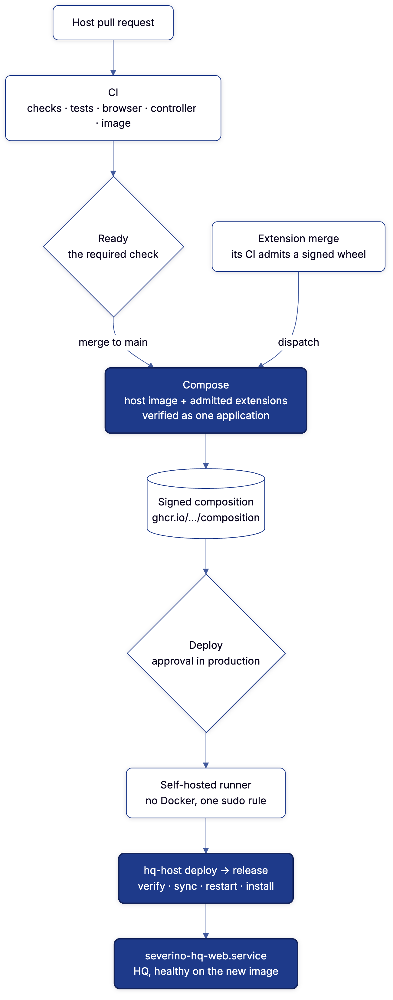

# Deployment

HQ runs on one Linux host, reachable only over a tailnet. systemd runs it: the
web container under `severino-hq-web.service`, the controller and the scheduled
work as oneshot units beside it. A merge to `main` reaches that host through
three workflows and one approval. Nothing on the host is built there or read
from a checkout.



<sup>Source: [`docs/diagrams/changes-reach-hq.mmd`](diagrams/changes-reach-hq.mmd), pre-rendered with [`diagram`](https://github.com/joeseverino/tools/tree/main/lib/diagram).</sup>

## The pipeline

Each workflow is started by the one before it, naming the commit, so nothing
waits on a schedule.

| Workflow | Started by | Does |
| :--- | :--- | :--- |
| **CI** (`ci.yml`) | every pull request and push to `main` | Lint, Test, Browser, Scan and Build (build, boot healthy, publish and sign the host image, and attest its SBOM), each running the task of its name. On a pull request, Build verify and the composition run beside them, then **Ready**, which passes only when every job did. On `main`, **Release**, which starts Compose |
| **Compose** (`compose.yml`) | CI on a pull request (verify only); CI's Release on `main`; an extension's admission; a person | the host image plus every admitted extension, verified as one application; on `main`, published and signed, and its SBOM attested |
| **Deploy** (`deploy.yml`) | Compose, once it has published; a person, to redeploy or roll back | waits for approval in the `production` environment, then deploys on the self-hosted runner |

Each CI job is named for the `mise` task it runs, so the gates are declared
once, as tasks in their job's file under [`mise-tasks/`](../mise-tasks) ([Development](Development.md)).

Production runs the composed image (`ghcr.io/joeseverino/severino-hq/composition`),
never the host image alone. How Compose admits, fingerprints and assembles
the extensions is in [Plugins](Plugins.md#composition). It stamps the released
commit into the image (`SEVERINO_HQ_REVISION`), so production reports the
commit it runs.

Each image CI or Compose signs also carries a signed CycloneDX SBOM, Trivy's
list of its Debian packages, Python distributions (the composition's include
the extensions) and Go binaries' modules. The SBOM is attested by the same
workflow identity and stored beside the image. The composition's is the file
its vulnerability gate scanned (`mise run image:trivy`), so the list attested
is the list checked. To read the host image's:

```sh
cosign verify-attestation --type cyclonedx \
  --certificate-oidc-issuer https://token.actions.githubusercontent.com \
  --certificate-identity-regexp '^https://github.com/joeseverino/severino-hq/\.github/workflows/ci\.yml@' \
  ghcr.io/joeseverino/severino-hq@sha256:... | jq -r .payload | base64 -d | jq .predicate
```

The composition's, by its own workflow:

```sh
cosign verify-attestation --type cyclonedx \
  --certificate-oidc-issuer https://token.actions.githubusercontent.com \
  --certificate-identity-regexp '^https://github.com/joeseverino/severino-hq/\.github/workflows/compose\.yml@' \
  ghcr.io/joeseverino/severino-hq/composition@sha256:... | jq -r .payload | base64 -d | jq .predicate
```

A pull request never starts Deploy, so no pull request's code reaches the
self-hosted runner. The runner dials out to GitHub; nothing inbound is opened.
To redeploy or roll back, run **Deploy** with the commit to put back. To
rebuild the current set, run **Compose**. A rollback to a composition from
before an extension was added drops it, so Deploy refuses it; run Compose at
that commit instead, which composes the extensions admitted now onto that host
commit.

A release that fails is undone whole. Its boot keeps a copy of the database
before migrating it (`manage.py boot`, at the path `hq-host run-web`
names). The rollback stops HQ, puts that copy back and starts the previous
image on the schema it was built with. What the failed release wrote is lost
with it. A rollback by hand, to a release that already stood, keeps the
schema the newer release left: nothing unapplies a migration. So a migration is
one the release before it can run on (add a table or a column with a default,
remove one only in a later release), or that rollback starts from a backup
([Backup](Backup.md)). `tools/pipeline/host-boot-drill.sh` deploys a migrating
release that cannot serve and proves the previous one comes back on its schema.

### Checked once

When a pull request merges, the push to `main` asks
`tools/pipeline/proven-on-pr.sh` whether the pull request already proved it:
its last CI run passed, its image carries a `dev.severino.hq.tree` label equal to the
pushed commit's tree, and it is signed by that run. With all three, Build
promotes that image by digest to the commit's tag, and Lint, Test and Browser
are skipped when that run left none of them out
([What a pull request runs](Development.md#what-a-pull-request-runs)). Short
of all three, every gate runs again.

### Where a change stands

GitHub's own records say it:

- **Ready** on a pull request is the one check the `main` ruleset requires,
  expected from GitHub Actions. It fails when a job it needs did not pass, and
  its summary lists each job's result.
- A **deployment** to the `production` environment, on the commit Deploy was
  handed: *queued* while it waits for approval, *in progress* once approved,
  then its outcome ([Deployment outcomes](#deployment-outcomes)). GitHub shows
  it on the commit, the merged pull request and the environment's page.
- **Severino HQ · Production** on an extension's commit: opened by its
  admission and moved on by HQ's controller, through HQ's GitHub App, until
  production runs it, when its connection manages `github.delivery`. That is
  HQ reporting on what it runs, not a CI verdict.

### Deployment outcomes

A deployment's outcome is the one `deploy/outcomes.json` declares for
`hq-host deploy`'s exit status, each with its state, description and what
production runs after it. hq-host's statuses are generated from that file and
Report reads it, so it is the one place an outcome changes.

| Outcome | When | Production runs |
| --- | --- | --- |
| *success* | the release went live, even if a check after it then failed: its description then says a check failed, which HQ shows as needing attention, beside a red Deploy job | the release |
| *failure* | the release never went live | the previous image |
| *error* | the release never went live and putting the previous image back failed too | unknown until someone looks at the host |

A deploy hq-host never answered is told apart by whether GitHub's record of
the run shows the deploy step began:

| Outcome | When | Production runs |
| --- | --- | --- |
| *inactive* or *failure* | the step never began: not approved, superseded, or cancelled while it waited | the previous image |
| *error*, interrupted | the step began, then a person or the job's timeout cancelled it, or its runner was lost; or the record was not read | unknown until `hq-host verify` reads the host |

A live release's run summary links the changes since the release production
ran before (`python3 -m tools.pipeline.production previous COMMIT`, the same
reading `mise run release:report` takes). It gives the `cosign verify` command
for the image it deployed.

Resolve records the deployment itself: the environment's job sets
`deployment: false`, since the deployment GitHub would record names the
commit `main` was at when the run started and succeeds once approved.

### When a run fails

`mise run annotations RUN_ID` prints the annotations of each failed job, one
per line (level, `path:line`, message): they appear as soon as a step fails,
before its log can be read. `mise run audit:ci-timings RUN_ID` prints where a run's
time went: each job's and step's seconds, and the jobs on its critical path.

Every log is public, so each failure is reported at two levels:

| Where | Says | Holds |
| :--- | :--- | :--- |
| the run's log and summary | the failed step and its error, failing host test ids, counts | nothing that names an extension or the host |
| the sealed `failure-logs` artifacts, one per failed job | what the log withheld: the composed suite's output, an extension's check against the host, a refused composition's reason, a container's log | readable only with the operator's identity |
| the host, `/var/log/severino-hq/` | the pull, sync, install and failed-health output, root-only | the host's own detail |

Compose writes what it withholds to `WITHHELD_DIR`;
`tools/pipeline/seal-failure-logs.sh` encrypts it with [age](https://age-encryption.org)
to `FAILURE_LOG_RECIPIENT` in [`tools/pipeline/toolchain.env`](../tools/pipeline/toolchain.env).
`mise run failure-logs RUN_ID` opens it with the identity in
`SEVERINO_FAILURE_LOG_IDENTITY`. To rotate, generate a pair with
`age-keygen -pq`, store the identity, and replace the recipient; runs sealed
before then need the old identity.

Extension values never pass through a step's `env:` block, which the log
prints: they move between steps as files.

### HQ's GitHub App

One app, registered with no webhook and the permissions in
[`deploy/github-apps.json`](../deploy/github-apps.json) (a test holds them to
what HQ asks for), installed on the host repository, every extension and each
repository a host grant names ([Tokens on the host](#tokens-on-the-host)). Each
use mints an hour-long token for only what it does:

| Who | Holds the key as | Asks for |
| :--- | :--- | :--- |
| the controller | an SSH Key item in the vault, rendered for openssl only | what each read or report needs |
| an extension's admission | `HQ_APP_KEY` on its `admission` environment, `main` only | Actions write here: start Compose |
| Compose and CI's Release | `HQ_APP_KEY` and `HQ_APP_CLIENT_ID` repository secrets | Actions and Contents read the extensions; Actions write here: start the next workflow |

Every use under one installation shares its hourly allowance. The controller
leaves at least 1,000 requests of it to the pipeline and the dependency update
run, and reads a repository in full only when it changed or its hourly full
read is due ([Architecture](Architecture.md#providers)). So a deploy's report
does not wait on the readings.

`mise run wire-github-app` reads the key from 1Password and sets those
secrets on this repository and each extension's `admission` environment,
through standard input. The client ID is a secret too: a variable is state
outside the repository that changes what a build does.

For the controller, keep the key as an SSH Key item beside a connection item
with `connection_ref`, `projection: github_app`, `env_prefix: GITHUB`,
`app_id` and `signing_key` (the SSH Key item's title). Leave `manages` off
until the sweep's view of each extension's admitted and running commit
matches GitHub, then set it and adopt the `github.delivery` record.

To rotate: generate a second key on the app, replace the SSH Key item's key,
run the script again, wait for the connection probe to show the new
fingerprint, then delete the old key on GitHub.

### Tokens on the host

A program on the host that needs to reach GitHub, such as a timer that clones
a private repository, is given an installation token of HQ's app by a grant
(`Grant` in `controller/host/grant.go`). A grant names the repositories, all
under one account, the permissions, and the file the token goes to. HQ has one
grant of its own, the dependency update run's (`DependencyUpdates`). HQ's plan
names that grant's repositories and says when a run is due, and root spools its
hand-off for `severino-hq-renovate.service`. A host adds its own grants to
`grants` in `/etc/severino-hq/host.json`, one entry each:

```json
"grants": [{"name": "example-pull", "repositories": ["example/notes"], "permissions": {"contents": "read", "metadata": "read"}, "path": "/run/example-pull/github_token"}]
```

The automation worker's procedures come from the repository the host's
`automation` entry names, with the directory in it they run from and, for a
private one, the grant whose token fetches it, which must read that
repository's contents:

```json
"grants": [{"name": "automation-projects", "repositories": ["example/playbooks"], "permissions": {"contents": "read", "metadata": "read"}, "path": "/run/severino-hq-automation/github_token"}],
"automation": {"repository": "example/playbooks", "directory": "ansible", "grant": "automation-projects"}
```

`hq-host controller` reads the grants on every pass, so a grant added there
takes effect on the next pass with no other step. Install the app on each
repository a grant names. Until then, each applying pass reports
`github.grant:<name>` on the app's connection as work it could not finish:
"the GitHub App is not installed on <owner>/<repository>".

What a program reading a grant's file can rely on:

- The file holds the token alone, with no newline. It is root's, mode 0400, in
  a directory only root enters (made 0700 if absent, and set to 0700 if it
  is not). It lies under `/run`, which systemd mounts as tmpfs, so a token
  never reaches a disk.
- It is replaced whole, by a rename: a reader sees the old token or the new
  one, never part of one.
- A token lives an hour, and a pass mints a new one once the file is half an
  hour old. A pass runs at least every 15 minutes, so the token in the file
  always has at least about 15 minutes left. A program that runs longer than
  that reads the file again rather than keeping the token.

The security properties:

- The controller's container writes only to its own out directory. It is told
  which grants are due (their names, repositories and permissions), never
  where a grant's token goes.
- Root reads `<name>.json` from the out directory only for a grant its own
  copy declares. It opens the file without following a link, refuses one with
  a second name or one larger than a hand-off can be, and holds it to the
  exact hand-off shape. It takes a token only if it expires within the hour,
  and for a host's grant only one token covering exactly the declared
  repositories. Anything else in the directory is logged as refused, naming
  no token, and removed.
- A grant's path must be a file in a directory of its own under `/run`,
  outside HQ's own directories (`/run/severino-hq`, its secrets, the
  dependency run's spool, the unit socket's directory), and no two grants
  share a name or a path. `hq-host` refuses a configuration that breaks this.
- The token reaches exactly the declared repositories with exactly the
  declared permissions, which cannot exceed what the app is registered with
  (`deploy/github-apps.json`): GitHub refuses a token that asks for more. It
  is written to that file only, never to a record, a log line or an error.
- HQ's web, which plans the dependency run, cannot add or widen a host's
  grant: only root's configuration declares those.

## The host

| Path | Holds | Written by |
| :--- | :--- | :--- |
| `/usr/local/lib/severino-hq/` | the root-owned tree: `hq/config/`, `deploy/` (units, `bin/hq-host`, `bin/hq-secrets`) | `hq-host sync`, from the image |
| `/usr/local/lib/severino-hq-verifier/cosign` | root's pinned cosign, outside the tree a deploy replaces | `hq-host install` |
| `/etc/severino-hq/host.json` | the host's own values ([`deploy/host.example.json`](../deploy/host.example.json)) | the operator |
| `/etc/systemd/system/` | every unit and drop-in under `deploy/systemd`, plus the drop-ins `hq-host bootstrap` renders | `hq-host install`, `hq-host bootstrap` |
| `/etc/sudoers.d/severino-hq-deploy` | the runner's one rule: `hq-host deploy *`. sudo-rs matches no pattern inside an argument, so root checks the image: exactly one argument, a digest-pinned composition of this repository, signed by its compose workflow | `hq-host bootstrap` |
| `/etc/credstore.encrypted/` | the Connect token, as an encrypted systemd credential | the operator ([Secrets](Secrets.md)) |
| `/var/lib/severino-hq/release` | the digest-pinned image the web unit runs | a deploy |
| `/run/severino-hq-secrets/` | rendered credentials, on a root-only `noswap` tmpfs (`run-severino\x2dhq\x2dsecrets.mount`) | `hq-secrets` |
| `/run/severino-hq/` | the doorbells HQ rings: `controller-doorbell` when it queues controller work, `glance-doorbell` when someone asks for a dashboard reading, `automation-doorbell` when it queues a procedure's run | `deploy/tmpfiles/severino-hq.conf` |
| `/run/severino-hq-unit/` | the unit socket, in a directory only the controller's account and root may enter, mounted into the controller's container alone | `deploy/tmpfiles/severino-hq.conf`, `severino-hq-unit.socket` |
| each grant's `path` under `/run` | a host grant's installation token, root's, mode 0400 ([Tokens on the host](#tokens-on-the-host)) | `hq-host controller` |
| `/run/severino-hq-renovate/` | root-only: a validated dependency handoff waiting to run, and each run's environment files, removed when it ends | `hq-host controller`, `hq-host renovate` |
| `/run/severino-hq-secrets/automation.*/` | one automation worker's lent connections, identities and token, the web account's, removed when it ends | `hq-host automation` |
| `/var/lib/severino-hq/automation/` | the automation worker's journal, the web account's alone, mode 0700 | `deploy/tmpfiles/severino-hq.conf`, the worker |
| `/var/lib/severino-hq/renovate/dependency-run.json` | the last dependency run's outcome, given read-only to the next controller pass | `hq-host renovate` |
| `/opt/apps/severino-hq/secrets/` | the renderer's lock, the controller's ACME state, and in `seal/` the controller's sealing seed, its account's, mode 0400, lent to a pass read-only ([Secrets](Secrets.md#sealing-to-the-controller)) | `hq-secrets`, the controller, `hq-host controller` and `hq-host release` |
| `/var/lib/severino-hq/seal/public.key` | root's copy of the sealing key's public half, bound read-only into the web container | `hq-host controller` and `hq-host release` |
| docker volumes `severino-hq_severino_{data,media,exports,bridge}` | the database, uploads, exports and the bridge socket | HQ |
| `/var/log/severino-hq/` | output a deploy keeps off the public log, `extensions.log`: which extensions a refused deploy would have dropped, and `renovate.log`: every dependency run's own output | `hq-host` |

### hq-host

`hq-host` (`controller/cmd/hq-host`) is the host's side of HQ. It runs as root,
from the tree, and every unit and the deploy call it.

| Command | Does |
| :--- | :--- |
| `run-web` | runs the web container (`severino-hq-web.service`); waits for the rendered environment, notifies systemd once HQ is healthy |
| `controller [--apply \| --glance]` | one controller pass: plan, claim and apply queued work, or (`--glance`) read only the dashboard panels HQ is waiting on. A glance's container is given the Portainer and SSH connections from the connections document and their identities, the host's roots and the bridge, and nothing else a controller pass is given. It gets no certificate state, unit socket, host reading or out directory. A pass is told which of the host's grants are due, and an applying pass may leave a hand-off for each, and for a due dependency run, in its own out directory. Root opens each one without following links and validates it against its grant (each owner's repositories by GitHub's naming rules, a token that expires within the hour, no other key). It moves a dependency run's hand-off to `/run/severino-hq-renovate/` and writes a host grant's token to the grant's path ([Tokens on the host](#tokens-on-the-host)), or logs and drops the hand-off |
| `renovate` | runs the spooled handoff: Renovate once per owner, in a container with no capability, a read-only root, no host path but `deploy/renovate/config.json`, and the token in an environment file; records each owner's outcome for the next pass. The container reaches public IPv4 addresses and nothing else: not the host, the LAN, the tailnet, link-local, multicast or another container. It runs on its own bridge, `severino-hq-renovate` (10.231.0.0/24, interface `hq-renovate0`, no IPv6), made if absent and refused unless it is exactly that, with public resolvers. Before each run root loads the nftables table `inet severino_hq_renovate` (`controller/host/egress.go`) in one transaction. The table drops everything the bridge sends to a private, reserved or IPv6 destination and everything it sends to the host itself. A run that cannot load the table never starts |
| `automation` | runs the automation worker until no run is queued, when `host.json` has an `automation` entry and the release pins the worker's image (`AutomationImage` in `controller/host/layout.go`), and otherwise says which is missing and exits 0. It runs only the image the deploy verified and pulled, with `--pull never`, and refuses when the host does not hold it. It copies into a run directory on the renderer's tmpfs the runner-role SSH connections whose host is an IPv4 address, their identities and the pinned host keys, and the grant's token, which it keeps current while the worker runs; it names each runner connection it leaves out. Root loads the egress table `inet severino_hq_automation` (`controller/host/egress.go`) before the container starts, and removes the container at `AutomationBound`. What the container is given, and why: [The automation worker on the host](Architecture.md#the-automation-worker-on-the-host) |
| `deploy IMAGE` | verifies the signature, refuses an image that drops an extension production runs, pulls, and hands over to the image's own `hq-host release` |
| `release IMAGE` | verifies the automation worker image the image pins against the compose workflow's identity and pulls it, before anything live is held, refusing the release when it is not the source's signed runner image; then syncs the tree, installs the web unit, restarts HQ on the image, then `install`; rolls back on any failure, the database with it when the release migrated it. Once the release stands it runs `severino-hq-script-drift.service`, so the release is verified at once. Drift fails the deploy without rolling it back, since what verify finds is the host's, and `journalctl -u severino-hq-script-drift.service` there names it |
| `install` | installs every shipped unit, renders secrets, preflights the controller and the content index, enables every timer and path |
| `sync IMAGE` | replaces the tree with the image's, refusing a unit that names a path the tree lacks |
| `verify` | reports where the host differs from its release: tree, units, anything retired, and the Actions runner's sudo rules. It holds them to one runner unit, not root, with its NOPASSWD rule for `hq-host deploy *`, no unrestricted rule, and no command `sudo -l` lists that HQ does not render. A failure names the command and the grep that finds its file. Root alone can list another account's rules, so the rules are checked here (`severino-hq-script-drift.timer`, daily) |
| `bootstrap` | renders the drop-ins and sudo rule `host.json` decides |
| `backup` | snapshots and archives HQ's volumes, where docker says they are ([Backup](Backup.md)) |
| `upgrade ARGS` | moves one compose service to a pinned image, through its own sudo rule ([Container upgrades](#container-upgrades)) |
| `unit --serve` | answers one request on the unit socket: stops, starts or restarts the systemd unit a container names in its `severino-hq.unit` label, once that unit's own start commands are found to run the container ([Architecture](Architecture.md#a-container-its-unit-runs)) |
| `check` | the host's half of `mise run check --release`, as any account and read-only. It runs `verify`, and with it the runner's sudo rules (or, where sudo asks for a password, the drift unit's run since the release was installed). It checks the established units, free disk, and that every program a sudo rule names is root's alone. Where sudo lets it read nftables, it checks that a loaded Renovate egress table is the one `hq-host` renders (an absent one waits for the next run, which loads it). `mise run check:host`, which `check --release` runs, builds it from HEAD for the host's platform and runs it from a temporary directory over SSH on `SEVERINO_HQ_DEPLOY_HOST`, so the release being checked is the one checking. Exits 0 ready, 1 a fault, 3 unverified |

### Units

`hq-host install` installs every unit and drop-in under `deploy/systemd`,
found by walking the directory (`controller/host/units.go`), and enables every
timer, path and unit with an `[Install]` section. Adding a unit is adding its
file. A unit a release no longer ships is disabled and removed. A drop-in the
host adds beside a shipped one is the host's, and `verify` does not compare it.

| Unit | Runs |
| :--- | :--- |
| `severino-hq-web.service` | the web container; the only thing that starts it. Once HQ is ready, a health poll that reads unhealthy stops it and fails the unit, which restarts it, and a supervisor or health read that hangs for 90 seconds misses the watchdog (`WatchdogSec=`), which does the same |
| `severino-hq-secrets.service` / `.timer` | `hq-secrets`, hourly ([Secrets](Secrets.md)) |
| `severino-hq-controller.service` / `.timer` / `.path` | `hq-controller --apply`, when HQ rings the doorbell (work queued or a pass due), else 15 minutes after each run ends |
| `severino-hq-glance.service` / `.path` | `hq-controller --glance` beside any controller pass, when HQ creates the glance doorbell (a Refresh press, or a page opening on a due reading). The pass removes the doorbell before it reads; one created while it reads still stands when it ends, and the path unit starts it again. It reads while HQ is still waiting on a panel, up to three times, and never counts as the controller arriving |
| `severino-hq-job@.service` | one scheduled job inside the web container (`hq-controller job NAME`) |
| `severino-hq-due.timer` | hourly, asks for `due`: every piece of scheduled work, the host's and the extensions', whose cadence (`every=`) has come round |
| `severino-hq-renovate.service` / `.path` | `hq-host renovate`, when a handoff reaches the spool |
| `severino-hq-automation.service` / `.timer` / `.path` | `hq-host automation`, when HQ creates the automation doorbell (a run queued), else 15 minutes after each worker ends. The worker removes the doorbell before it claims; one created while it works still stands when it ends, and the path unit starts it again |
| `severino-hq-backup.service` / `.timer` | `hq-host backup`, nightly ([Backup](Backup.md)) |
| `severino-hq-script-drift.service` / `.timer` | `hq-host verify`, daily |
| `severino-hq-unit.socket` / `severino-hq-unit@.service` | `hq-host unit --serve`, one instance per connection from the controller |

A unit that fails is reported to HQ with no wiring of its own:
`deploy/systemd/severino-hq-.service.d/10-on-failure.conf` (and the same for
timers, paths and sockets) sets `OnFailure=severino-hq-job@units.read.service` for
every unit whose name begins `severino-hq-`. Each unit a path unit starts (the
controller, the glance, the dependency run and the automation worker) and the `units.read` job carry
an empty drop-in of that name, so that no failure can ring the doorbell that
starts it again. `controller/host/units_rules_test.go`
holds the shipped units to those rules.

Every service runs in one sandbox,
`deploy/systemd/severino-hq-.service.d/20-sandbox.conf`, which reaches each by
the same name rule: root with no capability and no way to gain one, a
read-only system, a private network namespace, Unix sockets only and a system
call allow list. A unit that needs more widens it in its own
`30-sandbox.conf`, which says why:

| Unit | Widened to |
| :--- | :--- |
| controller | host network and netlink for its nftables reading (`CAP_NET_ADMIN`); the web account's files (`CAP_CHOWN`, `CAP_DAC_OVERRIDE`) |
| glance | the same files, with no network |
| renovate | host network and netlink to load the egress table (`CAP_NET_ADMIN`) |
| automation | host network and netlink to load the egress table (`CAP_NET_ADMIN`); the run directory and the doorbell, the web account's (`CAP_CHOWN`, `CAP_DAC_OVERRIDE`) |
| backup | the volumes (`CAP_DAC_OVERRIDE`) and SQLite's files (`CAP_CHOWN`) |
| secrets | IPv4 loopback for Connect (`CAP_CHOWN`, `CAP_FOWNER`, `CAP_DAC_OVERRIDE`) |
| script-drift | sudo-rs, with no-new-privileges off |

`lint:units` scores each service with `systemd-analyze security --offline`
over this directory and fails one above the bar `mise-tasks/lint/units` gives
it. An install and a deploy put every drop-in in place with the first unit
they install.

### Reading one dashboard refresh

A glance pass logs a line for each stage it reads (the whole glance, each
panel, each machine and each Portainer environment) and each provider call,
with how long it took:

| Event | Fields |
| :--- | :--- |
| `controller.glance.stage` | `step` (`glance`, `infrastructure`, `weather`, `machine KEY`, `environment NAME`), `duration_ms`, and `failure`, the error's type, when it failed |
| `controller.glance.call` | `step` (the provider call: `host reading`, `environment list`, each container sample), `duration_ms`, `failure` |
| `controller.glance.failed` | `panel`; a panel whose reading failed, which HQ shows as a note and keeps its last good reading for |

One refresh's timeline is one run of the glance unit, oldest line first:

```sh
journalctl -u severino-hq-glance.service -o short-precise --since -10min
```

A run's lines sit between systemd's `Starting` and `Finished` (or `Failed`)
lines for the unit; `grep controller.glance.stage` keeps the stages, and the
`step=glance` stage is the whole reading. The same events appear in
`journalctl -u severino-hq-controller.service`, where a controller pass reads
its glance before it sweeps.

## A deploy

The Deploy job pipes the registry token to `sudo
/usr/local/lib/severino-hq/deploy/bin/hq-host deploy IMAGE`, the one command
the runner may run as root. The runner checks nothing itself and keeps no
checkout or credential: root does not trust it, so a check there would protect
nothing. `hq-host deploy`:

1. Refuses anything but a digest-pinned reference to the composition, and
   verifies its signature as root, against the Compose workflow on `main`
   (`Source.Signer` in `controller/host/deploy.go`, the one copy of that
   identity).
2. Reads the extensions the running release carries, from the lock in its
   image (pulled again by digest if the host no longer has it).
3. Prunes unused images, checks free space, pulls, and refuses the image if it
   drops an extension the running release carries that its composition does
   not declare retired ([Plugins](Plugins.md#composition)). The public log
   says how many; `/var/log/severino-hq/extensions.log` says which.
4. Copies the image's own `hq-host` out, so every step after the pull is the
   new release's code.
5. Rehearses the release on a copy of production's data, touching nothing
   live (`Rehearsal` in `controller/host/rehearse.go`, which states its
   security properties). It renders no secrets.
   - The database is copied read-only, as HQ's account, into a scratch volume.
   - The image's web process boots on the copy with no network. It is checked
     for readiness, its bridge socket, the copy's integrity, scheduled work
     over the socket and memory kills.
   - The image's controller plans on copies of the connections, identities and
     certificate state.
   - The live web unit and container must not have restarted meanwhile.

   The public log gets one verdict line,
   `Rehearsal: result=pass ready=yes socket=ok ...`, and
   `/var/log/severino-hq/rehearsal.log` each step's output. A failed check, or
   too little free space for the copy, refuses the release as not deployed,
   before anything below runs.
6. Stops every active timer and path the tree ships and waits up to three
   minutes for a controller run or secret render already in flight.
7. Replaces the tree with the image's, installs its web unit, records the
   image and restarts `severino-hq-web.service`, which returns once HQ is
   healthy on it.
8. Runs the new tree's `hq-host install`: the controller preflight is the
   release's first pass against the new bridge.
9. Starts what step 6 stopped.

A failure from step 6 on puts back the previous image, tree and units, then
restarts what was held. A unit that was not active before the deploy is not
started by it. A failure of that rollback ends the deploy with a status of its
own, so its deployment says production's state is unknown.

### After a release

Once the Deploy job is green, `mise run release:report` on a checkout of the
released commit writes `var/release/<commit>.md` and prints its path. The
report holds `perf all` beside the release production ran before it (the
previous deployment GitHub records as live, or `--base <ref>`), and the
production container's memory and CPU. It also holds the host's drift verdict,
its failed units and the last run of the controller and glance units. It reads the host over SSH on
`SEVERINO_HQ_DEPLOY_HOST` as the operator account, with no sudo and no docker
group: the container is found through the cgroup of the process serving HQ,
whose files any account can read. A reading that fails is a row saying so; the
task exits 1 then, or when the release was never marked live.

### The bridge

The controller reaches HQ over a Unix socket the web container serves
(`/run/hq-bridge/bridge.sock`, in the `severino_bridge` volume). The socket
exists once the web process starts and is gone while the container is
replaced; a pass in that gap fails with the reason and the next one runs. The
volume takes its owner and mode from the image, and HQ refuses to start if the
directory is not its account's alone. The design is in
[Architecture](Architecture.md#infrastructure-control-plane).

## A new host

[Install](Install.md) brings up a new host, step by step: Connect, the
encrypted credential, the runner, `host.json`, the vault items and the first
start. `tools/pipeline/host-boot-drill.sh` does the web unit's part of it on every
image CI builds.

Every later change arrives through Deploy. Rerun `hq-host bootstrap` when
`host.json` changes.

## Configuration

Every setting is a value in [`hq/config/settings.py`](../hq/config/settings.py).
The environment carries only what differs per installation or is secret, and
these are all the variables HQ reads. An installer sets the *installer* rows on
the application-environment item ([Install](Install.md#7-create-the-application-environment));
the image, the composition and `hq-host run-web` set the *platform* rows; the
*development* rows are for a checkout, its gates and CI. A real environment
variable wins over the rendered file, so a platform row set on the item
changes nothing. A secret marked `_FILE` may instead be read from the file
that variable names. `test_settings_env.py` holds this table to the code.

| Variable | Set by | Does |
| :--- | :--- | :--- |
| `DJANGO_SECRET_KEY` | installer | signs sessions; required, HQ will not start without it |
| `DJANGO_ALLOWED_HOSTS` | installer | every hostname browsers and clients use, comma-separated; required, anything else gets 400 |
| `DJANGO_CSRF_TRUSTED_ORIGINS` | installer | each full origin the browser uses, such as `https://hq.example.com`; sign-in through a proxy fails without it |
| `DJANGO_BEHIND_TLS_PROXY` | installer | `1`: redirect a request that did not arrive over HTTPS to `SEVERINO_SITE_HOST`; the scheme is the one a proxy in `SEVERINO_TRUSTED_PROXIES` names in `X-Forwarded-Proto` |
| `DJANGO_DEBUG` | installer | `0` in production; `1` turns on development's defaults |
| `DJANGO_SESSION_COOKIE_SECURE` | installer | the session cookie only over HTTPS; on unless `DJANGO_DEBUG` |
| `DJANGO_CSRF_COOKIE_SECURE` | installer | the CSRF cookie only over HTTPS; on unless `DJANGO_DEBUG` |
| `DJANGO_HSTS_SECONDS` | installer | how long browsers insist on HTTPS; a year by default, `0` only while TLS is not working |
| `DJANGO_TIME_ZONE` | installer | the time zone dates are shown in, such as `America/New_York`; `America/Chicago` by default |
| `SEVERINO_SITE_NAME` | installer | the name in page titles and the header |
| `SEVERINO_SITE_HOST` | installer | the canonical host for printed pages, exports and the HTTPS redirect; derived from the two lists above when unset |
| `SEVERINO_TRUSTED_NETWORKS` | installer | who may reach HQ at all, as CIDR ranges; loopback and Tailscale's ranges by default |
| `SEVERINO_TRUSTED_PROXIES` | installer | the proxy's exact address, the only source whose `X-Forwarded-For` and `X-Forwarded-Proto` HQ believes; loopback by default |
| `SEVERINO_SEAL_PUBLIC_KEY`, `SEVERINO_SEAL_PUBLIC_KEY_FILE` | platform | the controller's public sealing key, which `hq-host run-web` binds from root's file ([Secrets](Secrets.md#sealing-to-the-controller)); seals the secrets an operator hands HQ; unset, HQ holds none |
| `SEVERINO_POSTURE` | installer | `advanced` lists each unmet check of HQ's standard in Needs you ([Posture](Posture.md)) |
| `SEVERINO_OIDC_ENABLED` | installer | `1` signs in through the identity provider and closes the password form |
| `SEVERINO_OIDC_ISSUER` | installer | the identity provider's issuer URL |
| `SEVERINO_OIDC_CLIENT_ID` | installer | HQ's client at the identity provider |
| `SEVERINO_OIDC_CLIENT_SECRET` | installer | that client's secret |
| `SEVERINO_OIDC_ROLE_GROUPS` | installer | the identity provider's groups whose members may sign in, each with the role it gives, comma-separated: `admins=operator,family=viewer`; a person in several holds the highest ([Security](Security.md#roles)) |
| `SEVERINO_OIDC_ALLOWED_EMAILS` | installer | addresses that may sign in, honored only when the provider marks them verified, each with an optional `=role` (`viewer` when it names none) |
| `SEVERINO_OIDC_CREATE_USER` | installer | whether a first sign-in creates the account; on by default |
| `SEVERINO_PASSWORD_LOGIN_ENABLED` | installer | break-glass: `1` reopens the password form beside SSO; follows `SEVERINO_OIDC_ENABLED` when unset |
| `SEVERINO_API_RESOURCE` | installer | the identity provider's API audience; empty disables the machine API and MCP |
| `SEVERINO_MCP_ALLOWED_HOSTS` | installer | the host name the proxy serves HQ at, which MCP clients connect to; empty disables MCP |
| `SEVERINO_MCP_ALLOWED_NETWORKS` | installer | the networks MCP answers; Tailscale's ranges by default |
| `SEVERINO_MCP_ALLOWED_ORIGINS` | installer | browser origins MCP accepts; none by default |
| `SEVERINO_FINDINGS_AUTO_REMEDY` | installer | `1` lets HQ queue a repair for a finding with nobody asking; the controller still claims and runs it |
| `SEVERINO_INFRASTRUCTURE_ENABLE_PUBLIC_DNS` | installer | `1` lets public DNS declarations reconcile |
| `SEVERINO_DASHBOARD_LINKS` | installer | extra dashboard links, as a JSON list of `{"label", "sub", "href"}` |
| `HQ_CONTROLLER_ID` | installer | the installation a sweep files its findings under; the machine's name when unset |
| `CONTENT_INDEX_URL` | installer | a public site's content index to sync; unset turns the sync off |
| `CONTENT_INDEX_PROJECT_SLUG` | installer | the project the index belongs to, when its public URL does not say |
| `CF_ACCESS_CLIENT_ID`, `CF_ACCESS_CLIENT_ID_FILE` | installer | the Cloudflare Access service token's ID the index sits behind |
| `CF_ACCESS_CLIENT_SECRET`, `CF_ACCESS_CLIENT_SECRET_FILE` | installer | that token's secret |
| `CLOUDFLARE_D1_DATABASE_NAME` | installer | which D1 database is the contact inbox, when more than one holds the contact table |
| `SEVERINO_APP_ENV_PATH` | platform | the rendered application environment, which settings load into every process |
| `SEVERINO_DATABASE_PATH` | platform | the SQLite database; HQ will not start without it |
| `SEVERINO_MEDIA_ROOT` | platform | where uploads are kept |
| `SEVERINO_EXPORTS_ROOT` | platform | where exports are written |
| `DJANGO_STATIC_ROOT` | platform | the collected static tree, built into the image |
| `SEVERINO_HQ_SOURCE` | platform | the repository this build came from |
| `SEVERINO_HQ_REVISION` | platform | the commit this build is |
| `SEVERINO_HQ_PLUGINS` | platform | the installed extensions' manifests, as `package.module:PluginManifest` entries |
| `SEVERINO_HQ_PLUGIN_LOCK` | platform | the composition's signed lock of admitted extensions |
| `SEVERINO_HQ_PLUGIN_POLICY_SHA256` | platform | the digest of the admission policy the lock was made under |
| `SEVERINO_HQ_REQUIRE_PLUGIN_ADMISSION` | platform | whether extensions must be admitted; on unless `DJANGO_DEBUG` when unset |
| `SEVERINO_BRIDGE_SOCKET` | platform | the Unix socket the controller bridge is served on; unset serves none |
| `SEVERINO_TAILSCALED_SOCKET` | platform | tailscaled's local API socket, which places each agent call on the tailnet device that sent it. Set by `hq-host run-web` to `/var/run/tailscale/tailscaled.sock` on a host where tailscaled is enabled, which binds `/var/run/tailscale` read-only at the same path; a socket missing or unanswering there makes a call wait (503). Empty, the default, is a deployment with no tailnet: a call is placed on no device and the client is the finest unit |
| `SEVERINO_CONTROLLER_DOORBELL` | platform | the file HQ touches when it queues controller work |
| `SEVERINO_SCHEMA_SNAPSHOT` | platform | where boot keeps a copy of the database before migrating it |
| `SEVERINO_LOG_LEVEL` | development | a standard Python log level; `INFO` by default |
| `DJANGO_TEMPLATE_CACHE` | development | whether rendered templates are cached; on unless `DJANGO_DEBUG` |
| `DJANGO_WHITENOISE_AUTOREFRESH` | development | serves static files from the source trees, uncached; refused with `DJANGO_DEBUG` off in a deployment check |
| `SEVERINO_DEBUG_TOOLBAR` | development | `1` with `DJANGO_DEBUG` shows Django Debug Toolbar |
| `SEVERINO_DEBUG_TOOLBAR_IPS` | development | who sees the toolbar; loopback by default |
| `OTEL_EXPORTER_OTLP_ENDPOINT` | development | the OTLP/HTTP collector spans are sent to ([Tracing](Development.md#tracing)); unset, as in every image, nothing is traced |
| `SEVERINO_CONTROLLER_HEARTBEAT` | development | where HQ records that the controller reached it; beside the database when unset |
| `SEVERINO_ACTIVITY_MARKER` | development | where HQ marks itself in use; beside the database when unset |
| `SEVERINO_TEST_RUN` | development | a test run's own temporary directory, which it names to every process it starts as `TMPDIR` and removes when it ends; set by the process that starts the run, and a process started with it joins that run |
| `SEVERINO_SANDBOX` | development | `1` with no `SEVERINO_DATABASE_PATH`: a process makes a run folder of its own as a test run does, with a new empty database in it, named to every process it starts and removed when it ends; set by mise.toml's gate templates |
| `SEVERINO_TEST_DATABASE_PATH` | development | the suite's database file; in the run's own temporary directory by default |
| `MISE_TASK_NAME` | development | the task a browser run keeps its failure shots under, in `var/browser-failures/`; `test` when unset; set by mise |
| `SEVERINO_TEST_MARKERS` | development | the directory a test run keeps the controller's markers in |
| `SEVERINO_TEST_BUILDS` | development | the directory a test run builds programs into |
| `SEVERINO_TEST_LEAK_LEDGER` | development | the file parallel test workers record leaked resources in |
| `HQ_TEST_STALL_SECONDS` | development | seconds a test process may go without progress before it prints what it is running, every stack and the browser's log, and fails that test; 300 when unset, `0` turns it off |
| `HYPOTHESIS_PROFILE` | development | the Hypothesis profile every property runs under: `dev` by default, `ci` where Hypothesis detects CI |
| `HQ_TEST_REPORTS` | development | the folder a gate names for a test run to write each failed test into, with its exception and traceback; set by `tools/gate/verdict.py` |
| `HQ_API_RECORD_EXAMPLES` | development | `1`, with `--parallel 1`, writes the API responses a run receives to `openapi-examples.json`; `mise run fix:api-examples` sets it |
| `HQ_API_RECORD_EXAMPLES_TO` | development | Where a recording writes instead of `openapi-examples.json`; `lint:drift-api-examples` sets it |

## Network exposure

The container uses host networking and Uvicorn binds `127.0.0.1:8000`, so
port 8000 answers only loopback. A co-located reverse proxy terminates TLS and
forwards everything to it, the browser UI, `/api/mcp/` and
`/.well-known/oauth-protected-resource/api` alike. Its address is the only entry
in `SEVERINO_TRUSTED_PROXIES`, the one source whose forwarded address and
scheme HQ believes, so `/api/mcp/` sees the tailnet caller the proxy saw. MCP
clients connect to `https://<hq-host>/api/mcp/`, and `SEVERINO_MCP_ALLOWED_HOSTS`
names that host. Limit host ingress for 443 to the tailnet interface and
loopback, and forward it from no router.

With Nginx Proxy Manager, attach an access list whose client rules allow
exactly Tailscale's two ranges, `100.64.0.0/10` then `fd7a:115c:a1e0::/48`
(`reach.TAILNET`), and keep `satisfy_any` off. NPM generates the final
`deny all` itself. HQ declares only the list's id on the proxy host
(`access_list_id`). It reads the list's rules and judges them against those two
ranges whatever `SEVERINO_TRUSTED_NETWORKS` holds, so a list that allows
anything more reads as "Other sources allowed". The checklist is in
[Security](Security.md#production-checklist).

## Remote targets

The controller deploys certificates and routes to two kinds of receiver. Each
rejects every operation outside its allowlist. An administrator installs them;
a deploy cannot rewrite its own remote authorization.

- A Caddy edge runs `hq-edge` ([`controller/edge`](../controller/edge), which
  states what it trusts), installed root-owned as
  `/usr/local/sbin/severino-hq-edge-controller`. The edge key is forced to
  [`deploy/targets/severino-hq-edge-dispatch`](../deploy/targets/severino-hq-edge-dispatch),
  also root-owned, and that account may sudo only the receiver. `version`
  prints the version the controller's messages name (`edge.Version`), and
  `edge.Operations` is every operation it answers. `reboot`, from version 5,
  says whether the edge waits on a restart; an older edge refuses it, and HQ
  says to redeploy.
- A cPanel account runs
  [`deploy/targets/severino-hq-cpanel-controller`](../deploy/targets/severino-hq-cpanel-controller),
  installed as that account, with its key forced to the script.

`hq-edge` ships in the composed image at `/app/deploy/bin/hq-edge`. To install
or update it, run this on the edge as an account that may use Docker and sudo,
with `image` set to the digest-pinned composition HQ runs (the one in
`/var/lib/severino-hq/release` on HQ's host). It needs cosign and read access
to the image, verifies the compose workflow's signature, and stops if the
image is built for another platform than the edge's:

```sh
image=ghcr.io/joeseverino/severino-hq/composition@sha256:DIGEST && cosign verify --certificate-oidc-issuer https://token.actions.githubusercontent.com --certificate-identity-regexp '^https://github\.com/joeseverino/severino-hq/\.github/workflows/compose\.yml@refs/heads/main$' "$image" >/dev/null && docker pull -q "$image" >/dev/null && built="$(docker image inspect --format '{{.Os}}/{{.Architecture}}' "$image")" && here="$(docker version --format '{{.Server.Os}}/{{.Server.Arch}}')" && { [ "$built" = "$here" ] || { echo "hq-edge in this release is built for $built; this edge runs $here" >&2; false; }; } && container="$(docker create --pull never "$image")" && docker cp "$container:/app/deploy/bin/hq-edge" ./hq-edge && docker rm "$container" >/dev/null && sudo install -o root -g root -m 0755 ./hq-edge /usr/local/sbin/severino-hq-edge-controller && rm ./hq-edge && sudo /usr/local/sbin/severino-hq-edge-controller version
```

It prints the receiver's version last. The dispatcher and the sudo rule name
the same path, so neither changes.

## Container upgrades

`hq-host upgrade` ([`controller/host/upgrade`](../controller/host/upgrade))
is the program an upgrade plan in HQ describes. It runs as root for another
account, so it trusts nothing that account passes beyond naming the upgrade:

- The stack is a directory directly under `/opt/apps`, not a symlink. The
  directory, its compose file, any override and any `.env` are owned by root
  or by the owner of `/opt/apps`, and writable by no one else.
- `--from` is the image `docker compose config` resolves for the service and
  what its one running container runs. `--to` is the same repository, pinned
  by digest.
- The data is the running container's writable mounts, read from Docker. A
  writable directory mount outside the stack is refused.

For one compose service it pulls the target, stops the service and snapshots
its data, and proves the target against a copy of the data with no network. It
then pins the digest in the stack's compose override, recreates the service
and verifies it stays up for a settle window. Any failure restores the override
and the data. It is idempotent by operation id and prints one JSON result:
exit 0 kept, 3 rolled back, 2 refused or unchanged, 1 failed and not put back.
It needs Docker Compose 2.24.4 or later, `tar`, and Linux.

A machine runs it only through a sudo rule for that one program,
`hq-host upgrade *`; the plan shows the rule and how to check it. sudo-rs
matches no pattern inside an argument, so the helper's parser, run as root, is
the boundary: each flag once, every value whole by its pattern, the stack
directly under `/opt/apps`. The rule is only worth having if that
account cannot already reach Docker. HQ's own host has `hq-host` in its tree.
Any other machine needs its own root-owned copy: the plan's fetch step takes
it from the composed image HQ runs, by digest, after `cosign` verifies the
compose workflow's signature, and stops if the image's platform is not the
machine's. HQ queues no upgrade to another machine, so there the helper is
run by hand with the plan's values.

A machine whose rule names a program other than `hq-host upgrade` admits
nothing: re-run the plan's allow step there to write the current rule.

## Verifying

From the host:

```sh
curl -I http://127.0.0.1:8000/accounts/login/
systemctl status severino-hq-web.service
sudo /usr/local/lib/severino-hq/deploy/bin/hq-host verify
```

From a device on the tailnet, every URL redirects to `/accounts/login/` until
you sign in; the audit log records the sign-in.

| Symptom | Cause |
| :--- | :--- |
| 502 from the proxy | HQ is not answering on `127.0.0.1:8000`: `journalctl -u severino-hq-web.service` |
| the web unit stays `activating` | the environment has not rendered: `journalctl -u severino-hq-secrets.service` |
| CSRF errors on sign-in | `DJANGO_CSRF_TRUSTED_ORIGINS` lacks the full origin, scheme and host, or the proxy's address is not in `SEVERINO_TRUSTED_PROXIES`, so HQ does not believe its `X-Forwarded-Proto` |
| Compose fails in "Resolve the host image" | CI for that commit failed, so the host image was never published |
| an extension merged and nothing deployed | its admission did not dispatch Compose, or found nothing new: run Compose |
| the Deploy step failed | the deployment's description says what production runs: the previous image, the release with a check failed, or unknown when the rollback failed too or the deploy was interrupted after hq-host began; the detail is in `/var/log/severino-hq/` on the host |
| a deploy refuses an image that drops an extension | the composition does not say it was meant: name the extension in `retired` in `COMPOSITION_EXTENSIONS` and run Compose, or restore it to the set |
| a push says `permission_denied: write_package` | the package does not give this repository write: in its settings, under Manage Actions access, give it the Write role |
| minting HQ's token says `Bad credentials` or `could not create installation access token` | the key or client ID in the secrets is not the app's: run `mise run wire-github-app` |
| a step as HQ's app says `Resource not accessible by integration` | the installation lacks a permission: compare it with `deploy/github-apps.json` and accept the change |
