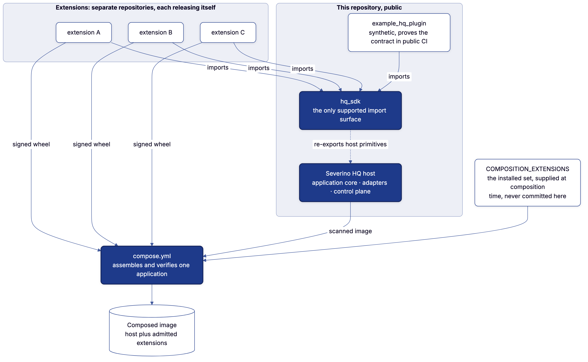

# Plugins

HQ exposes a versioned extension contract for trusted, installable Django
packages. A plugin declares its integration once; HQ derives app installation,
routing, navigation, dashboard projections, global search, readiness,
authorization and every adapter's view of its capabilities from that manifest.

Plugins are off by default. `SEVERINO_HQ_PLUGINS` allowlists each trusted entry
point as a comma-separated `package.module:attribute` list; importable code is
never discovered and run on its own.

```python
from hq_sdk.plugin import NavigationGroup, NavigationItem, PluginIntegration, PluginManifest


def integration():
    return PluginIntegration(
        capabilities=capability_specs,
        resources=resource_specs,
        connections=connection_specs,
        dashboard=dashboard_cards,
        overview=domain_overview,
        attention=attention_items,
        calendars=calendar_sources,
        outbound=outbound_work,
        health=ready,
    )


plugin = PluginManifest(
    id="example.notes",
    name="Notes",
    version="1.0.0",
    distribution="example-notes",
    source_repository="example/example-notes",
    source_workflow=".github/workflows/admit-plugin.yml",
    api_version=12,
    integration_provider="example_notes.plugin:integration",
    django_apps=("example_notes",),
    url_prefix="notes/",
    urlconf="example_notes.urls",
    navigation=(NavigationItem("Notes", "notes:list", "notes", 40, "Writing"),),
    operator_capabilities=("notes.read", "notes.write"),
    mcp_read_capabilities=("notes.read",),
    description="Notes, each with its author and the records it mentions.",
    navigation_groups=(NavigationGroup("Writing", "What gets written down, and where it is kept."),),
)
```

`description` says what the domain holds and each `NavigationGroup` what a
group the extension's items add is for, as a host section and the host's own
groups (`NAVIGATION_GROUPS` in `hq/platform/application/domains.py`) say
theirs. The API document reads both under each tag.

Locally, set `SEVERINO_HQ_PLUGINS=example_notes.plugin:plugin`, install the
package and run its migrations. In production the list is derived from the
signed lock ([Composition](#composition)). `python manage.py plugins` prints the
effective inventory as JSON and validates compatibility.

A manifest is checked where it is built, at the extension's import. One
`DeclarationRefused` (an `ImproperlyConfigured`) names the plugin by its id and
lists every field it gets wrong, read from `MANIFEST_CHECKS` in
`hq/platform/application/plugins.py`. A `NavigationItem` and a
`NavigationGroup` are each checked the same way when built. Nothing pydantic
loads for them, since every process builds the manifests at start.

A manifest must pass these checks:

- Every field is declared by the class, and every value has its declared type
  as written. Nothing is converted, so a tuple field takes a tuple and never a
  list, and `api_version` takes an int and never a string or a bool.
- `id`, `distribution`, `source_repository`, `source_workflow`,
  `integration_provider` (`module:attribute`), each Django app and each
  capability name match their patterns in `hq/platform/application/plugins.py`.
  `name` and `version` are not blank.
- `api_version` is the host's `PLUGIN_API_VERSION`.
- `url_prefix` (`segment/`, never `/segment`) and `urlconf` are both set or
  both empty.
- Each navigation item has a label, a route and a namespace.
- Each navigation group has a name and a description, and is one the
  manifest's own items are in, said once.
- No capability appears twice in one list, and each MCP read capability is also
  an operator capability.

Two checks need the running host, so they run at startup. A plugin's
capabilities are its own: naming one of the host's fails there. The installed
set is checked whole: two plugins may not share an id, a distribution, a
Django app or a URL prefix, one prefix may not nest inside another, and a
navigation group says what it is for once, in the host or one manifest.

Every plugin view needs a session wherever it is mounted. A native or machine
client uses the versioned [API](API.md), derived from the same command and query
services as the web and MCP. Identifiers, idempotency keys, pagination and
scoped authorization belong to that transport, not to templates or plugin
registration.

## The golden path

A plugin imports host behavior only through `hq_sdk`. Its repository owns the
domain; the SDK owns integration mechanics:

| Need | Import from |
| --- | --- |
| Manifest and navigation | `hq_sdk.plugin` |
| Capabilities, principals, strict JSON commands | `hq_sdk.capabilities` |
| Claim-resolution plans and workflow actions | `hq_sdk.workflows` |
| Read resources, strict filters, search projection | `hq_sdk.resources` |
| Connections | `hq_sdk.connections` |
| Capability-gated Django views | `hq_sdk.web` |
| Audit attribution and summary events | `hq_sdk.audit` |
| Work that reaches a network or a provider | `hq_sdk.outbound` |
| Automation procedures HQ may run | `hq_sdk.automation` |
| Kept reads and derivations | `hq_sdk.reads` |
| References to other records | `hq_sdk.references` |
| Calendar sources | `hq_sdk.calendar` |
| Tables, forms, UI projections, money, global search | the matching `hq_sdk.*` module |
| Moving rows the host keeps under a renamed capability | `hq_sdk.migrations` |
| Synthetic siblings and style checks | `hq_sdk.testing` |

Imports from `application`, `core` or another host app are unsupported: they
couple a private plugin to public implementation details. The extension check
holds the boundary with Ruff's `banned-api` over the package's source
(`tools/pipeline/extension-imports.toml`), which also refuses
`django.core.cache`: a cache the host cannot see serves a stale answer, so a
derived read is kept with `hq_sdk.reads.derivation` ([Derived
reads](#derived-reads)). The check refuses four habits, the first two by the
host's `cell-read-by-its-text` and `absent-text-read-from-the-text` rules
(`tools/lint/ast-grep/rules`) and the last two by `python -m hq_sdk.validation
src`:

| Refused | Why | Instead |
| --- | --- | --- |
| A test whose `assertContains`, `assertNotContains`, `assertIn` or `assertNotIn` looks for text ending on `</td>` or `</th>` | the host may wrap what a cell says | read the cell's text |
| A test whose `assertNotContains` or `assertNotIn` over a response's markup says a short word (one to seven letters, digits, `_` or `-`) is absent | a CSRF token, nonce or retry key on the page can hold it by chance | `assertNotContains(response, word, html=True)`, which reads the text between the tags |
| A page sentence that closes on a value with a period written by hand (`f"Renews through {registrar}."`) | a value HQ did not write can end in its own period | close it through `hq_sdk.ui.ended(f"... {value}")`, which adds the full stop only when the text has none |
| A label (a heading, a column, a button, a link) written as a sentence: past three words, opening on a question word, or saying a pronoun or "each" (`"What owners complain about"`) | a label names the thing, as a dashboard does, and the host's own are held to it ([Design](Design.md)) | the plain noun (`"Complaints"`), with what the part holds in its lede |

The host's own code is held to the same rule, and an extension to the refusal
from `PLUGIN_API_VERSION` 6.

The shape of that surface is committed as `hq_sdk/contract.json`: every
export's parameters, fields, enum members and public methods. It leaves out
annotations, so it is identical across the interpreter matrix.

A test fails when the exports drift from the file. An extension's binding to a
renamed field or a new required parameter is a change this repository cannot
otherwise see. Regenerate it with `mise run fix`, read the diff as the review,
and decide there whether `PLUGIN_API_VERSION` moves. `mise run lint` fails on
drift.

What the annotations promise is held from an extension's side by
`tests/sdk_consumer/consumer.py`, which mypy checks: a valid call pins its
return with `assert_type`, and a call an extension must not make carries the
`# type: ignore[code]` mypy must report for it. A new export gets a case
there; an annotation that slides to `Any` fails it.

Capability input models inherit `StrictCommand`, so unknown JSON keys fail at
the boundary instead of being dropped. Class-based views inherit
`CapabilityRequiredMixin` and declare `required_capability`; function views use
`@capability_required(...)`. Either only names the capability. The host's page
gate refuses a person who does not hold it, and records the refusal, before the
view runs. It also refuses to serve a mixin view that names none. Bulk work
uses `audit_operation` with `record_operation`, so adapter and actor
attribution match without a domain-owned wrapper. Every row it writes carries
one operation id: the id it is given, else the one of the operation it runs
inside, else a new one. Without a principal it is the operation of whoever its
door bound (a request, a job, a command), and with nothing bound it is refused,
as `record_event` is. Every door binds who acted where it starts, so a row nobody bound is a door's
defect and fails where it runs. Once an actor is bound, a binding opened inside
it that names another actor is refused: a job's work runs under its job's
binding, a command under the shell's, and a step that needs a principal is
handed the requester's. The same actor may name another interface. A
binding given an id of its own inside another operation records that
operation as its row's `cause`, so a chain of operations is followed from
either end. A model whose rows are about another record (an operation on a
declaration, a decision on one) passes `register_audit(..., subject=...)`, a
function returning that record's key, so one indexed read of the log's
`subject` is the record's whole story.

Every extension's `.github/workflows/admit-plugin.yml` is the same, because it
names nothing about the extension:

```yaml
jobs:
  checks:
    uses: joeseverino/severino-hq/.github/workflows/plugin-checks.yml@main
  admit:
    name: Admit
    if: github.event_name != 'pull_request'
    needs: checks
    runs-on: ubuntu-26.04
    environment: admission
    permissions:
      contents: read
      id-token: write
    steps:
      - uses: joeseverino/severino-hq/.github/actions/admit-plugin@main
        with:
          app-client-id: ${{ secrets.HQ_APP_CLIENT_ID }}
          app-private-key: ${{ secrets.HQ_APP_KEY }}
```

The extension's identity is declared once, by the package:
`tools/pipeline/plugin_identity.py` reads the distribution from `pyproject.toml` and
the plugin id and Django app from the `plugin = PluginManifest(...)` in
`src/<package>/plugin.py`, where `<package>` is the distribution with
underscores. It fails when the two disagree, before anything is built or
signed.

The same checks run from an extension's checkout with nothing to pass:
`../severino-hq/tools/pipeline/check-plugin.sh`, or `mise run plugin:check -- --plugin-root PATH`
from the host checkout. The host runs it on `examples/extension`, a synthetic
package of its own, in its own CI (`test:plugin-check`).

The check:

- refuses a dot typed between two parts of a line in its `src` (less tests
  and migrations), by the host's `dot-typed-in-text` rule
  (`tools/lint/ast-grep/rules`); a line's parts join with `hq_sdk.ui.dotted`;
- refuses a test that reads a table cell by its closing tag, by the host's
  `cell-read-by-its-text` rule;
- refuses a test that asserts a short word absent from a page's markup, where
  a random token can hold it, by the host's `absent-text-read-from-the-text`
  rule;
- syncs the package against its lock and lints it;
- enforces SDK-only imports;
- type checks it;
- runs Django checks, migration drift checks and the plugin's tests;
- then installs the package (built as a wheel) with `--no-deps` into a clean
  host environment.

That last step reproduces production's dependency boundary, and catches a
missing host pin before composition.

Every package declares `[tool.mypy]` in its `pyproject.toml`, and the check
refuses one that does not. Its own mypy (from its dev group) runs against the
host's typed `hq_sdk`, with django-stubs pointed at
`hq.config.settings_typecheck`, the host's settings with that package
installed.

In CI it runs against host `main`, or the host branch named like the
extension's branch when one exists
([Coordinated changes](#coordinated-changes)).

### Renaming a capability

A capability's name follows the API's pattern ([API](API.md#names)). HQ keeps
rows under it: an operator's standing rule, and a change held for a person.
A rule left under an old name matches nothing, so the call would run at its
default, and a held change could no longer be approved. A rename therefore
lands with a migration of the plugin's own that moves them:

```python
from django.db import migrations

from hq_sdk.migrations import CAPABILITY_ROWS, RenameCapabilities


class Migration(migrations.Migration):
    dependencies = [("example_ledger", "0004_entries"), CAPABILITY_ROWS]
    operations = [RenameCapabilities({"example.entries": "example.entry.list"})]
```

`CAPABILITY_ROWS` is the host migration whose rows the operation reads, so
the migration names no host app. A settled decision and the audit log keep
the name they were written under.

### Several extensions in one repository

One repository may hold several extensions, each still its own package (its
own `pyproject.toml`, `uv.lock` and `src/<package>/`), plugin and signed wheel.
One repository is one trust domain. Its extensions share one signer, that
repository and its admission workflow, so whoever can sign for one can sign for
all of them. The composition set names the same `workflow` for every entry of
one `repository`, with each entry's `path` (its package directory, `.` when
omitted).

`plugin-checks.yml` takes the package's `package-dir`, called once per package
with `secret-scan: false` on all but one call.

One run admits them all. The admission job is a matrix over the package
directories, each leg passing `dispatch: "false"`. A final job that needs every
leg starts the composition once, so it reads a run in which every package was
admitted.

That job dispatches **Compose** as the action does, with `admission-run` set to
`$GITHUB_RUN_ID`. The run is still finishing. Compose takes that repository's
extensions from it once it has checked that the run is that repository's
admission workflow on `main` and has not failed.

```yaml
  admit:
    # as above, plus:
    strategy:
      matrix:
        package: [packages/example-alpha, packages/example-beta]
    steps:
      - uses: joeseverino/severino-hq/.github/actions/admit-plugin@main
        with:
          package-dir: ${{ matrix.package }}
          dispatch: "false"
          app-client-id: ${{ secrets.HQ_APP_CLIENT_ID }}
          app-private-key: ${{ secrets.HQ_APP_KEY }}
```

Each leg retains its own artifact, `admission-<plugin id>`. Compose resolves
each repository's admission run once and reads every listed extension's
artifact from it by id (`tools/pipeline/admissions.sh`); a listed id with no artifact
in that run fails the composition. A coordinated branch builds each listed
extension from its `path`, which must declare that id, and nothing else in the
repository.

## Cordon admission

Production loading fails closed. With plugins enabled and `DJANGO_DEBUG` off,
HQ requires `SEVERINO_HQ_PLUGIN_LOCK` and `SEVERINO_HQ_PLUGIN_POLICY_SHA256`.
The lock's inventory must equal the enabled manifests exactly. Every entry
binds the plugin ID, distribution, installed version, host API version,
immutable source commit, wheel SHA-256 and Cordon policy SHA-256.

The policy is `policy/plugin-admission-v1.json`. Admission requires:

| Evidence | Produced by |
| --- | --- |
| The plugin contract and package tests, and a secret scan | `plugin-checks.yml` |
| A dependency lock that matches `pyproject.toml` | the admission action |
| An audit of every locked dependency with no known vulnerability | the admission action |
| A CycloneDX SBOM of the wheel and its locked runtime dependencies, exported from its lock by uv, dev groups left out | the admission action |

Each id the policy lists is produced by one step or job, named beside it in
`AdmissionEvidenceTests`, since Cordon's evidence step marks every listed id as
passed.

The extension's admission signs its statement with GitHub OIDC through
Sigstore. Cordon verifies the bundle against the exact repository and workflow
identity before installation, then emits the lock entry embedded in the
composed image.

The lock is evidence about one artifact under one policy, not a claim that
arbitrary plugin code or future versions are safe. A changed wheel, version,
workflow, policy, host API or enabled inventory needs a new admission and
image build.

Compose refuses an admission signed under another policy. So once a policy
change lands on `main`, each extension repository runs its admission workflow
again (`gh workflow run admit-plugin.yml --repo OWNER/NAME`), which admits
every package and starts the composition.

Admission tests one extension against the host it checks out. Composition then
runs Django's checks and the whole suite in the assembled image, with every
admitted wheel installed together. Admission proves an artifact is acceptable
on its own; composition proves the accepted set is one application.

Duplicate routes or capabilities, missing host-owned runtime dependencies,
migration conflicts and tests that assume no sibling exists fail before
publication.

## Composition



<sup>Source: [`docs/diagrams/host-and-extensions.mmd`](diagrams/host-and-extensions.mmd), pre-rendered with [`diagram`](https://github.com/joeseverino/tools/tree/main/lib/diagram).</sup>

Production runs one image carrying every admitted plugin. Plugins build no
images: each admits itself and publishes its signed bundle, and the host
composes them, so deploying one never replaces the others. The pipeline around
it is in [Deployment](Deployment.md#the-pipeline).

Compose takes each plugin's newest successful admission, so a plugin whose
latest admission failed ships its last good wheel and holds back neither the
host nor the others. The composed suite runs every installed plugin's tests
against the host it is composed with, so whatever wheel is chosen is proven
together before it is published.

A plugin's admission starts the composition, and nothing polls. The last step
of the host's `admit-plugin` action mints a token as HQ's GitHub App, asking
only for Actions write on this repository. It dispatches **Compose** with an
input that names no plugin.

The token lasts an hour and can only start a workflow here. The app's key is
the only credential a plugin repository holds, as a secret on an `admission`
environment limited to `main`. A deploy still waits for a person's approval in
the `production` environment, which no app can give.

A dispatch that fails fails the admission, where it happened. So nothing is
missed silently, and no schedule backs it up.

```
merge a plugin → its CI admits the wheel and publishes the bundle
               → the admission dispatches the host's composition
               → build → verify → scan → publish → approve → deploy
               → HQ marks the plugin's commit live and comments on its pull request
```

What a composition is made of (the host image digest, the automation worker's
image digest it pins, the plugin wheel digests and the admission policy) is
hashed into a fingerprint, published as a
`composition:fp-…` tag beside the image. An admission's dispatch whose
fingerprint is already published (the same commit admitted twice) stops before
building. Every other trigger rebuilds: a host build, a pull request, and a
hand-run **Compose** (`workflow_dispatch`), which is how to rebuild the current
set on purpose.

Compose reads the plugins' admissions as the same app, through a token minted
per run with only Actions and Contents read; there is no personal token to
renew. It is the only path to production.

It verifies each signature itself, against the identity built from the
declared repository and workflow. So a plugin cannot widen who may sign for it
by editing its own repository.

Cordon's lock tool merges the entries into one lock; the host does not
reimplement it. `SEVERINO_HQ_PLUGINS` is derived from the merged lock, because
the enabled and approved inventories must be identical or the host refuses to
start.

The declared set is the `COMPOSITION_EXTENSIONS` repository secret rather than
a committed file, because this repository is public and the extensions are not.
`composition/extensions.json` documents its shape. An empty `extensions` list
composes the host with none; a missing secret or list fails Compose.

An extension leaves production only by being named. `hq-host deploy` reads the
lock in the running image and in the one being deployed, both covered by the
signature over their digests. It refuses an image that drops an extension the
running release carries, unless the image's composition lists its id under
`retired` (shipped in the image as `/opt/severino/plugin-retired.json`).

To remove one, move its id from `extensions` to `retired`, run Compose and
deploy. Once production runs without it, the `retired` entry may go.

### Coordinated changes

A change that needs both the host and an extension (a plugin API bump, say)
lands as branches with the same name in each repository, verified together
before either merges:

- An extension pull request's `plugin-checks.yml` resolves the host ref to the
  host branch of the same name when one exists, and to `main` otherwise. An
  explicit `hq-ref` input wins.
- The host pull request's composition builds each extension's same-named branch
  into a candidate image and runs the composed checks and suite in it. The
  candidate is verify-only: unadmitted wheels, no lock, a local tag, never
  published, signed or deployed.
- Extensions without such a branch are reused from their verified admissions.
  The app's Contents read covers reading the branches.
- Beside composing, in a job of its own, the host pull request runs its own
  `plugin:check` against every extension in the set, from its same-named branch
  or else its default branch. So a host change that breaks an extension fails
  the pull request rather than the next admission. Which extension failed is
  only in the sealed failure logs.
- The host's Test job runs the same check, `test:plugin-check`, on
  `examples/extension`, a synthetic package of its own. So a host change that
  breaks the check itself (a test it runs that reads a host dev dependency)
  fails there, before anything is composed, and on a fork's pull request too.

Merge the host first; each extension then checks and admits against `main`.

## Contract boundary

The plugin API is for trusted code that ships with a deployment. External or
untrusted systems integrate through the authenticated API or MCP, not through
runtime code loading. Providers contain projection logic only; domain rules
stay in the plugin's application services, so pages, commands, search and MCP
cannot diverge.

`api_version` is required and authored as a literal by the extension, never
defaulted to the host's constant. So a host loading an older wheel reports the
incompatible epoch, instead of relabeling the wheel or failing with an
unexplained constructor error.

Additive manifest fields stay compatible within
a version; removals and semantic changes need the next version. Plugin IDs are
stable reverse-DNS names and are never reused.

### Public host, private domains

HQ publishes the generic SDK and composition mechanism; a private package owns
its domain language, models, migrations, fixtures, repository identity and
business rules. The host never imports a private package by name or commits the
production inventory. It learns the admitted set only from deployment-supplied
composition metadata and checks it against its signed lock. Public tests use
synthetic extensions; the assembled private image runs the real suites
together.

Code moves into HQ only when it is host policy or a reusable primitive:
authorization, capability execution, audit attribution, table behavior, UI
vocabulary, composition, testing infrastructure. Domain-specific calculations
stay in their package even when the host would be their only consumer.

### The integration

An integration provider returns one frozen `PluginIntegration` of lazy, typed
callables for every runtime contribution: capabilities, resources,
connections, dashboard cards, overview, attention, search, calendars, outbound
work, [operations](#operations), health and [demo data](#demo-data). HQ calls only the one a surface needs. The manifest carries
static install, routing, navigation and authority metadata plus exactly one
executable entry point; an extension never registers a surface on its own. How
the host compiles these into one graph is in
[Architecture](Architecture.md#emit-once-derive-everywhere).

**Dashboard and attention.** A card and its destination page describe the same
reporting window. Put the actual window or data cutoff in the card's `detail`
when it differs from today or coverage is incomplete, since a render time does
not establish freshness. The host never infers dates from a card label or
recalculates an extension's totals.

An attention provider emits `serious` or `attention` only for a decision that
needs the operator, and `neutral` or `good` for observations. The title states
what is wrong, with its count where it stands for several; the body says what
it means. A domain whose items are also decided together on one page of its
own names it in `PluginIntegration.attention_url`, and the Needs you page's
heading for the domain links there.

An item's `key` (else its eyebrow and title) is what the queue knows it by:
its row and its dismissal. Two of one provider's items under one key are one
item, so HQ keeps the more urgent, drops the other and logs
`composition.source.repeated_key` naming the key, and the extension kit's
attention check refuses the pair, so the extension's own suite fails on it.

A dashboard, overview or attention provider that raises, or answers what the
host refuses (a status outside the vocabulary, an unknown card key, two of its
cards with one id, an overview of another type), costs only its own place: HQ
logs the failure with its traceback and the request id, shows one card valued
"Unreadable" for the cards, an `attention` item titled "<name> could not be
read" for the attention items, and leaves the overview out. The item is shown
only to a reader holding the extension's `mcp_read_capabilities`. HQ asks
again on the next read, since nothing that holds a stand-in is stored.
`plugin_attention_items`, `plugin_dashboard_sections` and `plugin_overviews`
read a failing sibling the same way (`read_source` in
`hq/platform/application/plugins.py`), and `providers_derived_again` names
each refused answer, so the extension's own suite fails on it.

**Health.** `PluginIntegration.health` answers whether the extension can
serve: its tables exist, its registry reads. HQ ANDs every extension's answer
into `/health/ready/`, which gates the deploy, so one false there fails the
whole host. A configuration gap (a secret or setting this process lacks, rows
it holds no key to read) is shown instead: an `attention` item and a notice on
the extension's own pages, saying which setting is missing and where the guide
to it is. It is never a readiness failure, so an install without production's
secrets, such as a development one, still answers ready.

Supply the help the shared card shows ([Design](Design.md), "A card says what
is wrong and holds what fixes it"):

| Field | For |
| --- | --- |
| `Insight.actions` | what can be pressed |
| `Insight.action` with `Insight.url` | the page the work is done on (a short label; a sentence is shown as a sentence) |
| `Insight.workflow` | commands and their check |
| `Insight.since` | the moment it began, when that is known |

**Capabilities.** HQ validates every `CapabilitySpec` before describing or
invoking the registry: name, effect, required permissions, target kind and
label, command JSON Schema, duplicates and the handler's signature. MCP grants
must be a subset of the plugin's operator grants. A typo fails the composition's
checks instead of becoming a production-only failure or an authority gap.

A handler is called as `handler(command, *, principal, <target keyword>)`,
the keyword being the one its `target_kind` binds (`current_slug`,
`current_id`, ...). A handler that checks for a stale write also declares
`expected_updated_at` and receives the caller's token; any other handler
leaves it out and is never handed it.

A handler refuses with one of the host's error codes, the ones the API
reference lists on each operation (`REFUSAL_STATUS` in
`hq/platform/application/refusal_status.py`); any other code is answered as
`operation_failed`.

Fields that shape the Command Center form:

- `subject_resource` names the `ResourceSpec` the operation acts on, which
  joins it to its domain in machine discovery and the operator UI.
- `target_label` and `target_help` explain the identifier in operator language
  (`Record slug`); `target_kind` stays its machine type.
- `target_query` lists eligible targets from the subject resource; HQ checks
  the filter against that resource's strict query and renders a choice control.
- `target_initial_fields` names command fields HQ fills from the selected
  record's detail, with one authorized local read that also carries
  `updated_at` into the concurrency check; it never contacts the provider.
- `execution_notes` describe the registered read, queue and provider boundary
  in the zero-network preview.
- `reached_from` is the route of the page a person starts the command from,
  for one that needs a value only that page hands out (a held change's id, a
  token HQ gave a live record). Search links there instead of to the form,
  and the form says where to start. `ON_ITS_PAGE` marks one that the page of
  whatever it acts on sends, which search does not offer.
- `about` is what the command's page says of it under the form: a callable,
  read each time the page is drawn, that returns a `CommandAbout(label,
  facts, sections)`. Its `facts` are drawn as one section headed `label`
  (required once there are facts), each a `CommandFact(label, value,
  detail)` whose `detail` is the lines under the value. `sections` holds the
  host's own page sections (a procedure's latest runs), which `hq_sdk` offers
  no way to build, so an extension supplies a label and facts. Both types are
  in `hq_sdk.capabilities`; `None` leaves the page to its form.

A command's fields say what they are through markers in their `Annotated`
type, the ones the host's commands use, all from `hq_sdk.capabilities`:

```python
class NoteCommand(StrictCommand):
    note: Annotated[str, Describe("What to write down.")]
    project: Annotated[str, Names("example.projects"), Describe("The project it is for.")]
    tone: Annotated[str, Choices(Note.Tone.choices)]
    about: Annotated[str, Refers(Note, "about"), Describe("What it is about, as type:identity.")]
```

- `Describe(text)` is the field's help on the form and its description in the
  machine contract.
- `Names(resource, key="")` makes the field one of that resource's records
  (several, for a list), offered as a choice from what the caller may list;
  `key` names the item field the value is, where that is not the identifier.
- `Choices(options)` offers a fixed set of `(value, words)` pairs. The form
  offers only these; the command still refuses any other value itself, with a
  `Literal` type or in its handler.
- `Refers(model, field)` makes the field a reference the model's
  `ReferenceField` of that name holds ([References](#references)), offered
  as the grouped picker the record's own form shows, with what this caller
  may name.

A marker writes itself into the field's schema through pydantic's
`__get_pydantic_json_schema__`, so the schema every adapter reads carries it.
A field several commands declare alike is a named type alias,
`type Notes = Annotated[str, Describe("Anything else worth keeping.")]`, used
as `notes: Notes = ""`: the schema holds its definition once, under the
alias's name in `$defs`, and each use is a `$ref` to it beside that use's
default.

A command's words are declared on it once:

| Field | Its words | Example |
| --- | --- | --- |
| `label` | its name | `Remove a note` |
| `verb` | what its button says, where that is shorter | `Remove` |
| `variants` | the words for a mode one button cannot say | `variants=(("all", "Refresh all"),)` |

Every button, link, remedy and toast for the command reads them
(`spec.words(variant)`; a press answers with `spec.requested(subject)`). So a
call site never writes them. A control built for a command takes no `label`,
and a template says them with ``. A variant nothing
declares fails the host's checks instead of the press.

The commands one connection's abilities run share its row, so no two of them
may say the same words. A composition where they do fails at startup
(`connection.repeated_words`).

A command whose one field is a yes or no is a switch. Declaring its `on` and
`off` variants, `variants=(("on", "Turn on updates"), ("off", "Turn off
updates"))`, presses it as those two words. A page opened for one record says
where it stands and offers only the word that changes it. Without both, it is
a checkbox pressed by its name.

When an agent asks for a command a person must approve, the card, the bell
and the audit say it as one sentence: "example-agent wants to delete the note
example-note". It is read from the same declaration (`spec.wanted()`):

| Command | Reads as |
| --- | --- |
| Any | the command's `label` mid-sentence with the record after it, its "a" read as "the" ("Delete a note" says "delete the note example-note") |
| A switch | the variant it sets ("turn off updates for example-project") |
| A change of one short value | that change ("change the status of example-note from draft to done") |

Where a name does not read that way, `wants` says it, with `{target}` where the
record goes: `wants="keep the live version of {target}"`. It names `{target}`
exactly when the command takes one.

HQ gives every capability that writes an `idempotency_key`
([API](API.md#safe-retries)); a command type declares the field only when its
handler keeps the key itself.

**Resources.** A `ResourceSpec` may expose a list handler with a
`ResourceQuery` subclass, a detail handler with one stable identifier, a
`SearchDefinition`, or any combination. HQ validates names, permissions, query
and handler compatibility, identifier contracts, and duplicate resources and
search scopes at startup. The API, MCP and global search derive from the spec.
A search projection that belongs to no resource comes from
`PluginIntegration.search`. A list that reads its first `limit` rows
subclasses `hq_sdk.resources.TopQuery` rather than declaring `limit` itself,
so its schema carries the deployment's maximum and a larger ask is refused.
A list narrowed by a free-text `query` or a `status` types the field by
`hq_sdk.resources.TextFilter` or `StatusFilter`, which say what it does in
the words every list's does, so the API reference writes them once.

| Field | Set it |
| --- | --- |
| `pass_principal=True` | when the answer depends on what the caller may see; both handlers then also receive `principal=` |
| `web_route` | to the resource's list route, which must reverse without arguments, to link it from the Command Center |

Plugins read through the authorized `list_resource` and `get_resource`; the raw
registry and handlers are not exported.

**Connections.** Emit a `ConnectionSpec` for every external API, token, consent
or keyless gateway the package uses, and map each useful operation to its
registered capability or resource. Import the contracts and
`describe_connections` from `hq_sdk.connections`; given `principal=`, it and
`hq_sdk.resources.describe_resources` say whether each entry is `permitted`.

Each spec names a family, its abilities and provider scopes, the capability
needed to inspect it, and a zero-argument provider of cached
`ConnectionInstance` observations. HQ derives the Connections workspace,
Command Center entry, API catalog, MCP tools and topology from it. The provider
runs under a principal its spec permits, or in HQ's own derivation, whose
results each reader sees only as far as `readable_by` allows. It reads local
state, and never makes a network request because someone opened discovery.

An instance may carry status, safe endpoint text, granted scope names, targets,
dependencies and small facts. It never carries tokens, credentials,
authorization headers, secret values or private URL parts. URL userinfo, query
strings and fragments are rejected outright, rather than filtered by a list of
secret parameter names.

`observed_at` is a `datetime` and serializes as ISO 8601. Links are local paths
or explicit HTTP(S) URLs. Emit a truthful reduced mode when the gateway works
anonymously, rather than hiding it.

Say how authority is proven, not only what it permits. Each ability declares a
`grant`:

| `grant` | When |
| --- | --- |
| `scoped` | the provider issues narrow permissions, and the ability lists its needs in `required_scopes` |
| `coarse` | the credential is the whole account and nothing narrower exists |
| `none` | the call is keyless |

Each instance says its `credential_model`, a required keyword: one of the same
words, `rejected` for a credential the provider refused, or `unknown` for one
whose kind cannot be told. An instance that leaves it out, or says anything
else, is refused as it is made. One that holds a credential (any model but
`none`) belongs to a spec that names its `secret_store`, and the Connections
page says "Secrets in" that store or "No key needed" (`PLUGIN_API_VERSION` 11).
HQ derives one evidence state per ability and instance:

| Evidence | The ability |
| --- | --- |
| `verified`, `coarse` (whole account), `not_applicable` (keyless), `unverified` | stays open |
| `undeclared` | stays usable under HQ's own authorization, and says so |
| `unknown` | is left undecided |
| `missing`, `revoked` | is closed; only these two close it |

The same derivation gives each connection's lifecycle (configured, reachable,
ready, unauthorized, stale, revoked) against the family's `stale_after_hours`.

An ability may set `subject_resource` to the resource it governs and list its
provider kinds in `governs_kinds`. Command Center then offers the registered
commands against that resource whose target filters include one of those
kinds. For an operation that maps through no resource, set `capability` to the
exact `CapabilitySpec` name. Composition refuses unknown resource and
capability references.

The ability is the only connection-to-capability edge. Scope coverage decides
only whether the connection can perform it; no command is fabricated from
token text. Command discovery stays declaration-driven, so a missing or stale
observation does not hide a supported workflow.

In the topology:

| Declared | Becomes |
| --- | --- |
| An ability's `governs_kinds` | edges to managed resources |
| `targets` | observed destinations |
| Dependencies with a `resource_key` | declared-use relationships |

Set `controller_id` only when the instance is an observation emitted by a
distinct controller. It is observer identity, not credential identity, and
never holds secret material. A plugin needs no topology template, route,
callback or host edit.

## Shared UI contract

An extension renders HQ's design system and ships no stylesheet or script of
its own. Its templates use only the public pieces below.
`python -m hq_sdk.validation src` (part of `plugin:check`) reads every file
under a `templates` directory and refuses anything else:

- a frame or block not listed;
- a private partial;
- an include named at render time;
- a parameter a partial does not read, or a required one left to whatever the
  page has in scope;
- a host tag, filter, class or `data-` hook not listed;
- a style attribute, which HQ's policy refuses: a value drawn to scale goes
  through a public partial (`partials/_allocation.html`, the charts).

The record is the `templates` section of `hq_sdk/contract.json`, derived from
the host's own templates by `manage.py sdk_contract`, which writes these tables
too.

Every view model `hq_sdk.ui` hands an extension says its values in words. It
raises `ValueError` where it is built on a date-time
stamp, a dumped record or list, a bare `True` or `False`, markup, a flag or
`None` where text belongs, or a field's snake_case name as a label. A moment
goes in its typed field (`ListRow.at`, `Insight.since`) or through
`hq_sdk.ui.when`.

A page extends a frame and fills its blocks. It never extends `base.html` or
draws its own head: the view declares the page (`hq_sdk.pages`). A head action
that opens a dialog declares that as well,
`PageAction("Import", url, modal=PageDialog("import", "Import records", "notes/_import_form.html"))`,
which `page.html` draws once with the page's context. A head action may also be
the control `hq_sdk.outbound.ask` returns, so `get_page_actions` returns
`tuple[PageAction | Ask, ...]`, both from `hq_sdk.pages`. A POST action sends
its `value` as its `field`; one that must also send what it acts on, an
identifier that may be any string, names it in `fields`
(`fields={"client_id": client_id}`), and is then a form of its own, never
drawn inside another.

Where the page sits is declared too. `page_trail` is every crumb above it, from
the top, as (label, url) pairs, `(("Notes", reverse_lazy("notes:list")),)`. A
record's page adds its own crumb after them by naming it in
`trail_label(record)`. One crumb written bare is refused where the view is
declared. `page_trail` holds the trail's crumbs from `PLUGIN_API_VERSION` 7.

A block a frame does not list is the host's. An override of it is refused,
rather than silently ignored the day the frame stops rendering it.

A data table is declared through the table tags, so its shape is in the HTML on
first paint. `…` wraps it in the box it
fits, which takes the label as its name only when it scrolls. The region derives the width its columns leave at, by rank,
from what each column holds ([Design](Design.md)). It draws the empty state in
place of tables with no row beneath their heads; an `` around the
region says what is missing in the page's own words.

Each column heading is ``:

| Argument | What it says |
| --- | --- |
| The kind | `prose`, `identifier`, `numeric`, `status` or `control`, following from `date-col` or `actions-col` when left out; a `numeric` column's cells align under it with nothing written on them |
| `drop=` | the order a narrow table lets it go in, never on the column that names the row or a `key-col` |
| `sort=` | a list sorted on the server |
| `local_sort=True` | a list sorted on the page, its control drawn only where the table holds two rows to sort |
| `gutter=True` | the column whose cell in each row stands in the gutter and holds the row's toggle |

The region draws each row's toggle, last in its cell under the `gutter=True`
heading, and refuses one written there by hand; only a table with no
headings ends its naming cell with ``. The stylesheet shows
the toggle only where the row holds something back.

A row edited on the page holds `` in its
cell. It draws a link to the page with that row's editor open (`?edit=<key>`),
and on that page the form, which the region moves into the line beneath the
row and opens the row on, with no script as with it. `form` is the one form
the view declares for the table, drawn for the open row alone with the values
given by field name, or as it was sent when it is bound; its ids carry the
row's key. With script the link, the form and its Cancel are answered in the
table's region. The form posts `next`, the page with the editor closed, for
the view to return to.

A state is ``, a pill said in sentence case; with
`pill=False` it is the label in its tone alone, as a figure that says which
way it went (``). Neither is written
by hand: the pill and tone classes are not public.

`PLUGIN_API_VERSION` 10 retires the `|sortable` filter and the `num-col`,
`pill*` and `worth*` classes, each derived or drawn by the host.

No template draws by hand what a shared part draws: a `<section>`, a heading,
a fold, a form that writes, a notice and the other shapes the table at the end
of this section names, each beside the part to write instead. `hq plugin
check` refuses each where it is drawn with the host's `hand-drawn-*` ast-grep
rules (`tools/lint/ast-grep/rules`), which hold the host's own templates
too, and `ast-grep scan --update-all` moves the ones whose rule carries a
fix. A shape a page still draws is marked on the line above it, inside a
Django comment no page receives, with why:
``, then `<!-- ast-grep-ignore: hand-drawn-fold --> why` alone
on its line, then `` on the shape's own line before it. A
mark no shape needs any more fails the check, so the marks only fall. `PLUGIN_API_VERSION` 11 retires ``, whose
head `` draws, and publishes `partials/_icon.html`.

A notice is `body`, with a
title the page composes as its `` part after the body
([Design](Design.md)). Its classes (`notice`, `notice-*`) are the host's, so
`hq plugin check` refuses one written by hand.

A `TableListMixin` list declares the same through `TableColumn(kind=)`, its
ranks derived from the columns unless one says `drop=`, and its region's
`room=` as `table_room`.

A list whose rows come from a projection rather than a model's queryset
overrides `get_table_rows(query)`, which is handed the address's filters,
search and sort as a `TableQuery` (`query.chosen("state")`, `query.search`,
`query.sort`) and answers `Projected(rows, read)`: `rows` a queryset the
paginator counts and slices in the database, `read` the function that turns
one page of it into the rows the template draws. Its columns declare their
`kind=`, there being no model to read it from, and it sums no totals.

A form renders as `{{ form }}`, and one field as `{{ field.as_field_group }}`.
HQ's form renderer draws every field in its own markup, with the help text and
errors the control's `aria-describedby` names, and a checkbox inside its label.
The page draws `form.non_field_errors` where it says them.

A form whose fields stand one to a row of a table is
``:
the form declares a field for each row, named by the row, and the template
draws the table, each row's cell drawing its field with
``.

A form that posts carries `` where Django's own form carries
``: the CSRF field and a retry key drawn for that drawing of
the form. A view runs the write through `hq_sdk.capabilities.execute_posted(request, name, payload)`,
which acts as the signed-in person under that key, so the form sent twice acts
once; HQ refuses a change from the browser that posts no key. A refused
answer reaches the person through `hq_sdk.capabilities.refused(request,
answer, form=form)`. It puts the answer on the form drawn again (each detail
beside its field) or, without a form, on the next page's messages. It returns
the refusal, whose `status` the view answers with, or None when the write ran. A post no page is drawn for answers `refusal_response(answer)`: the
refusal's sentence at its status. A form view whose write is a service call of
its own inherits `hq_sdk.writes`' mixins, which run it once under the same key.
A test that posts a form without opening its page first sends
`hq_sdk.testing.form_keyed(data)`.

| A form field may set | To |
| --- | --- |
| `wide = True` | take the whole row |
| `change_effect` | the sentence saying what changing it causes |
| `confirms = True` | close the form as the callout a submission is confirmed in |

<!-- sdk_contract: shared UI contract, written by `mise run fix` from hq_sdk/template_contract.py -->

| Frame | Blocks a page fills | What it is |
| --- | --- | --- |
| `confirm_page.html` | `consequences` | A destructive action's confirmation: `consequences` says what will happen. |
| `form_page.html` | nothing | A page that is one form, a record's: its card and `partials/_form.html`, closing with `form_verb` and `cancel_url`; `form_fields` names a template for fields beyond the form's own loop and `form_note` says what saving does, each from the view, so the page fills no block. |
| `list_page.html` | `foot`, `row` (given `forloop`, `row`), `summary` | A `TableListMixin` list: toolbar, table, empty state and pagination. `row` is one row's cells, `summary` sits above the table and is redrawn with it when a search or filter changes, `foot` is its `<tfoot>`. |
| `page.html` | `page` | Any page: the head, actions, dialogs and section navigation, drawn from `page`. |

| Partial | Required | Optional | What it is |
| --- | --- | --- | --- |
| `partials/_activity_calendar.html` | `calendar` | `calendar_id` | One month of plan against execution, from `hq_sdk.ui.ActivityCalendar`. |
| `partials/_allocation.html` | `allocation` | `legend`, `stacked` | Parts of one whole as one bar, from `hq_sdk.ui.AllocationBar`. |
| `partials/_ask.html` | `ask` | `extra` | A do-this-now control and how its work stands, from `hq_sdk.outbound.ask`. |
| `partials/_attention_list.html` | `empty`, `entries` | nothing | Decisions waiting on the operator, from `hq_sdk.ui.Insight` entries. |
| `partials/_cadence.html` | `cadence` | nothing | Whether a thing happened, period by period, from `hq_sdk.ui.Cadence`. |
| `partials/_cadence_matrix.html` | `matrix` | `compact`, `label` | Several cadences over the same periods, from `hq_sdk.ui.CadenceMatrix`. |
| `partials/_chart_tabs.html` | `charts`, `group` | nothing | Up to four charts of one thing in the space of one. |
| `partials/_dropzone.html` | `field` | `hint`, `title` | A file field that also accepts a drop. |
| `partials/_empty_state.html` | `message` | `action_label`, `action_url`, `inline`, `remedy`, `why` | The one empty state: what is missing, then what would fill it. |
| `partials/_form.html` | `bar`, `cancel_url`, `choice_field`, `choices`, `form`, `note`, `verb` | `action`, `fields`, `gap`, `hooks`, `in_place`, `method`, `next`, `table_body` | A form that writes: its token, its errors, its fields or its table, and its closing row. |
| `partials/_form_actions.html` | `choice_field`, `verb` | `bar`, `cancel_url`, `choices`, `gap`, `in_place`, `live`, `note` | A form's closing row: its one verb, Cancel, and what saving does. |
| `partials/_form_errors.html` | nothing | `form` | What was wrong with a submitted form as a whole, above its fields. |
| `partials/_icon.html` | nothing | `name` | One of the host's icons, by `name`, the height of the text beside it. |
| `partials/_insight_grid.html` | `items` | `label` | Readings that need interpreting, each with its next step. |
| `partials/_job_progress.html` | `job` | nothing | A running job and what it is doing. |
| `partials/_kpi_grid.html` | `items` | `featured`, `label` | Responsive linked or static figures. |
| `partials/_line_chart.html` | `chart` | nothing | A measure over time on an axis fitted to it. |
| `partials/_record_list.html` | `rows` | `empty`, `label` | A compact list of records, from `hq_sdk.ui.ListRow`. |
| `partials/_row_field.html` | `field` | nothing | One field of a form whose fields stand one to a row of a table, in its row. |
| `partials/_stacked_bar_chart.html` | `chart` | nothing | Quantities that add up, from `hq_sdk.ui.StackedBarChart`. |
| `partials/_timeline.html` | nothing | `timeline` | Chronological linked events, from `hq_sdk.ui.Timeline`. |
| `partials/_week_plan.html` | `plan` | nothing | Which days of the week a thing is scheduled for, from `hq_sdk.ui.WeekPlan`. |

Host tags: ``, ``, ``, ``, ``, ``, ``, ``, ``, ``, ``, ``, ``, ``, ``, ``, ``, ``, ``, ``, ``, ``, ``. Host filters: `|ago`, `|breakable[:arg]`, `|counted:arg`, `|day`, `|measured:arg`, `|money[:arg]`, `|or_empty`, `|outside`, `|readout`, `|span`, `|web_url`, `|when[:arg]`. Django's own tags and filters, and `` of `static` or the extension's own libraries.

Classes: `actions-col`, `address-list`, `allocation`, `allocation-legend`, `btn`, `cell-data`, `cell-part`, `cell-whole`, `chart-axis`, `chart-card`, `chart-legend`, `code-list`, `compact`, `compact-table`, `count`, `danger`, `danger-link`, `data-table`, `date-col`, `domain-charts`, `domain-head`, `domain-head-copy`, `domain-stack`, `errors`, `eyebrow`, `field`, `field-row`, `figure-hero`, `figure-hero-note`, `figure-stats`, `finding`, `finding-evidence`, `form`, `form-actions`, `ghost`, `help`, `icon-link`, `inline`, `key-col`, `keyboard-only`, `list-rows`, `muted`, `name-line`, `narrow-more`, `narrow-only`, `nowrap`, `one-line`, `optional-col`, `page-lede`, `pie-chart`, `pie-row`, `primary`, `print-footer`, `print-only`, `prose-list`, `route-band-1`, `route-band-2`, `route-band-3`, `route-band-4`, `route-band-5`, `route-frame`, `route-line`, `route-map`, `route-marker`, `route-scale`, `route-swatch`, `row-actions`, `row-below`, `row-empty`, `row-group`, `row-gutter`, `row-less`, `row-main`, `row-meta`, `row-more`, `save-bar`, `section-flow`, `section-foot`, `section-period`, `split`, `stacked`, `status-tabs`, `subtle-link`, `table-clamp`, `table-scroll`, `tight-col`, `two-col`, `visually-hidden`, `whole`.

Script hooks: `data-chart`, `data-sort`, `data-submit-busy`, `data-submit-label`, `data-submit-status`, `data-tip`.

| Rule | Drawn by hand | Write instead |
| --- | --- | --- |
| `hand-drawn-empty-line` | An empty line drawn by hand, where the empty state part draws it. | Write ``, or a ``'s ``. |
| `hand-drawn-empty-state` | An empty state drawn by hand, where the empty state part draws it. | Write ``. |
| `hand-drawn-facts` | Label and value facts drawn by hand, where the facts part draws them. | Write `` around each ``, or `` for a band. |
| `hand-drawn-figure` | A figure drawn by hand, where the figure part draws it. | Write `` from hq_sdk.ui.Kpi. |
| `hand-drawn-filter-bar` | A filter bar drawn by hand, where the filter bar part draws it. | Write ``controls``count``. |
| `hand-drawn-findings` | A list of findings drawn by hand, where the work queue part draws it. | Write `` from the queue's items (hq_sdk.ui.Insight), with dense=True for problems inside a section. |
| `hand-drawn-fold` | A fold drawn by hand, where the section part draws it. | Write ``body``. |
| `hand-drawn-form` | A form that writes drawn by hand, where the form part draws it. | Write ``, or `` for a single verb. |
| `hand-drawn-heading` | A heading drawn by hand, where the section part or the page frame draws it. | Write the heading of ``, a sub-head a `` inside it (it heads itself a level down); the page's own title is the frame's, from page. |
| `hand-drawn-icon` | An icon drawn by hand, where the icon part draws it. | Write ``; a drawing that says something is role="img". |
| `hand-drawn-list-rows` | A list of rows drawn by hand, where the record list part draws it. | Write `` from hq_sdk.ui.ListRow. |
| `hand-drawn-notice` | A notice drawn by hand, where the notice part draws it. | Write ``body``, with tone= and a `` part where it has them. |
| `hand-drawn-row-actions` | A row's actions drawn by hand, where the row actions part draws them. | Write `` from hq_sdk.pages.PageAction, which draws the row's cell. |
| `hand-drawn-row-group` | A group of rows headed by hand, where the row group tag heads it. | Write ``. |
| `hand-drawn-section` | A `<section>` element drawn by hand, where the section part draws it. | Write ``body``, or a `<div>` for one that only groups a layout. |
| `hand-drawn-split-count` | A count split from its words, where the counted filter writes them as one. | Write {{ n\|counted:"thing" }}, the figure and its words as one, or ``. |
| `hand-drawn-split-figure` | A figure apart from its word, where a value filter writes them as one. | Write {{ n\|counted:"thing" }} for a count, or {{ x\|measured:"mi" }} for a unit or a word the count leaves alone ("more"), the figure and its word as one value. |
| `hand-drawn-table` | A table drawn outside its region. | Write `` around its `<table class="data-table">`. |
| `hand-drawn-toned-value` | A toned value drawn by hand, where the status part draws it. | Write ``. |

<!-- /sdk_contract -->

Plugin templates supply domain content; HQ owns layout, tokens, responsive
rules, accessibility states and visual change. A class, partial or hook an
extension needs and this contract lacks belongs in HQ first; copying host CSS
or markup into a plugin is a contract failure. The rules the classes follow are
in [Design](Design.md).

What the host writes for a value is pinned by example in
`hq_sdk/text_examples.json`: `span`, `when`, `when_day`, `counted`, `money`,
`signed_number`, `ended` and `ago`, regenerated and reviewed like the
contract.

An extension's test asserts what it composed from them
(`f"Due in {span(days)}"`), or reads a page through `hq_sdk.testing.plain`,
which reads the host's no-break spaces as spaces. It never writes the host's
words or markup out itself. Text that names the deployment reads
`hq_sdk.site.host()`, never a setting.

An amount is written by `{{ amount|money }}` in a template and
`hq_sdk.money.money` in Python:

| Form | Written |
| --- | --- |
| Default | "$1,234.50", a true minus sign before the dollar |
| `money:"whole"` or `cents=False` | a figure that is scanned |
| `plus=True` | a change signed either way |

A debt is a negative value. No extension writes a sign of its own, since the
host holds the sign to its figure so a line never ends between them.

Any other figure takes its sign through
`hq_sdk.money.signed_number(value, figure, plus=...)`. `figure` writes the
magnitude in its own units (`lambda drop: f"{drop} bpm"`), and the host puts
the sign before it by the rule an amount follows. So a value that writes as
zero is never negative.

An overview says what it is built from by putting
`hq_sdk.pages.built_from(plugin.id)`, a link to the project that names the
extension's repository, in its context as `built_from`; `page.html` draws the
line after the page. An extension's suite checks its templates for a
`{# #}` comment left open with `hq_sdk.testing.unclosed_template_comments`.

A list extends `list_page.html` and declares its empty state on the view, never
in its template:

| On the view | Says |
| --- | --- |
| `table_empty` | what an empty list means ("No vehicles yet.") |
| `table_empty_why` | a sentence beside it |
| `get_table_empty_remedy()` | returns an `hq_sdk.tables.Remedy`, where the page's lead action is not what fills it |

HQ draws the one empty state, and the "nothing matches" state of a filtered
list, from those.

Wrap a `.data-table` in `.table-scroll`. HQ keeps its headings visible through
long result sets with sticky cells, and the table stays the one semantic and
interactive source.

Dense pages declare their sections on the page,
`navigation=PageNavigation((PageSection("overview", "Overview"), ...))`, which
`page.html` draws, and put the stable `id` on each section. HQ owns overflow,
sticky positioning, scroll-aware current state and fragment history. Labels may
change; section IDs are durable links.

### What a template prints

A `{{ value }}` in an extension's templates prints text, markup, a number
(not a flag), a UUID or a path. Anything else is refused: a flag, None, a date
or a length of time, a mapping, a list, bytes, a plain enum member, a model
instance or any other object.

The view or projection says it in words first: `when` or `when_day` for a
moment, the missing mark for nothing, a count, a name. The same holds for
``, ``, the translation tags and a `simple_tag`'s
result. Text always prints as it is, even text that looks like a date.

Under test and with DEBUG a refusal raises `Unprintable`, naming the template
and line, so an extension's suite finds it. In production the page prints the
missing mark and logs the value's type and place.

The host holds only its own and its extensions' templates, so Django's widgets
and other third-party templates print as they always have. The rule arrives
with `PLUGIN_API_VERSION` 5.

## Outbound work

A request never waits on anything outside the process. While one is served, HQ
refuses every connection, name lookup, subprocess and sleep, whichever library
makes it. So a view or capability handler that calls a provider raises
`OutboundInRequest` before the call leaves
([Architecture](Architecture.md#what-a-request-waits-on)).

An extension does not start threads, poll, or expose a status endpoint to get
round that. It declares the work, and HQ runs it:

```python
from hq_sdk.outbound import Failed, OutboundWork, ask


def look_up(progress, *, subject, principal):
    progress("Asking the registry.")
    listed = registry.read(subject)  # the network call
    if listed is None:
        raise Failed("The registry lists nothing for this note.")
    Note.objects.filter(slug=subject).update(listed=listed)
    progress(f"The registry lists {len(listed)} entries.", force=True)
    return {"seen": len(listed)}


def outbound_work():
    return (
        OutboundWork(
            "notes.lookup",
            "Look up a note",
            "Ask the registry what it lists for one note.",
            "notes.write",
            look_up,
            subject_label="Note",
            verb="Look up",
        ),
    )
```

`"Look up a note"` is the work's `label`, what its job, audit entry and
command are called; `verb` is what its button and toasts say, and defaults to
the label. `ask()` takes no words of its own.

`PluginIntegration(outbound=outbound_work)` is the one declaration. HQ derives
the rest:

| Derived | What it is |
| --- | --- |
| The job | `run` is called on a job's own thread, where reaching out is allowed. One job of a name is live at a time, held by the database, so a second press or caller starts nothing. |
| The capability | `notes.lookup`, with the subject as its target. The API, MCP, the command center and `hq_call` ask through it with the same authorization, approval policy and denial record as any command, and are answered at once with the job's id. A command line waits for the work, because nothing there outlives the command. |
| The route and status | The control posts to `jobs:ask` and follows `jobs:status`. The extension has no URL, view, template or script for either. |
| The control | `ask("notes.lookup", note.slug)` is the shared Ask (`partials/_ask.html`), in the work's own words, standing as the stored job does: live work is followed, failed work says why until asked for again. It may stand among a page's actions. One query. |
| The audit entries | Who asked, how it ended, how long it took, and the `seen`, `created`, `updated` and `skipped` counts the work returns. |

The page shows what is stored and puts the control beside it:

```python
context["lookup"] = ask("notes.lookup", note.slug, refresh="#note-listing")
```

```django

```

`refresh` names the part of the page the result shows in, fetched again when
the work ends; without one the page loads again.

Work that is not about one record can run on a cadence. Declared with
`every=timedelta(days=1)`, it is done by the host once that long has passed
since it last succeeded. The hourly `due` timer asks for each piece whose
cadence has come round, as its own job, recorded against the timer. A failed
attempt is not a success, so it is asked again on the next hour.

An extension ships no systemd unit for this, and the host removes any
`severino-hq-*` unit it did not ship.

Three rules keep the work honest:

- **Store, then say.** The work writes its result where the page reads it and
  ends with a sentence (`progress(..., force=True)`), which the control shows
  when done. A failure the operator can act on is `Failed("...")`: the sentence
  is shown where the work was asked for and nothing stored is touched. Any
  other exception is a fault: the job says its kind, and its traceback is in
  HQ's log alone.
- **Refuse from what HQ holds.** `refuse(subject)` returns why the work cannot
  be asked for now, or `""`. Every control for the work is drawn unusable with
  that reason: its `ask`, and any link HQ offers to its command (a connection's
  row, a topology node, a remedy). So a page draws nothing of its own for it.
  An ask is refused with that reason before a job is recorded. `refuse` runs
  inside requests, once per subject in each, so it reads the database and
  nothing else.
- **One at a time is the duplicate guard.** Work that costs money or is not
  idempotent at the provider relies on the one-live-job rule, not a check of
  its own. A name is the unit: declare two names for two things that may run
  together.

A management command a timer runs calls `run_now("notes.lookup",
principal=...)`: the same job row, rule and audit entry, run to its end on the
calling thread. It is refused inside a request.

The SDK exports nothing that enters one of HQ's declared outbound exceptions or
leaves the request, and a test holds that. A credential the work uses is still
read by the web process; a job changes when the call is made, not who holds the
credential.

In an extension's tests, two helpers hold the rule. `example_hq_plugin` and
`hq/platform/application/tests/test_outbound_work.py` show both.

| Helper | What it does |
| --- | --- |
| `hq_sdk.testing.held_jobs` | records each job a request starts, and holds its work until the test calls `run()` |
| `hq_sdk.testing.reaches_out()` | called from a network double, makes the double subject to the rule, so a test that drives a view proves the view answered without reaching out |

## Operations

An automation procedure HQ may run against a host is declared by the
extension that owns it, as an `OperationManifest` from `hq_sdk.automation`,
so the host's source names no procedure, repository or host. Each field and
what it holds: [Architecture](Architecture.md#operation-manifests).

```python
from hq_sdk.automation import OperationManifest
from hq_sdk.plugin import PluginIntegration


def operations():
    return (
        OperationManifest(
            id="example.service_logs",
            revision="0123456789abcdef0123456789abcdef01234567",
            playbook="playbooks/service_logs.yml",
            input_type=ServiceLogs,
            target_kinds=("example.machine",),
            privilege=None,
            effect="read",
            timeout_seconds=120,
            preconditions=("The service is installed on the host.",),
            verification=("The answer holds the service's last lines.",),
            recovery=("Nothing to recover: the procedure changes nothing.",),
            retry="safe",
        ),
    )


def integration():
    return PluginIntegration(operations=operations)
```

`plugin_operations()` in `hq/platform/application/plugins.py` gathers every
installed extension's manifests, skipping one that supplies none, and refuses
an item that is not an `OperationManifest` with an error naming the extension.
The `OperationRegistry` built from them refuses one id supplied twice, by one
extension or two.

`playbook` is the playbook's path inside the project at `revision`
(`playbooks/service_logs.yml`): relative, each part starting with a letter,
digit or underscore, ending `.yml`. Which repository and which directory of it
are the project is the host's own configuration, never a manifest's. A
manifest without one is refused, so `PLUGIN_API_VERSION` 12 adds it.

## Derived reads

What an extension contributes to a page many domains share is derived once per
change, by the host. HQ asks `attention`, `dashboard`, `overview` and each
calendar source's `events` through a derivation of its own,
`extension.<plugin id>.<provider>`
([Architecture](Architecture.md#derived-once-per-change)).

The answer is kept until a table the provider was seen to read is written.
Every request in between is answered from what is stored. After a write, the
answer is derived again before the next request asks.

An extension does nothing to be kept, and keeps three rules so what is stored
is true:

- **Answer from rows, the clock and the demo switch.** HQ sees the tables a
  provider reads and counts every write to them. It cannot see a module-level
  cache, a file, the environment or the signed-in person, so an answer that
  depends on one of those is served to a request it is wrong for.
- **Return a value that pickles and compares equal.** Dataclasses, dicts,
  tuples, dates and decimals do; a lambda, a generator held in the value, an
  open file or a lazy queryset does not. An answer that cannot be kept is
  derived on every request, and the log says so.
- **Expect the clock a minute late at most.** HQ cannot see where an extension
  reads the clock, so a kept answer stands one minute and never past local
  midnight. A count of days turns on time; an age in minutes may be a minute
  behind.

`hq_sdk.testing.providers_derived_again(plugin_id)` holds an extension to them:
with its records in place, it names every provider not answered from what is
stored.

```python
def test_every_provider_is_answered_from_what_is_stored(self):
    self.assertEqual(providers_derived_again("example.notes"), [])
```

`hq_sdk.reads` is for an extension's own pages. `read_once` shares one read
among the functions assembling a page. `derivation` keeps a fact of the
extension's own across requests, by the same rules:

```python
from hq_sdk.reads import derivation, today


@derivation("example.overview", reads=("example.Session", "example.Goal"))
def overview():
    return _summarize(as_of=today())
```

HQ counts writes to every model table in the writing transaction, an
extension's included, so nothing is invalidated by hand and nothing is served
older than its rows. Asking `today`, `reached`, `passed`, `since` or `whole`
also derives the answer again when one of them would change. An extension keeps
no process-level cache, `cache.set` or timestamp table beside this; the
extension check refuses `django.core.cache` in its source.

A test of an answer that turns on the day holds the clock those reads ask with
`with hq_sdk.testing.frozen(moment):`. Patching `timezone.now` misses it.

## References

A record names a thing in HQ one way, whoever owns either end. A reference is
the text `kind:identity`: `machine:lab-1`, `zone:example.com`, `asset:<slug>`,
`project:<slug>`, `expense:<id>`, a certificate by its registry kind and key, or
a row of a model by that model's label and key. `hq_sdk.references` is the
whole surface:

```python
from hq_sdk.references import CERTIFICATE, Referable, ReferenceField


class Note(models.Model):
    title = models.CharField(max_length=200)
    review_on = models.DateField()
    # What the note is about, and what it was called when this was saved.
    about = ReferenceField(
        kinds=("asset", "zone", CERTIFICATE),
        heading="Notes",
        shows=("title", "review_on"),
        note="review_note",
    )
    about_name = models.CharField(max_length=200, blank=True, default="")

    # Other records may refer to a note.
    referable = Referable(shows=("title",), requires="notes.read")
```

- **A reference is two columns.** The `ReferenceField` and a text column of the
  same name ending `_name`. A migration sees two plain text columns. The system
  check fails a field without its name column or its `heading`.
- **What it may name.** `kinds` lists them; `role` takes any model that
  declares that role; neither takes anything HQ names, less the kinds in `but`.
- **Being referred to.** A model with `referable = Referable(...)` and a
  `get_absolute_url` is a kind of its own, named by its model label. `requires`
  is the capability a viewer needs before a row is named to them: without it
  the picker does not offer the kind and a page shows nothing for the
  reference. `role` lets a host field take the model without naming it.
- **Showing one.** `` then
  ``. A reference that names nothing is its stored name as
  plain text, never an error.
- **Both ends.** `` on the note's page lists every row
  of every installed model that names it, each under its field's `heading`, in
  one statement. `shows` are the columns a line is built from: its link is
  `str(row)` to `row.get_absolute_url()`, and `note` an attribute that says a
  few words beside it.
- **Writing one.** A `ModelForm` field for it is the shared picker; the view
  takes `ReferencePickerMixin`. A save through `full_clean` stores the name and
  refuses a new reference that names nothing. A sync that copies records in
  stores what `as_stored(text)` answers, which keeps one that names nothing.
- **Reporting one that names nothing.** Return `dangling(Note)` from the
  domain's attention provider.

## Calendar sources

Every domain can put what it holds on HQ's calendar. `calendars` returns
`hq_sdk.calendar.CalendarSource` values; each names a stream of dated things the
domain already holds and answers `events(first, last)` with every
`CalendarEvent` touching those days. The calendar composes every domain's
sources, stores none of them, and lists each in the operator's calendars,
checked or unchecked by their own choice.

```python
from hq_sdk.calendar import CalendarEvent, CalendarSource


def calendar_sources():
    return (
        CalendarSource(
            id="notes.reviews",
            label="Note reviews",
            events=reviews_between,
        ),
    )


def reviews_between(first, last):
    for note in Note.objects.filter(review_on__range=(first, last)):
        yield CalendarEvent(f"note:{note.pk}", f"Review {note.title}", note.review_on, url=note.get_absolute_url())
```

A source keeps four rules:

- **Derive, never copy.** Read what the domain holds; the calendar is a view,
  not a store. An event links to the record it came from.
- **One pass per window.** `events` is called once per view; a query per day is
  a bug. Hold it with a query-count test over a short and a long window.
- **Say only what is true.** An event's `state` (`done`, `planned`, `missed`)
  is a claim; a day the domain cannot speak for emits nothing.
- **Mind the noise.** History (what happened, rather than what is coming)
  starts unchecked (`shown=False`); a dot (`mark=True`) is for what is many a
  day and read by color.

`ends` is exclusive, as in iCalendar: an all-day event over the 3rd to the 5th
ends on the 6th. A timed event's `starts` is an aware datetime. `slot` keeps a
color the domain's charts already use; otherwise the calendar deals one.

The calendar page is the host's. An extension may place a host page in its own
navigation group by naming its route, `NavigationItem("Calendar",
"calendar:month", "calendar", 11, "Notes")`; where none does, the host lists it
in its own place.

## Demo data

An extension's pages are worth looking at only with records in them, so it
ships a demo the host's showcase and standard data sets write beside the
example estate (`hq/platform/core/seeds.py`). A composed `mise run dev:scratch
--seed showcase`, `mise run dev:look --composed` and the layout gate then draw
its pages with data, its record pages included.

```python
from hq_sdk.plugin import PluginIntegration


def integration():
    from . import demo

    return PluginIntegration(demo_seed=demo.plant, demo_pages=demo.pages)
```

`demo_seed(owner)` writes the records, owned by the operator the set signs
up. `demo_pages()` names, by address, a record's page of each kind it writes:
the layout gate and dev:look's `all` read them beside the host's own, and
`DemoPageTests` in the host's `test_plugins`, which an extension's CI runs,
holds each to answering. They are declared because which records stand for a
kind (two kinds of record may share one page) is the domain's to say.
`examples/extension` is a small one.

A demo is code, not a Django fixture (`loaddata` and an app's `fixtures/`):

- **Dates sit relative to today.** A fixture's dates are fixed and go stale,
  and a page that reads the last weeks shows nothing a month later.
- **Keys are fixed.** The gate and dev:look each write the set into a
  database of their own and must meet the same pages, so a record a page names
  is keyed by a constant (a slug, a `uuid5`), never `uuid4` or an
  autoincrement.
- **It writes through the domain's own models,** so a page reads the demo as
  it reads an import, and a migration that breaks it fails the extension's own
  suite.
- **Its events read as use did.** A demo runs outside every door, so a record
  its extension audits is refused unless it is written inside
  `hq_sdk.audit.seeded_by_hand(path, at=...)`: the event is the set's owner's,
  in the browser, one request for the page at `path`, at the moment `at`, as
  each of the example estate's events is. Anywhere but a demo being written it
  is refused, since writing an event as somebody at a moment past is a seed's
  power alone.

Two rules keep a demo out of real data, both in `seeds.plant`, which every set
is written through:

- A set is written only into a database that holds no record of the host's
  domains, so it never merges into one in use.
- An extension's demo is written only by a development process (`DEBUG` on) or
  a test run or gate's own database. A production process refuses it, before
  anything is written, even on a new database.
