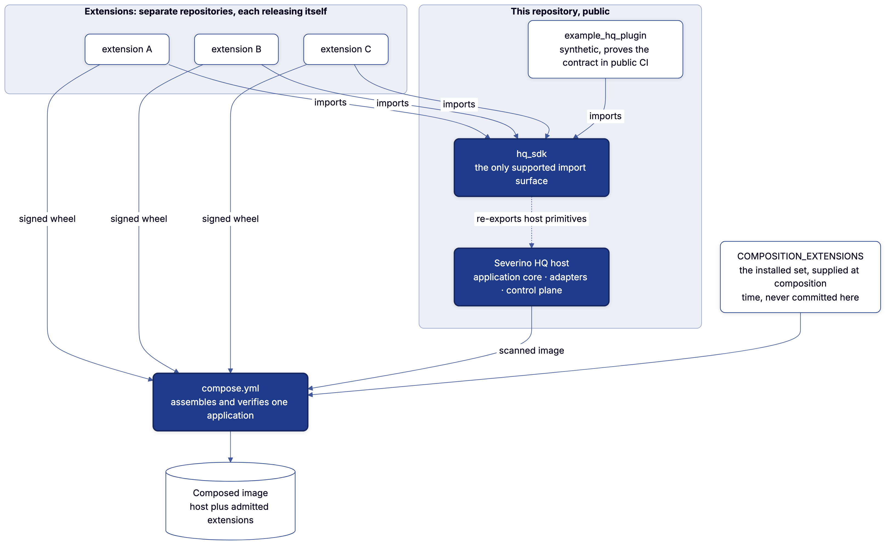

# Plugins

HQ exposes a versioned extension contract for trusted, installable Django
packages. A plugin declares its integration once; HQ derives app installation,
routing, navigation, dashboard projections, global search, readiness,
authorization and every adapter's view of its capabilities from that manifest.

Plugins are off by default. `SEVERINO_HQ_PLUGINS` allowlists each trusted entry
point as a comma-separated `package.module:attribute` list; importable code is
never discovered and run on its own.

```python
from hq_sdk.plugin import NavigationItem, PluginIntegration, PluginManifest


def integration():
    return PluginIntegration(
        capabilities=capability_specs,
        resources=resource_specs,
        connections=connection_specs,
        dashboard=dashboard_cards,
        overview=domain_overview,
        attention=attention_items,
        calendars=calendar_sources,
        outbound=outbound_work,
        health=ready,
    )


plugin = PluginManifest(
    id="example.notes",
    name="Notes",
    version="1.0.0",
    distribution="example-notes",
    source_repository="example/example-notes",
    source_workflow=".github/workflows/admit-plugin.yml",
    api_version=5,
    integration_provider="example_notes.plugin:integration",
    django_apps=("example_notes",),
    url_prefix="notes/",
    urlconf="example_notes.urls",
    navigation=(NavigationItem("Notes", "notes:list", "notes"),),
    token_authenticated_routes=("webhook/",),
    operator_capabilities=("notes.read", "notes.write"),
    mcp_read_capabilities=("notes.read",),
    mcp_write_capabilities=("notes.write",),
)
```

Locally, set `SEVERINO_HQ_PLUGINS=example_notes.plugin:plugin`, install the
package and run its migrations; in production the list is derived from the
signed lock ([Composition](#composition)). `python manage.py plugins` prints the
effective inventory as JSON and validates compatibility.

A manifest's capabilities are the plugin's own: naming one of the host's fails
at startup. Every plugin view needs a session wherever it is mounted; a route
that authenticates its own requests is listed in `token_authenticated_routes`
([below](#routes-that-authenticate-themselves)).

## The golden path

A plugin imports host behavior only through `hq_sdk`. Its repository owns the
domain; the SDK owns integration mechanics:

| Need | Import from |
| --- | --- |
| Manifest and navigation | `hq_sdk.plugin` |
| Capabilities, principals, strict JSON commands | `hq_sdk.capabilities` |
| Claim-resolution plans and workflow actions | `hq_sdk.workflows` |
| Read resources, strict filters, search projection | `hq_sdk.resources` |
| Connections | `hq_sdk.connections` |
| Capability-gated Django views | `hq_sdk.web` |
| Audit attribution and summary events | `hq_sdk.audit` |
| Work that reaches a network or a provider | `hq_sdk.outbound` |
| Kept reads and derivations | `hq_sdk.reads` |
| References to other records | `hq_sdk.references` |
| Calendar sources | `hq_sdk.calendar` |
| Tables, forms, UI projections, money, global search | the matching `hq_sdk.*` module |
| Synthetic siblings and style checks | `hq_sdk.testing` |

Imports from `application`, `core` or another host app are unsupported: they
couple a private plugin to public implementation details.
`python -m hq_sdk.validation src` enforces the boundary. It also refuses a
test whose `assertContains`, `assertNotContains`, `assertIn` or `assertNotIn`
looks for text ending on `</td>` or `</th>`: the host may wrap what a cell
says, so a test reads the cell's text instead.

The shape of that surface is committed as `hq_sdk/contract.json`: every
export's parameters, fields, enum members and public methods, without
annotations so it is identical across the interpreter matrix. A test fails when
the exports drift from the file, because an extension's binding to a renamed
field or a new required parameter is a change this repository cannot otherwise
see. Regenerate it with `mise run regen`, read the diff as the review, and
decide there whether `PLUGIN_API_VERSION` moves; `mise run drift` fails on
drift.

What the annotations promise is held from an extension's side by
`tests/sdk_consumer/consumer.py`, which mypy checks: a valid call pins its
return with `assert_type`, and a call an extension must not make carries the
`# type: ignore[code]` mypy must report for it. A new export gets a case
there; an annotation that slides to `Any` fails it.

Capability input models inherit `StrictCommand`, so unknown JSON keys fail at
the boundary instead of being dropped. Class-based views inherit
`CapabilityRequiredMixin` and declare `required_capability`; function views use
`@capability_required(...)`. Bulk work uses `audit_operation` with
`record_operation`, so adapter and actor attribution match without a
domain-owned wrapper.

Every extension's `.github/workflows/admit-plugin.yml` is the same, because it
names nothing about the extension:

```yaml
jobs:
  checks:
    uses: joeseverino/severino-hq/.github/workflows/plugin-checks.yml@main
  admit:
    name: Admit
    if: github.event_name != 'pull_request'
    needs: checks
    runs-on: ubuntu-26.04
    environment: admission
    permissions:
      contents: read
      id-token: write
    steps:
      - uses: joeseverino/severino-hq/.github/actions/admit-plugin@main
        with:
          app-client-id: ${{ secrets.HQ_APP_CLIENT_ID }}
          app-private-key: ${{ secrets.HQ_APP_KEY }}
```

The extension's identity is declared once, by the package:
`tools/pipeline/plugin_identity.py` reads the distribution from `pyproject.toml` and
the plugin id and Django app from the `plugin = PluginManifest(...)` in
`src/<package>/plugin.py`, where `<package>` is the distribution with
underscores. It fails when the two disagree, before anything is built or
signed.

The same checks run from an extension's checkout with nothing to pass:
`../severino-hq/tools/pipeline/check-plugin.sh`, or `mise run plugin:check -- --plugin-root PATH`
from the host checkout. It syncs the package against its lock and lints it,
enforces SDK-only imports, type checks it, runs Django checks, migration drift
checks and the plugin's tests, then installs the package (built as a wheel)
with `--no-deps` into a clean host environment. That last step reproduces
production's dependency boundary and catches a missing host pin before
composition. Every package declares `[tool.mypy]` in its `pyproject.toml`, and
the check refuses one that does not: its own mypy (from its dev group) runs
against the host's typed `hq_sdk`, with django-stubs pointed at
`hq.config.settings_typecheck`, the host's settings with that package
installed. In CI it runs
against host `main`, or the host branch named like the extension's branch when
one exists ([Coordinated changes](#coordinated-changes)).

### Several extensions in one repository

One repository may hold several extensions, each still its own package (its
own `pyproject.toml`, `uv.lock` and `src/<package>/`), plugin and signed wheel.
One repository is one trust domain: its extensions share one signer, that
repository and its admission workflow, so whoever can sign for one can sign for
all of them, and the composition set names the same `workflow` for every entry
of one `repository`, with each entry's `path` (its package directory, `.` when
omitted).

`plugin-checks.yml` takes the package's `package-dir`, called once per package
with `secret-scan: false` on all but one call. One run admits them all: the
admission job is a matrix over the package directories, each leg passing
`dispatch: "false"`, and a final job that needs every leg starts the
composition once, so it reads a run in which every package was admitted. That
job dispatches **Compose** as the action does, with `admission-run` set to
`$GITHUB_RUN_ID`: the run is still finishing, and Compose takes that
repository's extensions from it once it has checked that the run is that
repository's admission workflow on `main` and has not failed.

```yaml
  admit:
    # as above, plus:
    strategy:
      matrix:
        package: [packages/example-alpha, packages/example-beta]
    steps:
      - uses: joeseverino/severino-hq/.github/actions/admit-plugin@main
        with:
          package-dir: ${{ matrix.package }}
          dispatch: "false"
          app-client-id: ${{ secrets.HQ_APP_CLIENT_ID }}
          app-private-key: ${{ secrets.HQ_APP_KEY }}
```

Each leg retains its own artifact, `admission-<plugin id>`. Compose resolves
each repository's admission run once and reads every listed extension's
artifact from it by id (`tools/pipeline/admissions.sh`); a listed id with no artifact
in that run fails the composition. A coordinated branch builds each listed
extension from its `path`, which must declare that id, and nothing else in the
repository.

## Cordon admission

Production loading fails closed. With plugins enabled and `DJANGO_DEBUG` off,
HQ requires `SEVERINO_HQ_PLUGIN_LOCK` and `SEVERINO_HQ_PLUGIN_POLICY_SHA256`.
The lock's inventory must equal the enabled manifests exactly. Every entry
binds the plugin ID, distribution, installed version, host API version,
immutable source commit, wheel SHA-256 and Cordon policy SHA-256.

The policy is `policy/plugin-admission-v1.json`. Admission requires the plugin
contract and package tests, a dependency lock and audit, a secret scan, a wheel
SBOM and a wheel vulnerability scan with no fixable high or critical findings.
The extension's admission signs its statement with GitHub OIDC through
Sigstore. Cordon verifies the bundle against the exact repository and workflow
identity before installation, then emits the lock entry embedded in the
composed image.

The lock is evidence about one artifact under one policy, not a claim that
arbitrary plugin code or future versions are safe. A changed wheel, version,
workflow, policy, host API or enabled inventory needs a new admission and
image build.

Admission tests one extension against the host it checks out. Composition then
runs Django's checks and the whole suite in the assembled image, with every
admitted wheel installed together. Admission proves an artifact is acceptable
on its own; composition proves the accepted set is one application. Duplicate
routes or capabilities, missing host-owned runtime dependencies, migration
conflicts and tests that assume no sibling exists fail before publication.

## Composition



<sup>Diagram source: [`diagrams/host-and-extensions.mmd`](diagrams/host-and-extensions.mmd).</sup>

Production runs one image carrying every admitted plugin. Plugins build no
images: each admits itself and publishes its signed bundle, and the host
composes them, so deploying one never replaces the others. The pipeline around
it is in [Deployment](Deployment.md#the-pipeline).

Compose takes each plugin's newest successful admission, so a plugin whose
latest admission failed ships its last good wheel and holds back neither the
host nor the others. The composed suite runs every installed plugin's tests
against the host it is composed with, so whatever wheel is chosen is proven
together before it is published.

A plugin's admission starts the composition, and nothing polls. The last step
of the host's `admit-plugin` action mints a token as HQ's GitHub App, asking
only for Actions write on this repository, and dispatches **Compose** with an
input that names no plugin. The token lasts an hour and can only start a
workflow here; the app's key is the only credential a plugin repository holds,
as a secret on an `admission` environment limited to `main`. A deploy still
waits for a person's approval in the `production` environment, which no app can
give. A dispatch that fails fails the admission, where it happened, so nothing
is missed silently and no schedule backs it up.

```
merge a plugin → its CI admits the wheel and publishes the bundle
               → the admission dispatches the host's composition
               → build → verify → scan → publish → approve → deploy
               → HQ marks the plugin's commit live and comments on its pull request
```

What a composition is made of (the host image digest, the plugin wheel digests
and the admission policy) is hashed into a fingerprint, published as a
`composition:fp-…` tag beside the image. An admission's dispatch whose
fingerprint is already published (the same commit admitted twice) stops before
building. Every other trigger rebuilds: a host build, a pull request, and a
hand-run **Compose** (`workflow_dispatch`), which is how to rebuild the current
set on purpose.

Compose reads the plugins' admissions as the same app, through a token minted
per run with only Actions and Contents read; there is no personal token to
renew. It is the only path to production. It verifies each signature itself,
against the identity built from the declared repository and workflow, so a
plugin cannot widen who may sign for it by editing its own repository. Cordon's
lock tool merges the entries into one lock; the host does not reimplement it.
`SEVERINO_HQ_PLUGINS` is derived from the merged lock, because the enabled and
approved inventories must be identical or the host refuses to start.

The declared set is the `COMPOSITION_EXTENSIONS` repository secret rather than
a committed file, because this repository is public and the extensions are not.
`composition/extensions.json` documents its shape. An empty `extensions` list
composes the host with none; a missing secret or list fails Compose.

An extension leaves production only by being named. `hq-host deploy` reads the
lock in the running image and in the one being deployed, both covered by the
signature over their digests, and refuses an image that drops an extension the
running release carries unless the image's composition lists its id under
`retired` (shipped in the image as `/opt/severino/plugin-retired.json`). To remove one, move
its id from `extensions` to `retired`, run Compose and deploy; once production
runs without it, the `retired` entry may go.

### Coordinated changes

A change that needs both the host and an extension (a plugin API bump, say)
lands as branches with the same name in each repository, verified together
before either merges:

- An extension pull request's `plugin-checks.yml` resolves the host ref to the
  host branch of the same name when one exists, and to `main` otherwise. An
  explicit `hq-ref` input wins.
- The host pull request's composition builds each extension's same-named branch
  into a candidate image and runs the composed checks and suite in it. The
  candidate is verify-only: unadmitted wheels, no lock, a local tag, never
  published, signed or deployed. Extensions without such a branch are reused
  from their verified admissions; the app's Contents read covers reading the
  branches.
- Before composing, the host pull request runs its own `plugin:check`
  against every extension in the set, from its same-named branch or else its
  default branch, so a host change that breaks an extension fails the pull
  request rather than the next admission. Which extension failed is only in
  the sealed failure logs.

Merge the host first; each extension then checks and admits against `main`.

## Contract boundary

The plugin API is for trusted code that ships with a deployment. External or
untrusted systems integrate through the authenticated API or MCP, not through
runtime code loading. Providers contain projection logic only; domain rules
stay in the plugin's application services, so pages, commands, search and MCP
cannot diverge.

`api_version` is required and authored as a literal by the extension, never
defaulted to the host's constant, so a host loading an older wheel reports the
incompatible epoch instead of relabeling the wheel or failing with an
unexplained constructor error. Additive manifest fields stay compatible within
a version; removals and semantic changes need the next version. Plugin IDs are
stable reverse-DNS names and are never reused.

### Public host, private domains

HQ publishes the generic SDK and composition mechanism; a private package owns
its domain language, models, migrations, fixtures, repository identity and
business rules. The host never imports a private package by name or commits the
production inventory. It learns the admitted set only from deployment-supplied
composition metadata and checks it against its signed lock. Public tests use
synthetic extensions; the assembled private image runs the real suites
together.

Code moves into HQ only when it is host policy or a reusable primitive:
authorization, capability execution, audit attribution, table behavior, UI
vocabulary, composition, testing infrastructure. Domain-specific calculations
stay in their package even when the host would be their only consumer.

### The integration

An integration provider returns one frozen `PluginIntegration` of lazy, typed
callables for every runtime contribution: capabilities, resources,
connections, dashboard cards, overview, attention, search, calendars, outbound
work and health. HQ calls only the one a surface needs. The manifest carries
static install, routing, navigation and authority metadata plus exactly one
executable entry point; an extension never registers a surface on its own. How
the host compiles these into one graph is in
[Architecture](Architecture.md#emit-once-derive-everywhere).

**Dashboard and attention.** A card and its destination page describe the same
reporting window: put the actual window or data cutoff in the card's `detail`
when it differs from today or coverage is incomplete, since a render time does
not establish freshness. The host never infers dates from a card label or
recalculates an extension's totals. An attention provider emits `serious` or
`attention` only for a decision that needs the operator, and `neutral` or
`good` for observations. The title states what is wrong, with its count where
it stands for several; the body says what it means. Supply the help the shared
card shows: `Insight.actions` for what can be pressed, `Insight.action` with
`Insight.url` for the page the work is done on (a short label; a sentence is
shown as a sentence), `Insight.workflow` for commands and their check, and
`Insight.since` when the moment it began is known ([Design](Design.md), "A card
says what is wrong and holds what fixes it").

**Capabilities.** HQ validates every `CapabilitySpec` before describing or
invoking the registry: name, effect, required permissions, target kind and
label, command JSON Schema, duplicates and the handler's signature. MCP grants
must be a subset of the plugin's operator grants. A typo fails the composition's
checks instead of becoming a production-only failure or an authority gap.

A handler is called as `handler(command, *, principal, <target keyword>)`,
the keyword being the one its `target_kind` binds (`current_slug`,
`current_id`, ...). A handler that checks for a stale write also declares
`expected_updated_at` and receives the caller's token; any other handler
leaves it out and is never handed it.

Fields that shape the Command Center form:

- `subject_resource` names the `ResourceSpec` the operation acts on, which
  joins it to its domain in machine discovery and the operator UI.
- `target_label` and `target_help` explain the identifier in operator language
  (`Record slug`); `target_kind` stays its machine type.
- `target_query` lists eligible targets from the subject resource; HQ checks
  the filter against that resource's strict query and renders a choice control.
- `target_initial_fields` names command fields HQ fills from the selected
  record's detail, with one authorized local read that also carries
  `updated_at` into the concurrency check; it never contacts the provider.
- `execution_notes` describe the registered read, queue and provider boundary
  in the zero-network preview.

A command's words are declared on it once. `label` is its name (`Remove a
note`), `verb` what its button says where that is shorter (`Remove`), and
`variants` the words for a mode one button cannot say,
`variants=(("all", "Refresh all"),)`. Every button, link, remedy and toast
for the command reads them (`spec.words(variant)`; a press answers with
`spec.requested(subject)`), so a call site never writes them: a control built
for a command takes no `label`, a template says them with
``, and a variant nothing declares fails the
host's checks instead of the press. The commands one connection's abilities
run share its row, so no two of them may say the same words: a composition
where they do fails at startup (`connection.repeated_words`).

HQ gives every capability that writes an `idempotency_key`
([API](API.md#safe-retries)); a command type declares the field only when its
handler keeps the key itself.

**Resources.** A `ResourceSpec` may expose a list handler with a
`ResourceQuery` subclass, a detail handler with one stable identifier, a
`SearchDefinition`, or any combination. HQ validates names, permissions, query
and handler compatibility, identifier contracts, and duplicate resources and
search scopes at startup; the API, MCP and global search derive from the spec.
A search projection that belongs to no resource comes from
`PluginIntegration.search`. Set `pass_principal=True` when the answer depends
on what the caller may see; both handlers then also receive `principal=`. Set
`web_route` to the resource's list route, which must reverse without
arguments, to link it from the Command Center. Plugins read through the
authorized `list_resource` and `get_resource`; the raw registry and handlers
are not exported.

**Connections.** Emit a `ConnectionSpec` for every external API, token, consent
or keyless gateway the package uses, and map each useful operation to its
registered capability or resource. Each spec names a family, its abilities and
provider scopes, the capability needed to inspect it, and a zero-argument
provider of cached `ConnectionInstance` observations. HQ derives the
Connections workspace, Command Center entry, API catalog, MCP tools and
topology from it. The provider runs only after authorization and reads local
state: it never makes a network request because someone opened discovery. An
instance may carry status, safe endpoint text, granted scope names, targets,
dependencies and small facts, never tokens, credentials, authorization headers,
secret values or private URL parts; URL userinfo, query strings and fragments
are rejected outright rather than filtered by a list of secret parameter names.
`observed_at` is a `datetime` and serializes as ISO 8601; links are local paths
or explicit HTTP(S) URLs. Emit a truthful reduced mode when the gateway works
anonymously rather than hiding it. Import the contracts and
`describe_connections` from `hq_sdk.connections`.

Say how authority is proven, not only what it permits. Each ability declares a
`grant`: `scoped` when the provider issues narrow permissions and the ability
lists its needs in `required_scopes`; `coarse` when the credential is the whole
account and nothing narrower exists; `none` when the call is keyless. Each
instance reports its `credential_model` from the same words, or `rejected` for
a credential the provider refused. HQ derives one evidence state per ability
and instance: `verified`, `coarse` (whole account), `not_applicable`
(keyless), `unverified`, `undeclared`, `unknown`, `missing` or `revoked`. Only
`missing` and `revoked` close the ability; `unknown` leaves it undecided;
`undeclared` leaves it usable under HQ's own authorization and says so. The
same derivation gives each connection's lifecycle (configured, reachable,
ready, unauthorized, stale, revoked) against the family's `stale_after_hours`.

An ability may set `subject_resource` to the resource it governs and list its
provider kinds in `governs_kinds`; Command Center then offers the registered
commands against that resource whose target filters include one of those
kinds. For an operation that maps through no resource, set `capability` to the
exact `CapabilitySpec` name. Composition refuses unknown resource and
capability references. The ability is the only connection-to-capability edge,
and scope coverage decides only whether the connection can perform it; no
command is fabricated from token text. Command discovery stays
declaration-driven, so a missing or stale observation does not hide a supported
workflow.

In the topology, an ability's `governs_kinds` connect it to managed resources,
`targets` become observed destinations, and dependencies with a `resource_key`
become declared-use relationships. Set `controller_id` only when the instance
is an observation emitted by a distinct controller; it is observer identity,
not credential identity, and never holds secret material. A plugin needs no
topology template, route, callback or host edit.

## Shared UI contract

An extension renders HQ's design system and ships no stylesheet or script of
its own. Its templates use only the public pieces below, and
`python -m hq_sdk.validation src` (part of `plugin:check`) reads
every file under a `templates` directory and refuses anything else: a frame or
block not listed, a private partial, an include named at render time, a
parameter a partial does not read, a required one left to whatever the page has
in scope, or a host tag, filter, class or `data-` hook not listed. The record is the
`templates` section of `hq_sdk/contract.json`, derived from the host's own
templates by `manage.py sdk_contract`, which writes these tables too.

Every view model `hq_sdk.ui` hands an extension says its values in words, and
refuses one that is not with a `ValueError` where it is built: a date-time
stamp, a dumped record or list, a bare `True` or `False`, markup, a flag or
`None` where text belongs, or a field's snake_case name as a label. A moment
goes in its typed field (`ListRow.at`, `Insight.since`) or through
`hq_sdk.ui.when`.

A page extends a frame and fills its blocks. It never extends `base.html` or
draws its own head: the view declares the page (`hq_sdk.pages`), and a head
action that opens a dialog declares that as well,
`PageAction("Import", url, modal=PageDialog("import", "Import records", "notes/_import_form.html"))`,
which `page.html` draws once with the page's context. A block a frame does not
list is the host's, and an override of it is refused rather than silently
ignored the day the frame stops rendering it.

A data table is declared through the table tags, so its shape is in the HTML on
first paint. `…` wraps it in
its labeled region, which derives from what each column holds the width its
columns leave at, by rank ([Design](Design.md)); each column heading is
``, with its kind (`prose`,
`identifier`, `numeric`, `status` or `control`, following from `num-col`,
`date-col` or `actions-col` when left out), `drop=` the order a narrow table
lets it go in (never on the column that names the row or a `key-col`), and
`sort=` for a list sorted on the server or `local_sort=True` for one sorted on
the page. A row that holds more than it shows ends its naming cell with
``; that cell in every row, and its heading (`gutter=True`),
carry `row-gutter`; the stylesheet shows the toggle only where the row holds
something back. A `TableListMixin` list declares the same through
`TableColumn(kind=)`, its ranks derived from the columns unless one says
`drop=`, and its region's `room=` as `table_room`.

A form renders as `{{ form }}`, and one field as `{{ field.as_field_group }}`:
HQ's form renderer draws every field in its own markup, with the help text and
errors the control's `aria-describedby` names, and a checkbox inside its label.
The page draws `form.non_field_errors` where it says them. A form field may
set `wide = True` to take the whole row, `change_effect` to the sentence
saying what changing it causes, or `confirms = True` to close the form as the
callout a submission is confirmed in.

<!-- sdk_contract: shared UI contract, written by `mise run regen` from hq_sdk/template_contract.py -->

| Frame | Blocks a page fills | What it is |
| --- | --- | --- |
| `confirm_page.html` | `consequences` | A destructive action's confirmation: `consequences` says what will happen. |
| `list_page.html` | `foot`, `row` (given `forloop`, `row`), `summary` | A `TableListMixin` list: toolbar, table, empty state and pagination. `row` is one row's cells, `summary` sits above the table and is redrawn with it when a search or filter changes, `foot` is its `<tfoot>`. |
| `page.html` | `page` | Any page: the head, actions, dialogs and section navigation, drawn from `page`. |

| Partial | Required | Optional | What it is |
| --- | --- | --- | --- |
| `partials/_activity_calendar.html` | `calendar` | `calendar_id` | One month of plan against execution, from `hq_sdk.ui.ActivityCalendar`. |
| `partials/_ask.html` | `ask` | `extra` | A do-this-now control and how its work stands, from `hq_sdk.outbound.ask`. |
| `partials/_attention_list.html` | `empty`, `entries` | nothing | Decisions waiting on the operator, from `hq_sdk.ui.Insight` entries. |
| `partials/_cadence.html` | `cadence` | nothing | Whether a thing happened, period by period, from `hq_sdk.ui.Cadence`. |
| `partials/_cadence_matrix.html` | `matrix` | `compact`, `label` | Several cadences over the same periods, from `hq_sdk.ui.CadenceMatrix`. |
| `partials/_chart_tabs.html` | `charts`, `group` | nothing | Up to four charts of one thing in the space of one. |
| `partials/_dropzone.html` | `field` | `hint`, `title` | A file field that also accepts a drop. |
| `partials/_empty_state.html` | `message` | `action_label`, `action_url`, `remedy`, `why` | The one empty state: what is missing, then what would fill it. |
| `partials/_form_field.html` | `field` | nothing | Label, control, help text and validation errors for one form field. |
| `partials/_insight_grid.html` | `items` | `label` | Readings that need interpreting, each with its next step. |
| `partials/_job_progress.html` | `job` | nothing | A running job and what it is doing. |
| `partials/_kpi_grid.html` | `items` | `featured`, `label` | Responsive linked or static figures. |
| `partials/_line_chart.html` | `chart` | nothing | A measure over time on an axis fitted to it. |
| `partials/_record_list.html` | `rows` | `empty`, `label` | A compact list of records, from `hq_sdk.ui.ListRow`. |
| `partials/_stacked_bar_chart.html` | `chart` | nothing | Quantities that add up, from `hq_sdk.ui.StackedBarChart`. |
| `partials/_timeline.html` | nothing | `plain`, `timeline` | Chronological linked events, from `hq_sdk.ui.Timeline`. |
| `partials/_week_plan.html` | `plan` | nothing | Which days of the week a thing is scheduled for, from `hq_sdk.ui.WeekPlan`. |

Host tags: ``, ``, ``, ``, ``, ``, ``, ``. Host filters: `|ago`, `|breakable[:arg]`, `|counted:arg`, `|day`, `|money[:arg]`, `|or_empty`, `|readout`, `|sortable`, `|span`, `|web_url`, `|when[:arg]`. Django's own tags and filters, and `` of `humanize`, `static` or the extension's own libraries.

Classes: `actions-col`, `allocation`, `allocation-legend`, `btn`, `card`, `card-columns`, `cell-data`, `chart-axis`, `chart-card`, `chart-data`, `chart-legend`, `compact`, `compact-table`, `count`, `danger`, `data-table`, `date-col`, `domain-charts`, `domain-head`, `domain-head-copy`, `domain-stack`, `errors`, `eyebrow`, `field`, `field-row`, `figure-hero`, `figure-hero-note`, `figure-stats`, `finding`, `finding-evidence`, `form`, `form-actions`, `ghost`, `help`, `inline`, `key-col`, `kv`, `list-rows`, `msg`, `msg-error`, `msg-warning`, `muted`, `narrow-more`, `notice`, `notice-attention`, `num-col`, `optional-col`, `page-lede`, `pie-chart`, `pie-row`, `pill`, `pill-attention`, `pill-good`, `pill-neutral`, `pill-serious`, `primary`, `print-footer`, `print-only`, `prose-list`, `route-band-1`, `route-band-2`, `route-band-3`, `route-band-4`, `route-band-5`, `route-frame`, `route-line`, `route-map`, `route-marker`, `route-scale`, `route-swatch`, `row-actions`, `row-below`, `row-empty`, `row-group`, `row-gutter`, `row-less`, `row-main`, `row-meta`, `row-more`, `save-bar`, `section-foot`, `section-head`, `section-period`, `split`, `stacked`, `status-tabs`, `subtle-link`, `table-scroll`, `tight-col`, `two-col`, `visually-hidden`, `worth`, `worth-attention`, `worth-good`, `worth-neutral`.

Script hooks: `data-chart`, `data-sort`, `data-submit-busy`, `data-submit-label`, `data-submit-status`, `data-tip`.

<!-- /sdk_contract -->

Plugin templates supply domain content; HQ owns layout, tokens, responsive
rules, accessibility states and visual change. A class, partial or hook an
extension needs and this contract lacks belongs in HQ first; copying host CSS
or markup into a plugin is a contract failure. The rules the classes follow are
in [Design](Design.md).

What the host writes for a value is pinned by example in
`hq_sdk/text_examples.json`: `span`, `when`, `when_day`, `counted`, `money` and
`ago`, regenerated and reviewed like the contract. An extension's test asserts
what it composed from them (`f"Due in {span(days)}"`) or reads a page through
`hq_sdk.testing.plain`, which reads the host's no-break spaces as spaces; it
never writes the host's words or markup out itself. Text that names the
deployment reads `hq_sdk.site.host()`, never a setting.

An amount is written by `{{ amount|money }}` in a template and
`hq_sdk.money.money` in Python: "$1,234.50", a true minus sign before the
dollar, `money:"whole"` or `cents=False` for a figure that is scanned, and
`plus=True` for a change signed either way. A debt is a negative value: no
extension writes a sign of its own, since the host holds the sign to its
figure so a line never ends between them. An
overview says what it is built from with `hq_sdk.pages.built_from(plugin.id)`,
a link to the project that names the extension's repository. An extension's
suite checks its templates for a `{# #}` comment left open with
`hq_sdk.testing.unclosed_template_comments`.

A list extends `list_page.html` and declares its empty state on the view, never
in its template: `table_empty` says what an empty list means ("No vehicles
yet."), `table_empty_why` a sentence beside it, and `get_table_empty_remedy()`
returns an `hq_sdk.tables.Remedy` where the page's lead action is not what
fills it. HQ draws the one empty state, and the "nothing matches" state of a
filtered list, from those.

Wrap a `.data-table` in `.table-scroll`; HQ keeps its headings visible
through long result sets with sticky cells, and the table stays the one
semantic and interactive source. Dense pages declare their sections on the
page, `navigation=PageNavigation((PageSection("overview", "Overview"), ...))`,
which `page.html` draws, and put the stable `id` on each section; HQ owns overflow, sticky positioning,
scroll-aware current state and fragment history. Labels may change; section
IDs are durable links.

### What a template prints

A `{{ value }}` in an extension's templates prints text, markup, a number
(not a flag), a UUID or a path. Anything else is refused: a flag, None, a date
or a length of time, a mapping, a list, bytes, a plain enum member, a model
instance or any other object. The view or projection says it in words first:
`when` or `when_day` for a moment, the missing mark for nothing, a count, a
name. The same holds for ``, ``, the translation tags
and a `simple_tag`'s result. Text always prints as it is, even text that looks
like a date.

Under test and with DEBUG a refusal raises `Unprintable`, naming the template
and line, so an extension's suite finds it. In production the page prints the
missing mark and logs the value's type and place. The host holds only its own
and its extensions' templates, so Django's widgets and other third-party
templates print as they always have. The rule arrives with
`PLUGIN_API_VERSION` 5.

## Outbound work

A request never waits on anything outside the process. While one is served HQ
refuses every connection, name lookup, subprocess and sleep, whichever library
makes it, so a view or capability handler that calls a provider raises
`OutboundInRequest` before the call leaves
([Architecture](Architecture.md#what-a-request-waits-on)). An extension does
not start threads, poll, or expose a status endpoint to get round that. It
declares the work, and HQ runs it:

```python
from hq_sdk.outbound import Failed, OutboundWork, ask


def look_up(progress, *, subject, principal):
    progress("Asking the registry.")
    listed = registry.read(subject)  # the network call
    if listed is None:
        raise Failed("The registry lists nothing for this note.")
    Note.objects.filter(slug=subject).update(listed=listed)
    progress(f"The registry lists {len(listed)} entries.", force=True)
    return {"seen": len(listed)}


def outbound_work():
    return (
        OutboundWork(
            "notes.lookup",
            "Look up a note",
            "Ask the registry what it lists for one note.",
            "notes.write",
            look_up,
            subject_label="Note",
            verb="Look up",
        ),
    )
```

`"Look up a note"` is the work's `label`, what its job, audit entry and
command are called; `verb` is what its button and toasts say, and defaults to
the label. `ask()` takes no words of its own.

`PluginIntegration(outbound=outbound_work)` is the one declaration. HQ derives
the rest:

| Derived | What it is |
| --- | --- |
| The job | `run` is called on a job's own thread, where reaching out is allowed. One job of a name is live at a time, held by the database, so a second press or caller starts nothing. |
| The capability | `notes.lookup`, with the subject as its target. The API, MCP, the command center and `hq_call` ask through it with the same authorization, approval policy and denial record as any command, and are answered at once with the job's id. A command line waits for the work, because nothing there outlives the command. |
| The route and status | The control posts to `jobs:ask` and follows `jobs:status`. The extension has no URL, view, template or script for either. |
| The control | `ask("notes.lookup", note.slug)` is the shared Ask (`partials/_ask.html`), in the work's own words, standing as the stored job does: live work is followed, failed work says why until asked for again. It may stand among a page's actions. One query. |
| The audit entries | Who asked, how it ended, how long it took, and the `seen`, `created`, `updated` and `skipped` counts the work returns. |

The page shows what is stored and puts the control beside it:

```python
context["lookup"] = ask("notes.lookup", note.slug, refresh="#note-listing")
```

```django

```

`refresh` names the part of the page the result shows in, fetched again when
the work ends; without one the page loads again.

Work that is not about one record can run on a cadence. Declared with
`every=timedelta(days=1)`, it is done by the host once that long has passed
since it last succeeded: the hourly `due` timer asks for each piece
whose cadence has come round, as its own job, recorded against the timer. A
failed attempt is not a success, so it is asked again on the next hour. An
extension ships no systemd unit for this, and the host removes any
`severino-hq-*` unit it did not ship.

Three rules keep the work honest:

- **Store, then say.** The work writes its result where the page reads it and
  ends with a sentence (`progress(..., force=True)`), which the control shows
  when done. A failure the operator can act on is `Failed("...")`: the sentence
  is shown where the work was asked for and nothing stored is touched. Any
  other exception is a fault, kept with its traceback.
- **Refuse from what HQ holds.** `refuse(subject)` returns why the work cannot
  be asked for now, or `""`. Every control for the work, its `ask` and any
  link HQ offers to its command (a connection's row, a topology node, a
  remedy), is drawn unusable with that reason, so a page draws nothing of its
  own for it; an ask is refused with it before a job is recorded. It runs
  inside requests, once per subject in each, so it reads the database and
  nothing else.
- **One at a time is the duplicate guard.** Work that costs money or is not
  idempotent at the provider relies on the one-live-job rule, not a check of
  its own. A name is the unit: declare two names for two things that may run
  together.

A management command a timer runs calls `run_now("notes.lookup",
principal=...)`: the same job row, rule and audit entry, run to its end on the
calling thread. It is refused inside a request.

The SDK exports nothing that enters one of HQ's declared outbound exceptions or
leaves the request, and a test holds that. A credential the work uses is still
read by the web process; a job changes when the call is made, not who holds the
credential.

In an extension's tests, `hq_sdk.testing.held_jobs` records each job a request
starts and holds its work until the test calls `run()`, and
`hq_sdk.testing.reaches_out()` called from a network double makes the double
subject to the rule, so a test that drives a view proves the view answered
without reaching out. `example_hq_plugin` and
`hq/platform/application/tests/test_outbound_work.py` show both.

## Derived reads

What an extension contributes to a page many domains share is derived once per
change, by the host. HQ asks `attention`, `dashboard`, `overview` and each
calendar source's `events` through a derivation of its own,
`extension.<plugin id>.<provider>`: the answer is kept until a table the
provider was seen to read is written, every request in between is answered from
what is stored, and after a write the answer is derived again before the next
request asks ([Architecture](Architecture.md#derived-once-per-change)). An
extension does nothing to be kept, and keeps three rules so what is stored is
true:

- **Answer from rows, the clock and the demo switch.** HQ sees the tables a
  provider reads and counts every write to them. It cannot see a module-level
  cache, a file, the environment or the signed-in person, so an answer that
  depends on one of those is served to a request it is wrong for.
- **Return a value that pickles and compares equal.** Dataclasses, dicts,
  tuples, dates and decimals do; a lambda, a generator held in the value, an
  open file or a lazy queryset does not. An answer that cannot be kept is
  derived on every request, and the log says so.
- **Expect the clock a minute late at most.** HQ cannot see where an extension
  reads the clock, so a kept answer stands one minute and never past local
  midnight. A count of days turns on time; an age in minutes may be a minute
  behind.

`hq_sdk.testing.providers_derived_again(plugin_id)` holds an extension to them:
with its records in place, it names every provider not answered from what is
stored.

```python
def test_every_provider_is_answered_from_what_is_stored(self):
    self.assertEqual(providers_derived_again("example.notes"), [])
```

`hq_sdk.reads` is for an extension's own pages. `read_once` shares one read
among the functions assembling a page. `derivation` keeps a fact of the
extension's own across requests, by the same rules:

```python
from hq_sdk.reads import derivation, today


@derivation("example.overview", reads=("example.Session", "example.Goal"))
def overview():
    return _summarize(as_of=today())
```

HQ counts writes to every model table in the writing transaction, an
extension's included, so nothing is invalidated by hand and nothing is served
older than its rows. Asking `today`, `reached`, `passed`, `since` or `whole`
also derives the answer again when one of them would change. An extension keeps
no process-level cache, `cache.set` or timestamp table beside this.

## References

A record names a thing in HQ one way, whoever owns either end. A reference is
the text `kind:identity`: `machine:lab-1`, `zone:example.com`, `asset:<slug>`,
`project:<slug>`, `expense:<id>`, a certificate by its registry kind and key, or
a row of a model by that model's label and key. `hq_sdk.references` is the
whole surface:

```python
from hq_sdk.references import CERTIFICATE, Referable, ReferenceField


class Note(models.Model):
    title = models.CharField(max_length=200)
    review_on = models.DateField()
    # What the note is about, and what it was called when this was saved.
    about = ReferenceField(
        kinds=("asset", "zone", CERTIFICATE),
        heading="Notes",
        shows=("title", "review_on"),
        note="review_note",
    )
    about_name = models.CharField(max_length=200, blank=True, default="")

    # Other records may refer to a note.
    referable = Referable(shows=("title",), requires="notes.read")
```

- **A reference is two columns.** The `ReferenceField` and a text column of the
  same name ending `_name`. A migration sees two plain text columns. The system
  check fails a field without its name column or its `heading`.
- **What it may name.** `kinds` lists them; `role` takes any model that
  declares that role; neither takes anything HQ names, less the kinds in `but`.
- **Being referred to.** A model with `referable = Referable(...)` and a
  `get_absolute_url` is a kind of its own, named by its model label. `requires`
  is the capability a viewer needs before a row is named to them: without it
  the picker does not offer the kind and a page shows nothing for the
  reference. `role` lets a host field take the model without naming it.
- **Showing one.** `` then
  ``. A reference that names nothing is its stored name as
  plain text, never an error.
- **Both ends.** `` on the note's page lists every row
  of every installed model that names it, each under its field's `heading`, in
  one statement. `shows` are the columns a line is built from: its link is
  `str(row)` to `row.get_absolute_url()`, and `note` an attribute that says a
  few words beside it.
- **Writing one.** A `ModelForm` field for it is the shared picker; the view
  takes `ReferencePickerMixin`. A save through `full_clean` stores the name and
  refuses a new reference that names nothing. A sync that copies records in
  stores what `as_stored(text)` answers, which keeps one that names nothing.
- **Reporting one that names nothing.** Return `dangling(Note)` from the
  domain's attention provider.

## Calendar sources

Every domain can put what it holds on HQ's calendar. `calendars` returns
`hq_sdk.calendar.CalendarSource` values; each names a stream of dated things the
domain already holds and answers `events(first, last)` with every
`CalendarEvent` touching those days. The calendar composes every domain's
sources, stores none of them, and lists each in the operator's calendars,
checked or unchecked by their own choice.

```python
from hq_sdk.calendar import CalendarEvent, CalendarSource


def calendar_sources():
    return (
        CalendarSource(
            id="notes.reviews",
            label="Note reviews",
            events=reviews_between,
        ),
    )


def reviews_between(first, last):
    for note in Note.objects.filter(review_on__range=(first, last)):
        yield CalendarEvent(f"note:{note.pk}", f"Review {note.title}", note.review_on, url=note.get_absolute_url())
```

A source keeps four rules:

- **Derive, never copy.** Read what the domain holds; the calendar is a view,
  not a store. An event links to the record it came from.
- **One pass per window.** `events` is called once per view; a query per day is
  a bug. Hold it with a query-count test over a short and a long window.
- **Say only what is true.** An event's `state` (`done`, `planned`, `missed`)
  is a claim; a day the domain cannot speak for emits nothing.
- **Mind the noise.** History (what happened, rather than what is coming)
  starts unchecked (`shown=False`); a dot (`mark=True`) is for what is many a
  day and read by color.

`ends` is exclusive, as in iCalendar: an all-day event over the 3rd to the 5th
ends on the 6th. A timed event's `starts` is an aware datetime. `slot` keeps a
color the domain's charts already use; otherwise the calendar deals one.

The calendar page is the host's. An extension may place a host page in its own
navigation group by naming its route, `NavigationItem("Calendar",
"calendar:month", "calendar", 11, "Notes")`; where none does, the host lists it
in its own place.

## Routes that authenticate themselves

`token_authenticated_routes` names paths under a plugin's own `url_prefix` that
carry their own request authentication (a bearer token, a signed body) instead
of the session cookie. They are exempt from the session login redirect, not
from authentication: a 302 to an HTML login page is the wrong answer for a
native or machine client, which cannot render it or tell it from success. Those
routes answer 401 instead, and the view stays responsible for authenticating
the request.

Routes are declared relative and joined to `url_prefix` by the host, so a
plugin can only ever say "these paths of mine". An absolute path, a traversing
one, or one declared without a `url_prefix` fails closed at load.

A native or machine client otherwise uses the versioned [API](API.md), derived
from the same command and query services as the web and MCP. Identifiers,
idempotency keys, pagination and scoped authorization belong to that transport,
not to templates or plugin registration.
